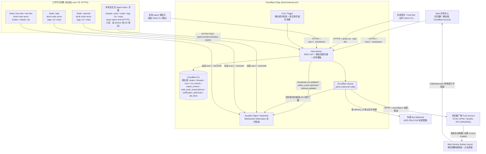

# 01 系统总体架构

`agent-hub` 的目标是构建一个不依赖第三方代码托管平台（GitHub / CNB）与外部内网穿透隧道工具（`cloudflared` / `ngrok`）的跨设备云端任务中心。系统由运行在 Cloudflare 边缘的控制面与运行在多台物理机/虚拟机上的 Go 单二进制 `ahub` 组成，默认服务入口为 `https://ahub.bobocai.win`（支持通过环境变量 `AHUB_URL` 指向自建域名）。

## 1. 全局拓扑

## 2. Cloudflare 组件职责划分与选型依据

控制面完全依托 Cloudflare 原生能力组合，每项组件各司其职，避免把消息队列当作数据库或把有状态长连接当作存储层使用。

### 2.1 为什么用 D1 作为唯一事实源

- **跨设备持久状态**：`nodes`（含节点默认外部通知通道外键 `default_notify_key_id`）、`threads`、`runs`、`run_events`、`native_events`（本地原生会话幂等事件与人工确认账本）、`web_push_subscriptions`（AES-256-GCM 密文保存浏览器推送订阅、节点与事件过滤规则）、`notification_deliveries`（受控 `Run` 与原生 `NativeEvent` 共用的多通道投递明细账本）与 `api_keys` 全部持久化在 D1 SQLite 中，用户在手机、笔记本或任意桌面浏览器打开 Web 任务中心都能读取完整历史。
- **双域物理隔离与会话级聚合**：`native_events` 与 `threads` / `runs` 在 D1 中物理隔离，绝不创建 `Thread`、绝不申请 `(node_id, workdir)` 调度锁或进程租约；查询层与前端按 `(node_id, agent, native_session_id || workdir)` 进行逻辑聚合。
- **确定性并发控制**：支持基于 `Compare-And-Swap (CAS)` 条件的状态迁移、幂等键去重与同机按工作区目录（`workdir`）的并发排队控制。
- **不直接用 Cloudflare Queues 存任务**：Queues 单条消息上限为 `128 KB`、免费方案消息保留期仅 `24 小时`，且不支持按节点、工作区、状态进行条件检索或由前端直接取消已入队任务。

### 2.2 为什么用 Durable Objects（WebSocket Hibernation）承担节点与实时信令

- **消除 100 秒同步超时**：Cloudflare 边缘代理对单次非流式 HTTP 请求存在 `100 秒` 超时限制（`HTTP 524`）。本体系所有任务提交接口 `POST /api/v1/runs` 采用「落库即返回」异步语义（可选最多 `45 秒` 短等待），耗时 10 至 15 分钟的 Coding Agent 执行完全脱离 HTTP 请求生命周期。
- **规避 Queues HTTP Pull 空转**：Cloudflare Queues 的 HTTP Pull Consumer 每次 `/messages/pull` 为即时返回，不支持服务端长轮询（Long-Polling）。若 4 台机器每 2 秒轮询一次，每日空转消耗超过 17 万次操作，迅速耗尽免费额度（10,000 次/天）；若拉长到 30 秒轮询，交互响应延迟过高。
- **WebSocket Hibernation 零空闲计费**：每台工作机只需维护一条纯出站 `wss://ahub.bobocai.win/ws/node` 长连接接入 Durable Object `NodeHub`。空闲期间 DO 自动进入休眠状态（不计入活跃计算时长，边缘网关维持 TCP/TLS 连接不断开）；一旦用户或 Agent 提交新任务、点击取消，DO 在毫秒级唤醒并推送 `hub.wake` 或 `hub.abort` 指令。
- **无 `cloudflared` 依赖**：工作机全部采用主动出站 TLS 连接，无需在各节点额外维护 `cloudflared` 进程、证书与隧道路由，同时天然穿透家庭宽带或公司 NAT。

### 2.3 为什么 Cloudflare Queues 仅用于云端对外异步多渠道通知

`ahub-outbound-notify` 队列专门承接控制面对外部 Bot Webhook 与标准浏览器 Web Push 的异步投递，与 `NodeHub` DO 实时信道相互隔离：

1. **受控 `Run` 多目标扇出（`ahub_run_completed` 与 Web Push）**：当受控 `Run` 到达终态（`done` / `failed` / `cancelled`）或首次进入 `needs_approval` 审批检查点时，沿用 `--notify` / `node_default` Bot 路由隔离边界（禁止 `client` 静默任务及 `depth >= 1` 子任务落入 `node_default`）；同时匹配激活的 `admin` Web Push 订阅（其中 `client` Key 创建的 `depth = 0` 任务仅在 `needs_approval` 与 `failed` 时向管理员推送 Web Push，不在 `done` / `cancelled` 弹窗；`depth >= 1` 子任务静默）。
2. **本地原生会话多目标扇出（`native_events`）**：支持 `interaction_needed`、`turn_summary` 与 `progress`；Bot Webhook 仍严格按 `nodes.default_notify_key_id` Fail-Closed（节点未绑定时仅跳过 Bot 通道，**不再阻断浏览器 Web Push 通道**）；Web Push 按 `node_filter_json` 与 `event_filter_json`（`native_<event_kind>`）独立扇出，Bot 载荷继续固定携带 `action_required: "notify_user_only"` 只读转达契约。
3. **独立投递账本与每渠道隔离入队**：入库期将每个匹配目标写入 `notification_deliveries`（`status = 'queued'`），并向 `NOTIFY_QUEUE` 投递独立的 `{ kind: "delivery", delivery_id }` 消息，使单条 Web Push `5xx` / `429` 重试绝不重复触发已成功的 Bot Webhook 或其他设备。
4. **零外部依赖边缘 Web Push 引擎（`apps/hub-worker/src/web-push.ts`）**：纯基于 Workers 原生 `crypto.subtle` 实现 RFC 8292 VAPID `ES256` 签名与 RFC 8291 / RFC 8188 `aes128gcm` 载荷加密（维持 `apps/hub-worker/package.json` 零运行时 npm 依赖），明文 JSON 控制在 `<= 3072` UTF-8 字节内供 `sw.js` 在 Cloudflare Access Cookie 过期时仍可离线零回源解密；严格校验 Push 端点域名 SSRF 白名单（`fcm.googleapis.com`、`*.push.apple.com`、`*.push.services.mozilla.com`、`*.notify.windows.com`，仅在显式测试环境变量 `ALLOW_LOOPBACK_PUSH_FOR_TEST === "true"` 时放行本地回环测试网关）。
5. **投递期 Fail-Closed 与 DO 实时回推**：Bot 消费端在发送 HTTP POST 前实时联表复核目标 `client` Key 未吊销、节点权限未移除且通道未中途换绑；Web Push 在 `404` / `410` 时自动吊销失效订阅（`revoked_at`），`400` / `401` / `403` / `413` 不重试，`429` / `5xx` / 超时按指数退避最多重试至第 5 次。`notify-queue.ts` 更新 `notification_deliveries` 及外层 `runs.notify_status` / `native_events.notify_status` 后，统一调用 `NodeHub` DO 内部接口向全局 `admin` `/ws/stream` 广播 `delivery.updated` 与 `run.updated` / `native_event.upserted`（同步修复原有受控任务通知状态滞留 `queued` 的缺陷）。

## 3. 物理会话亲和性模型：`Thread` 与 `Run` 分离

「任务库在云端跨设备可见」并不等同于「本地 Coding Agent 的上下文状态可以透明跨机漂移」。各 Coding Agent（如 `agy`、`pi`、`omp`、`codex`、`claude`）的会话数据库与未提交 Git 工作区均物理保存在特定节点的本地磁盘上。

为此，云端数据模型强制拆分为两层：

1. **`Thread`（会话线程）**：逻辑连续的多轮对话容器，创建时强绑定四元组 `(node_id, workdir, agent, native_session_id)`。
   - 用户在任意设备上对某个 `Thread` 继续追问时，云端自动将新 `Run` 路由至该 `Thread` 绑定的原 `node_id` 与 `workdir`，并透传 `native_session_id` 实现底层会话无缝续接。
   - 若原节点当前处于 `offline`，任务安全进入 `queued` 状态，Web 面板明确提示「节点离线，任务将在节点上线后自动执行」，不静默改派到缺少上下文的另一台机器。
   - 如确需把话题迁移到另一台设备继续，通过显式「Fork 新会话」（`POST /api/v1/threads/:id/fork`）在目标节点新建独立 `Thread`，并携带前序摘要作为首轮上下文。
2. **`Run`（单轮执行）**：对应一次具体指令从入队到终态的完整生命周期，包含快照参数、状态、租约、实时事件流与输出产物。

## 4. 双保险投递与断线自愈模型

WebSocket 连接在跨公网环境下可能因机器休眠、网络切换或代理波动发生闪断，因此系统严禁把 WebSocket 当作唯一投递保障，而是采用「D1 状态机兜底 + DO WebSocket 唤醒」双保险机制：

1. **落库先行**：客户端调用 `POST /api/v1/runs` 后，Worker 首先将记录写入 D1（`status = 'queued'`），随即向调用方返回 `202`（或进入短等待）。
2. **即时唤醒**：Worker 通知 DO `NodeHub`，若目标 `node_id` 当前存在活跃 WebSocket，立刻下发 `hub.wake` 信令，节点收到后主动发起认领（`POST /api/v1/nodes/:id/claim`）。
3. **重连必扫**：无论节点因休眠唤醒还是网络闪断重新连上 `/ws/node`，在 `node.hello` 握手完成后，节点守护进程**必须立即执行一次 `claim`**，拉取离线期间积压在 D1 中的待执行任务。
4. **租约与超时巡检及留存清理**：节点认领任务后获得有效期为 `90 秒` 的租约（`lease_expires_at`），执行期间每 `30 秒` 续期一次。Worker 每分钟通过 Cron Trigger（`scheduled`）巡检租约过期但仍处于 `claimed`、`running` 或 `needs_approval` 的任务（配合 `POST /api/v1/runs/:id/approval` 在总超时预算内的有界驻留与 `POST /api/v1/runs/:id/resolve` 人工放行收口，防止审批节点断联造成工作区互斥锁永久残留）：由于本地代码修改操作通常不具备天然幂等性，超时失联任务默认标记为 `failed`（`error_code = 'NODE_LEASE_EXPIRED'`）并通知发起方，避免节点意外重启后盲目重放造成工作区冲突；同时 Cron 依据 `NATIVE_EVENTS_RETENTION_DAYS`（默认 `30` 天）分批滚动清理过期的 `native_events` 与 `notification_deliveries`，保持 `threads` / `runs` 既有留存策略不变。

## 5. 跨机 Agent 互调防递归死循环门禁

当任意机器上的 Agent 均可通过 `ahub` CLI 向其他机器派发任务时，必须防止 Agent A 派单给 Agent B、Agent B 又派单回 Agent A 的递归循环或目录锁死。

系统在调用链路上设置三道硬门禁：

1. **血统透传（Lineage Propagation）**：节点守护进程拉起本地 Agent 子进程时，强制向子进程环境注入当前任务的 `AHUB_RUN_ID`、`AHUB_THREAD_ID`、`AHUB_ROOT_RUN_ID` 与 `AHUB_DEPTH`。当该 Agent 在子进程内执行 `ahub run` 时，CLI 自动读取上述环境变量并作为请求头/字段随任务提交。
2. **深度上限硬拦截（Depth Guard）**：默认策略限制 `max_depth = 1`（即允许「人类或外部助手 `depth=0` -> 节点 Agent A `depth=1` -> 节点 Agent B」一跳协同；Agent B 若再次调用 `ahub run` 试图生成 `depth=2`，云端在校验阶段直接返回 `409 DEPTH_LIMIT_EXCEEDED`）。仅 `admin` 可在特殊场景显式放宽上限（硬上限不超过 `3`）。
3. **目标环路检测与整树级联取消**：
   - 在同一条 `root_run_id` 祖先链上，禁止对已被祖先任务持有写锁的 `(node_id, workdir)` 发起回环调用（否则立刻返回 `409 DELEGATION_CYCLE_DETECTED`，防止自锁死锁）。
   - Web 任务中心与 CLI 均支持按 `root_run_id` 执行级联取消（`POST /api/v1/runs/:id/cancel` 传 `cascade: true`），一次性将整棵任务树的所有 `queued` 任务置为 `cancelled` 并向全部运行中节点下发 `hub.abort`。

## 6. 节点端双通道消息推送与双向防环边界

节点机上的 Agent 向外部推送状态或消息在物理链路上分为两条互相独立的通道，严禁混流：

1. **本地原生会话旁路（`ahub native-emit`）**：开发者直接在节点终端或 IDE 运行 `claude`、`grok`、`codex`、`agy`、`pi` 或 `omp` 时，宿主 Hook、扩展或长耗时阶段里程碑（`--kind progress`，**严禁挂载 `PreToolUse` / `PostToolUse` 等高频工具调用钩子**）拉起独立短进程 `ahub native-emit`（不依赖本机 `ahub node serve` 存活，也不申请 `(node_id, workdir)` 调度锁）。命令先校验工作目录是否属于 `allowed_roots`（为空则回退 `project_roots`，越界时不打开 `transcript_path`），再按需流式提取 Transcript 摘要、调用 `redact.Text` 完成首轮脱敏并生成幂等 `event_id`，最后仅读取 `node.json` 中的 `ahub_nod_*` 凭据调用 `POST /api/v1/nodes/:id/native-events`。控制面完成校验与二次脱敏写入 D1 `native_events` 后，将多渠道目标拆入 `notification_deliveries` 独立入队，并经 `NodeHub` DO **仅向全局 `admin` `/ws/stream` 连接**广播 `native_event.upserted`；同时仅面向 `admin` 作用域开放分页查询、人工确认（`ack`）、单通道重推（`redeliver`）与只读 `ahub activity` CLI 巡检（`client` / `node` 凭证一律 `403 FORBIDDEN_SCOPE`）。
2. **云端受控 `Run` 通道（`ahub node serve`）**：由控制面派发并经节点守护进程拉起的子进程，统一由 `BuildSanitizedEnv` 剥离 `ahub_nod_*` 凭据并注入 `AHUB_RUN_ID` 与 `AHUB_DEPTH`（根任务为 `"0"`）。其标准输出经 `os.Pipe()` 白名单过滤后由 `EventBatcher` 打包走 `/ws/node`（`run.state` / `run.events`）实时扇出至 `/ws/stream`；人工审批挂起与终态结果则通过 `POST /api/v1/runs/:id/approval` 与 `POST /api/v1/runs/:id/complete` 写入 D1 并按需触发 `ahub_run_completed` Webhook。

两条通道共同形成双向防环闭环：
- **受控子进程抑制原生推送**：受控 `Run` 子进程环境中始终存在 `AHUB_RUN_ID` 与 `AHUB_DEPTH`；即使宿主全局挂载了 Hook，`ahub native-emit` 在读取配置前就会命中环境门禁并以 `inside_ahub_run` 退出码 `0` 静默跳过，彻底杜绝受控任务双重通知。
- **外部 Bot 回调禁止反向派单**：投递至外部 Bot 的 `ahub_native_event` 载荷强制标记 `action_required: "notify_user_only"`，配合 Bot Routine 规则仅作只读转述，严禁代答审批或在回调回合内调用 `ahub run` 引发死循环。

## 7. 三级安全认证与权限边界

系统严格隔离人机界面、外部调用方与边缘节点的权限边界，绝不复用全局高权限密钥：

| 主体类型 | 认证方式 | 权限边界与约束 |
| --- | --- | --- |
| **Web 任务中心用户** | Cloudflare Access（Zero Trust）签发的 `Cf-Access-Jwt-Assertion` 请求头（RS256 JWKS 验签）或同源 `CF_Authorization` Cookie（强校验 `Origin` 与 `Sec-Fetch-Site` 防 CSRF）；本地开发模式可回退 `admin` Bearer Token | 拥有控制台完整读写能力，包括查看所有节点与任务、创建/取消任务、绑定节点默认通知通道、查阅/确认/重推原生活动与投递账本、管理浏览器 Web Push 订阅以及签发与吊销 API Key |
| **`admin` API Key** | `Authorization: Bearer ahub_adm_<secret>` | 仅供管理员自动化脚本或初始化部署使用，可管理节点、默认通知绑定、原生活动（含 `ahub activity`）、Web Push 订阅与全部凭证 |
| **`client` API Key** | `Authorization: Bearer ahub_cli_<secret>`（参考 `/dl/client-bootstrap.md` 与 `AHUB_CONFIG_DIR` 多 Bot 隔离） | 分发给 Grok Bot 或允许对外派单的本地 Agent。统一强制校验 `bound_node_id` 与 `allowed_nodes_json` 交集、`allow_unsandboxed` 与 `max_depth_limit`；`/ws/stream` 强制要求 `?run_id=<id>` 且校验创建者归属，绝不推送 `native_events` 或 `delivery.updated` 帧；调用 `/api/v1/native-events*`、`/api/v1/runs/:id/deliveries`、`/api/v1/runs/:id/redeliver`、`/api/v1/push/*` 与 `/api/v1/push-subscriptions*` 一律返回 `403 FORBIDDEN_SCOPE`；支持每 Key 独立 `AES-256-GCM` 加密 Webhook；非 `admin` 视图自动剥离节点 `default_notify_*` 元数据，控制面全链路返回脱敏 `prompt`（仅节点 `POST /api/v1/nodes/:id/claim` 返回明文指令） |
| **`node:<node_id>` API Key** | `Authorization: Bearer ahub_nod_<secret>` | 每台工作节点独享一枚。仅允许以该 `node_id` 建立 `/ws/node` 连接、认领并回写本机任务事件与结果，以及上报本节点的 `POST /api/v1/nodes/:id/native-events`（拒绝 `admin` / `client` 或跨节点代报）；对全部 `admin` 原生活动读取/确认/投递与 Web Push 管理接口一律返回 `403 FORBIDDEN_SCOPE`；`ahub native-emit` 绕过客户端 `credentials` 仅读取 `node.json` 中的节点令牌。单机泄露或退役时可在 Web 面板一键吊销，不影响其他机器 |

所有 API Key 在 D1 中仅保存 `SHA-256` 哈希摘要与短前缀 `key_prefix`，明文仅在签发响应中返回一次。
