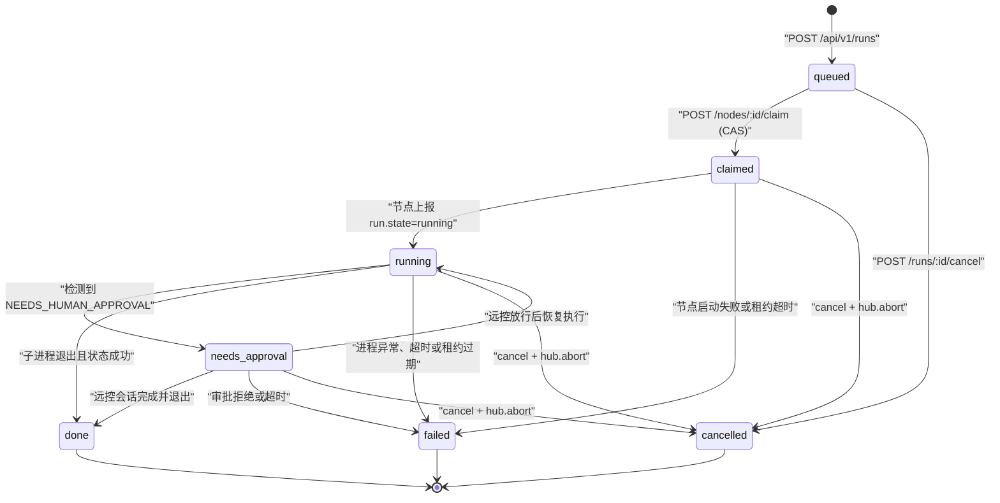

# 02 D1 数据模型与状态机契约

本文档定义 `agent-hub` 在 Cloudflare D1（SQLite）中的唯一事实源表结构、任务状态迁移约束、Compare-And-Swap（CAS）并发守卫、租约超时回收规则以及同机按工作区目录（`workdir`）的并发隔离契约。

## 1. D1 SQLite 初始迁移（`migrations/0001_init.sql`）

以下 DDL 可直接作为首版数据库迁移脚本执行：

```sql
PRAGMA foreign_keys = ON;

-- 1. 工作节点注册表
CREATE TABLE IF NOT EXISTS nodes (
  id TEXT PRIMARY KEY,                              -- 节点短标识，如 macmini / mbp / linux-dev
  display_name TEXT NOT NULL,
  os TEXT NOT NULL DEFAULT '',                      -- darwin / linux / windows
  arch TEXT NOT NULL DEFAULT '',                    -- arm64 / amd64
  version TEXT NOT NULL DEFAULT '',                 -- ahub 二进制版本号
  capabilities_json TEXT NOT NULL DEFAULT '{}',     -- 可用 agent、实时模型目录与推理档位能力
  workspaces_json TEXT NOT NULL DEFAULT '[]',       -- 已发现工作区 [{key, path, default_branch}]
  status TEXT NOT NULL DEFAULT 'offline'
    CHECK (status IN ('online', 'offline', 'draining')),
  max_concurrency INTEGER NOT NULL DEFAULT 4 CHECK (max_concurrency >= 1 AND max_concurrency <= 16),
  active_runs_count INTEGER NOT NULL DEFAULT 0 CHECK (active_runs_count >= 0),
  default_notify_key_id TEXT REFERENCES api_keys(id) ON DELETE SET NULL, -- 节点显式绑定的默认 Bot 通知 Key（migrations/0004）
  last_seen_at TEXT,
  created_at TEXT NOT NULL,
  updated_at TEXT NOT NULL
);

-- 2. 三级鉴权凭证表（仅保存 SHA-256 摘要，绝不存明文；多 Bot Webhook 配置经 AES-256-GCM 密文落库）
CREATE TABLE IF NOT EXISTS api_keys (
  id TEXT PRIMARY KEY,                              -- key_<ulid>
  name TEXT NOT NULL,
  scope TEXT NOT NULL CHECK (scope IN ('admin', 'client', 'node')),
  bound_node_id TEXT REFERENCES nodes(id) ON DELETE CASCADE,
  key_prefix TEXT NOT NULL,                         -- 展示前缀，如 ahub_cli_7f3a
  key_sha256 TEXT NOT NULL UNIQUE,                  -- 64 位小写十六进制 SHA-256
  allowed_nodes_json TEXT NOT NULL DEFAULT '[]',    -- 空数组表示允许全部在线节点
  allow_unsandboxed INTEGER NOT NULL DEFAULT 0 CHECK (allow_unsandboxed IN (0, 1)),
  max_depth_limit INTEGER NOT NULL DEFAULT 1 CHECK (max_depth_limit >= 0 AND max_depth_limit <= 3),
  notify_webhook_ciphertext TEXT NOT NULL DEFAULT '', -- client Key 专属 Webhook URL/Key 密文（AES-256-GCM，`v1:<iv_b64url>:<ct_b64url>`，以 `WEBHOOK_ENCRYPTION_KEY` 加密）
  notify_webhook_host TEXT NOT NULL DEFAULT '',       -- 脱敏 Webhook 目标主机名（如 hooks.x.ai），仅用于控制台展示
  revoked_at TEXT,
  last_used_at TEXT,
  created_at TEXT NOT NULL
);

-- 3. 会话线程表（物理绑定 node_id + workdir + agent + native_session_id）
CREATE TABLE IF NOT EXISTS threads (
  id TEXT PRIMARY KEY,                              -- thr_<ulid>
  title TEXT NOT NULL,
  node_id TEXT NOT NULL REFERENCES nodes(id),
  workdir TEXT NOT NULL,                            -- 节点本地规范化绝对路径
  project_key TEXT NOT NULL,                        -- 短名，如 dds / memctl
  agent TEXT NOT NULL CHECK (agent IN ('agy', 'pi', 'omp', 'codex', 'claude')),
  native_session_id TEXT,                           -- 底层 Agent 会话 UUID，首轮成功后回填
  status TEXT NOT NULL DEFAULT 'active' CHECK (status IN ('active', 'archived')),
  pinned INTEGER NOT NULL DEFAULT 0 CHECK (pinned IN (0, 1)),
  sort_order REAL NOT NULL DEFAULT 0,               -- 供左栏拖拽置顶排序
  last_run_id TEXT,
  created_at TEXT NOT NULL,
  updated_at TEXT NOT NULL
);

-- 4. 单轮执行任务表
CREATE TABLE IF NOT EXISTS runs (
  id TEXT PRIMARY KEY,                              -- run_<ulid>
  thread_id TEXT NOT NULL REFERENCES threads(id) ON DELETE CASCADE,
  root_run_id TEXT NOT NULL,                        -- 顶级任务 ID（root 本身等于自身 id）
  parent_run_id TEXT REFERENCES runs(id),           -- 直接父任务 ID，入口任务为 NULL
  depth INTEGER NOT NULL DEFAULT 0 CHECK (depth >= 0),
  max_depth INTEGER NOT NULL DEFAULT 1 CHECK (max_depth >= 0 AND max_depth <= 3),
  node_id TEXT NOT NULL REFERENCES nodes(id),
  workdir TEXT NOT NULL,
  agent TEXT NOT NULL CHECK (agent IN ('agy', 'pi', 'omp', 'codex', 'claude')),
  model TEXT NOT NULL DEFAULT '',                   -- 请求指定的模型简称或全名
  effort TEXT NOT NULL DEFAULT '',                  -- off / minimal / low / medium / high / xhigh / max / ultra / auto
  sandbox INTEGER NOT NULL DEFAULT 1 CHECK (sandbox IN (0, 1)),
  timeout_sec INTEGER NOT NULL DEFAULT 900 CHECK (timeout_sec >= 10 AND timeout_sec <= 7200),
  prompt TEXT NOT NULL,
  status TEXT NOT NULL DEFAULT 'queued'
    CHECK (status IN ('queued', 'claimed', 'running', 'needs_approval', 'done', 'failed', 'cancelled')),
  priority_order REAL NOT NULL DEFAULT 0,           -- 越小越优先，支持队列内拖拽重排
  idempotency_key TEXT UNIQUE,
  created_by_key_id TEXT REFERENCES api_keys(id),
  lease_owner TEXT,
  lease_expires_at TEXT,
  resolved_model TEXT NOT NULL DEFAULT '',          -- 底层 Agent 实际命中模型
  resolved_effort TEXT NOT NULL DEFAULT '',         -- 底层 Agent 实际思考强度
  native_session_id TEXT,
  remote_control_url TEXT NOT NULL DEFAULT '',      -- agy 触发人工审批时返回
  summary TEXT NOT NULL DEFAULT '',                 -- 截断摘要（供看板与 Webhook）
  output_md TEXT NOT NULL DEFAULT '',               -- 完整 Markdown 输出（单列 <= 900 KB）
  output_bytes INTEGER NOT NULL DEFAULT 0 CHECK (output_bytes >= 0),
  artifact_r2_key TEXT NOT NULL DEFAULT '',         -- 预留超大产物对象存储键
  error_code TEXT NOT NULL DEFAULT '',
  error_message TEXT NOT NULL DEFAULT '',
  notify_policy_json TEXT NOT NULL DEFAULT '{}',    -- 如 {"target":"grok"}
  notify_status TEXT NOT NULL DEFAULT 'none'
    CHECK (notify_status IN ('none', 'queued', 'sent', 'failed')),
  started_at TEXT,
  finished_at TEXT,
  duration_ms INTEGER NOT NULL DEFAULT 0 CHECK (duration_ms >= 0),
  created_at TEXT NOT NULL,
  updated_at TEXT NOT NULL
);

-- 5. 实时执行事件流表
CREATE TABLE IF NOT EXISTS run_events (
  id INTEGER PRIMARY KEY AUTOINCREMENT,
  run_id TEXT NOT NULL REFERENCES runs(id) ON DELETE CASCADE,
  seq INTEGER NOT NULL CHECK (seq >= 1),
  kind TEXT NOT NULL
    CHECK (kind IN ('status', 'tool_use', 'turn_end', 'approval_needed', 'stderr_warn', 'system')),
  payload_json TEXT NOT NULL,
  created_at TEXT NOT NULL,
  UNIQUE (run_id, seq)
);

-- 核心查询与调度索引
CREATE INDEX IF NOT EXISTS idx_runs_node_status_priority
  ON runs (node_id, status, priority_order ASC, created_at ASC);

CREATE INDEX IF NOT EXISTS idx_runs_thread_created
  ON runs (thread_id, created_at ASC);

CREATE INDEX IF NOT EXISTS idx_runs_root
  ON runs (root_run_id);

CREATE INDEX IF NOT EXISTS idx_runs_active_lease
  ON runs (status, lease_expires_at)
  WHERE status IN ('claimed', 'running', 'needs_approval');
-- 注：`migrations/0003_needs_approval_lease_index.sql` 已将 `needs_approval` 纳入活跃租约部分索引。

CREATE INDEX IF NOT EXISTS idx_threads_node_updated
  ON threads (node_id, pinned DESC, sort_order ASC, updated_at DESC);

CREATE INDEX IF NOT EXISTS idx_api_keys_scope_node
  ON api_keys (scope, bound_node_id)
  WHERE revoked_at IS NULL;

-- 6. 节点原生 Agent 事件幂等记录表（migrations/0004_node_default_notify_and_native_events.sql & 0005_native_events_allow_grok.sql）
CREATE TABLE IF NOT EXISTS native_events (
  id TEXT PRIMARY KEY,                              -- evt_<ulid>
  node_id TEXT NOT NULL REFERENCES nodes(id) ON DELETE CASCADE,
  event_id TEXT NOT NULL,                           -- 幂等去重键（由官方 Hook / 调用端生成）
  agent TEXT NOT NULL CHECK (agent IN ('agy', 'pi', 'omp', 'codex', 'claude', 'grok')),
  event_kind TEXT NOT NULL CHECK (event_kind IN ('interaction_needed', 'turn_summary')),
  native_session_id TEXT NOT NULL DEFAULT '',
  workdir TEXT NOT NULL DEFAULT '',
  title TEXT NOT NULL DEFAULT '',
  summary TEXT NOT NULL DEFAULT '',
  source TEXT NOT NULL DEFAULT '',                  -- claude-hook / codex-notify / agy-hook / pi-ext / omp-ext / grok-hook / cli
  notify_key_id TEXT REFERENCES api_keys(id) ON DELETE SET NULL,
  notify_status TEXT NOT NULL DEFAULT 'none'
    CHECK (notify_status IN ('none', 'queued', 'sent', 'failed', 'skipped')),
  notify_error TEXT NOT NULL DEFAULT '',
  created_at TEXT NOT NULL,
  updated_at TEXT NOT NULL,
  UNIQUE (node_id, event_id)
);

CREATE INDEX IF NOT EXISTS idx_native_events_node_created
  ON native_events (node_id, created_at DESC);
```

### 1.1 原生活动扩展与多渠道投递账本迁移（`migrations/0006_native_activity_and_web_push.sql`）

为在不破坏 `0001`–`0005` 既有兼容性前提下引入 `progress` 事件、人工确认 `ack_at`、浏览器 Web Push 订阅表与多渠道投递明细账本，`0006` 迁移按如下 DDL 演进：

```sql
PRAGMA foreign_keys = ON;

-- 1. 重建 native_events：扩展 event_kind 支持 'progress'，新增人工确认时间 ack_at 与多通道聚合状态 'partial'
CREATE TABLE native_events_v2 (
  id TEXT PRIMARY KEY,                              -- evt_<ulid>
  node_id TEXT NOT NULL REFERENCES nodes(id) ON DELETE CASCADE,
  event_id TEXT NOT NULL,                           -- (node_id, event_id) 幂等键
  agent TEXT NOT NULL CHECK (agent IN ('agy', 'pi', 'omp', 'codex', 'claude', 'grok')),
  event_kind TEXT NOT NULL CHECK (event_kind IN ('interaction_needed', 'turn_summary', 'progress')),
  native_session_id TEXT NOT NULL DEFAULT '',
  workdir TEXT NOT NULL DEFAULT '',
  title TEXT NOT NULL DEFAULT '',
  summary TEXT NOT NULL DEFAULT '',
  source TEXT NOT NULL DEFAULT '',
  notify_key_id TEXT REFERENCES api_keys(id) ON DELETE SET NULL,
  notify_status TEXT NOT NULL DEFAULT 'none'
    CHECK (notify_status IN ('none', 'queued', 'sent', 'partial', 'failed', 'skipped')),
  notify_error TEXT NOT NULL DEFAULT '',
  ack_at TEXT,                                      -- 人工在控制台点击「标记已处理」的 RFC 3339 UTC 时间
  created_at TEXT NOT NULL,
  updated_at TEXT NOT NULL,
  UNIQUE (node_id, event_id)
);

INSERT INTO native_events_v2 (
  id, node_id, event_id, agent, event_kind, native_session_id, workdir,
  title, summary, source, notify_key_id, notify_status, notify_error,
  ack_at, created_at, updated_at
)
SELECT
  id, node_id, event_id, agent, event_kind, native_session_id, workdir,
  title, summary, source, notify_key_id, notify_status, notify_error,
  NULL, created_at, updated_at
FROM native_events;

DROP TABLE native_events;
ALTER TABLE native_events_v2 RENAME TO native_events;

CREATE INDEX IF NOT EXISTS idx_native_events_created
  ON native_events (created_at DESC, id DESC);

CREATE INDEX IF NOT EXISTS idx_native_events_node_created
  ON native_events (node_id, created_at DESC, id DESC);

CREATE INDEX IF NOT EXISTS idx_native_events_session
  ON native_events (node_id, agent, native_session_id, created_at DESC)
  WHERE native_session_id != '';

-- 2. 浏览器 Web Push 订阅注册表（仅限 admin 作用域管理，端点与 ECDH 密钥经 AES-256-GCM 密文落库）
CREATE TABLE IF NOT EXISTS web_push_subscriptions (
  id TEXT PRIMARY KEY,                              -- wps_<ulid>
  label TEXT NOT NULL,                              -- 设备显示名，如 "MacBook Chrome" / "iPhone PWA"
  endpoint_sha256 TEXT NOT NULL UNIQUE,             -- 64 位小写十六进制 SHA-256，用于同浏览器幂等续订去重
  endpoint_host TEXT NOT NULL,                      -- 脱敏展示主机名，如 web.push.apple.com / fcm.googleapis.com
  subscription_ciphertext TEXT NOT NULL,            -- AES-256-GCM 加密的 {endpoint, keys:{p256dh, auth}}
  node_filter_json TEXT NOT NULL DEFAULT '[]',      -- 空数组表示接收全部节点；非空如 ["macmini","mbp"]
  event_filter_json TEXT NOT NULL DEFAULT '["run_needs_approval","run_failed","native_interaction_needed"]',
  enabled INTEGER NOT NULL DEFAULT 1 CHECK (enabled IN (0, 1)),
  failure_count INTEGER NOT NULL DEFAULT 0 CHECK (failure_count >= 0),
  last_sent_at TEXT,
  last_error_code TEXT NOT NULL DEFAULT '',
  last_error_message TEXT NOT NULL DEFAULT '',
  revoked_at TEXT,                                  -- 收到 404/410 Gone 或用户主动解绑时写入
  created_at TEXT NOT NULL,
  updated_at TEXT NOT NULL
);

CREATE INDEX IF NOT EXISTS idx_web_push_active
  ON web_push_subscriptions (enabled)
  WHERE revoked_at IS NULL AND enabled = 1;

-- 3. 统一多渠道通知投递明细账本（覆盖受控 Run 与原生活动 NativeEvent）
CREATE TABLE IF NOT EXISTS notification_deliveries (
  id TEXT PRIMARY KEY,                              -- dlv_<ulid>
  source_kind TEXT NOT NULL CHECK (source_kind IN ('run', 'native_event')),
  source_id TEXT NOT NULL,                          -- run_<ulid> 或 evt_<ulid>
  trigger_event TEXT NOT NULL,                      -- needs_approval / done / failed / cancelled / interaction_needed / turn_summary / progress
  node_id TEXT NOT NULL,
  channel_kind TEXT NOT NULL CHECK (channel_kind IN ('bot_webhook', 'web_push', 'legacy_webhook')),
  channel_id TEXT NOT NULL,                         -- key_<ulid> / wps_<ulid> / 'global_legacy'
  channel_label TEXT NOT NULL,                      -- 脱敏渠道名，如 "grok-bot-macmini" / "MacBook Safari"
  target_host TEXT NOT NULL,                        -- 脱敏主机名，如 hooks.x.ai / web.push.apple.com
  route_mode TEXT NOT NULL DEFAULT 'node_default'
    CHECK (route_mode IN ('key', 'node_default', 'web_push', 'global_legacy')),
  status TEXT NOT NULL DEFAULT 'queued'
    CHECK (status IN ('queued', 'sent', 'failed', 'skipped')),
  attempts INTEGER NOT NULL DEFAULT 0 CHECK (attempts >= 0),
  http_status INTEGER,
  error_code TEXT NOT NULL DEFAULT '',
  error_message TEXT NOT NULL DEFAULT '',
  sent_at TEXT,
  created_at TEXT NOT NULL,
  updated_at TEXT NOT NULL,
  UNIQUE (source_kind, source_id, trigger_event, channel_kind, channel_id)
);

CREATE INDEX IF NOT EXISTS idx_deliveries_source
  ON notification_deliveries (source_kind, source_id, created_at ASC);

CREATE INDEX IF NOT EXISTS idx_deliveries_status_updated
  ON notification_deliveries (status, updated_at DESC)
  WHERE status IN ('queued', 'failed');
```

### 1.2 节点默认通知事件过滤与投递冷却索引迁移（`migrations/0007_node_default_notify_events.sql`）

为解耦「原生活动落库观察」与「节点默认 Bot 外发打断」，并支撑非紧急通知的同会话冷却查询，`0007` 迁移按如下 DDL 演进：

```sql
PRAGMA foreign_keys = ON;

ALTER TABLE nodes
  ADD COLUMN default_notify_events_json TEXT NOT NULL
  DEFAULT '["run_needs_approval","run_failed","run_done","run_cancelled","native_interaction_needed","native_turn_summary","native_progress"]';

CREATE INDEX IF NOT EXISTS idx_deliveries_channel_sent
  ON notification_deliveries (source_kind, channel_kind, channel_id, sent_at DESC)
  WHERE status = 'sent';
```

### 字段语义与容量边界

- 所有时间字段统一使用 RFC 3339 UTC 字符串（精度至毫秒，例如 `2026-11-13T04:15:30.123Z`），确保按字典序比较与索引扫描结果一致。
- `runs.output_md` 在 D1 单行安全上限内截断保留前 900 KB（D1 单行限制为 1 MB）；超出部分在后续阶段可写入 `artifact_r2_key`，并在 `output_bytes` 记录原始字节总长。
- `runs.notify_status` D1 列继续保持 `('none', 'queued', 'sent', 'failed')` 枚举以向后兼容调用端 CLI 与 Schema；对外 REST / WebSocket 返回的 `RunRecord` 额外附带可选 `deliveries_summary: { total, sent, queued, failed }` 精确暴露多通道投递计数。
- `native_events.title` 与 `native_events.summary` 在节点端预脱敏与云端二次脱敏后，分别截断至 `<= 200` 字符与 `<= 4000` 字符。
- `web_push_subscriptions.subscription_ciphertext` 采用与 `api_keys.notify_webhook_ciphertext` 相同的 `AES-256-GCM` 格式（`v1:<iv_b64url>:<ct_b64url>`，以 `WEBHOOK_ENCRYPTION_KEY` 加密），明文为 `{ endpoint, keys: { p256dh, auth } }`。
- `threads.sort_order` 与 `runs.priority_order` 使用 IEEE 754 `REAL`（如中点插值法或批量整数重编号），以支持前端 `@dnd-kit` 单次拖拽调整顺序而不必重写全表。

## 2. 状态机定义与合法迁移



### CAS 迁移约束矩阵

任何状态更新必须显式匹配前置状态；终态（`done`、`failed`、`cancelled`）一经落盘绝对不可逆。

| 当前状态 | 目标状态 | 触发来源 | 必备 CAS SQL 条件 | 同步副作用 |
| --- | --- | --- | --- | --- |
| `queued` | `claimed` | 节点认领 | `WHERE id = ? AND status = 'queued'` | 写入 `lease_owner`、`lease_expires_at`、递增 `nodes.active_runs_count` |
| `queued` | `cancelled` | 用户或级联取消 | `WHERE id = ? AND status = 'queued'` | 写入 `finished_at`、若配置通知则入队 |
| `claimed` | `running` | 节点事件 | `WHERE id = ? AND status = 'claimed' AND lease_owner = ?` | 写入 `started_at`、广播 `/ws/stream` |
| `claimed` / `running` / `needs_approval` | `needs_approval` | 节点事件或检查点 `POST /runs/:id/approval` | `WHERE id = ? AND status IN ('claimed','running','needs_approval') AND lease_owner = ?` | 续期租约、原子持久化 `remote_control_url` / `native_session_id` / `summary` / `output_md`、回填 `threads.native_session_id`、仅首入时触发通知队列 |
| `needs_approval` | `running` | 节点事件 | `WHERE id = ? AND status = 'needs_approval' AND lease_owner = ?` | 续期 `lease_expires_at` |
| `needs_approval` | `done` | 人工放行结算 `POST /runs/:id/resolve` | `WHERE id = ? AND status = 'needs_approval'` | 写入 `finished_at`、释放 `lease_owner`/`lease_expires_at`、递减 `nodes.active_runs_count`、下发 `hub.abort(approval_resolved)`、触发通知队列 |
| `claimed` / `running` / `needs_approval` | `done` | 节点完成上报 | `WHERE id = ? AND status IN ('claimed','running','needs_approval') AND lease_owner = ?` | 回填 `threads.native_session_id`、释放 `lease_owner`、递减 `nodes.active_runs_count`、触发通知队列 |
| `claimed` / `running` / `needs_approval` | `failed` | 节点上报或 Cron 超时 | `WHERE id = ? AND status IN ('claimed','running','needs_approval')`（节点上报需带 `lease_owner`） | 释放 `lease_owner`、递减 `nodes.active_runs_count`、触发通知队列（审批超时写入 `APPROVAL_TIMEOUT`） |
| `claimed` / `running` / `needs_approval` | `cancelled` | 用户或级联取消 | `WHERE id = ? AND status IN ('claimed','running','needs_approval')` | 向 DO 发 `hub.abort`、递减 `nodes.active_runs_count`、触发通知队列 |

若 `cancelled` 先于节点迟到的 `done` 上报落库，后续节点 `POST /api/v1/runs/:id/complete` 的 CAS 语句因不匹配 `status` 而影响 0 行，服务端返回 `409 INVALID_STATE_TRANSITION` 并保留 `cancelled` 终态。

## 3. 租约（Lease）与超时回收契约

1. **租约签发**：节点在 `POST /api/v1/nodes/:id/claim` 认领成功时，服务端签发 `lease_owner = <node_id>:<conn_nonce>` 与 `lease_expires_at = now + 90s`。
2. **心跳续期**：节点在本地子进程存活期间，每 `30s` 调用一次 `POST /api/v1/runs/:id/heartbeat`（或通过 WebSocket 心跳汇总帧），服务端以 CAS 校验 `lease_owner` 一致后将 `lease_expires_at` 顺延 `90s`。
3. **Needs-Approval 检查点与有界租约驻留**：当 `agy -p` 等适配器输出 `NEEDS_HUMAN_APPROVAL` 并退出 OS 进程时，节点守护进程必须先调用 `POST /api/v1/runs/:id/approval` 将会话 ID、摘要、`output_md` 与 `remote_control_url` 原子持久化并回填 `threads.native_session_id`，随后保留本地 `workdir` 互斥锁与 `30s` 心跳续租并进入有界驻留等待，直到用户在远控完成审批后调用 `POST /api/v1/runs/:id/resolve`（或 `ahub resolve` / Web「标记已放行」）下发 `hub.abort(approval_resolved)` 立即解绑解锁，或取消任务，或单轮 `timeout_sec` 耗尽后节点上报 `failed`（`error_code = 'APPROVAL_TIMEOUT'`）。
4. **僵尸任务回收（Cron Trigger）**：Worker 每分钟运行一次定时检查，扫描满足 `status IN ('claimed', 'running', 'needs_approval') AND lease_expires_at < now` 的记录：
   - 将任务迁移至 `failed`，`error_code = 'NODE_LEASE_EXPIRED'`，`error_message = 'Node lease expired without heartbeat'`；
   - 同步修正所属节点 `active_runs_count`（通过实时统计 `SELECT COUNT(*) FROM runs WHERE node_id = ? AND status IN ('claimed','running','needs_approval')` 重算，防止计数器漂移）；
   - 如任务配置了 `notify_policy_json`，向 `ahub-outbound-notify` 入队失败通知。
5. **为何失联不自动重新入队**：本地 Coding Agent 可能已修改目标仓库文件或执行过外部命令，自动重放极易制造冲突。因此租约过期统一转为 `failed`，交由用户或上层调用 Agent 检查工作区后决定重跑。

## 4. 并发与 `workdir` 互斥隔离契约

为了消除「整台机器一把全局锁」造成的阻塞，同时保护同一项目目录不被并发写坏，调度层与节点层执行双层约束：

1. **同机跨目录并发**：同一节点可同时运行多个不同 `workdir` 的任务，上限由 `nodes.max_concurrency` 控制（默认 `4`）。
2. **同 `(node_id, workdir)` 串行互斥**：
   - 在云端 `claim` 查询中，排除已经存在任意处于 `claimed | running | needs_approval` 状态任务的 `(node_id, workdir)`；
   - 在节点守护进程本地，额外维护 `map[string]struct{}`（以规范化 `filepath.Clean(workdir)` 为键）的本地互斥锁，双重确保同一目录同一时刻最多只有一个子进程在运行。
3. **认领 SQL 选单规则**：
   在满足 `status = 'queued'` 且其 `(node_id, workdir)` 当前无活跃任务的候选中，按 `priority_order ASC, created_at ASC` 选取前 `K` 个（`K = max_concurrency - active_runs_count`），逐条以 CAS 锁定认领。

## 5. 原生活动注意力状态与多渠道投递聚合契约

### 5.1 `attention_state` 确定性推导规则

D1 查询层与 Web Store 共享同一纯函数逻辑推导每条 `native_events` 的 `attention_state`：

- 当 `event_kind !== 'interaction_needed'` 时，`attention_state` 恒为 `null`。
- 当 `event_kind === 'interaction_needed'` 时，严格按以下优先级顺序求值：
  1. **`acked`**：`ack_at !== null`。
  2. **`superseded`**：`native_session_id !== ''` 且存在另一条相同 `(node_id, agent, native_session_id)` 的 `native_events` 记录满足字典序 `(other.created_at > current.created_at) OR (other.created_at === current.created_at AND other.id > current.id)`（以 `(created_at, id)` 消除同毫秒并列歧义；`native_session_id === ''` 时绝不自动覆盖）。
  3. **`stale`**：不满足前两条，且 `now - Date.parse(created_at) > 24 小时`（`86,400,000 ms`）。
  4. **`open`**：其余情况。**仅 `attention_state === 'open'` 的记录计入 `open_interaction_count`**。

### 5.2 `deliveries_summary` 与汇总状态矩阵（`computeAggregateNotifyStatus`）

针对任意 `(source_kind, source_id)`，控制面从 `notification_deliveries` 聚合 `deliveries_summary = { total, sent, queued, failed }`，并按以下确定性规则更新外层 `notify_status`：

1. **零匹配投递记录（`total === 0`）**：
   - `native_events`：若 `node.default_notify_key_id == null`，保留 `notify_status = 'skipped'`、`notify_error = 'NODE_DEFAULT_CHANNEL_UNBOUND'`；若节点已绑定 `default_notify_key_id` 但该 Key 已吊销/无权/无加密 Webhook，保留 `notify_status = 'failed'`、`notify_error = 'DEFAULT_CHANNEL_INVALID_OR_REVOKED'`。
   - `runs`：当 `notify.target === 'none'` 时保持 `notify_status = 'none'`（仅人工 / `admin` 发起 `depth = 0` 任务且节点绑定了失效 `default_notify_key_id` 时保留 `'failed'`）；当显式 `--notify` 目标未能通过 Fail-Closed 校验时保留 `'failed'`。
2. **存在至少一条投递记录（`total >= 1`）**：
   - 存在任意 `queued > 0` -> `'queued'`。
   - `sent > 0 && failed === 0` -> `'sent'`。
   - `sent > 0 && failed > 0` -> `native_events.notify_status` 置为 `'partial'`；`runs.notify_status` 为严格兼容既有限定枚举保持 `'sent'`，并由 `deliveries_summary` 精确暴露 `failed` 数量。
   - `sent === 0 && failed > 0` -> `'failed'`（`native_events.notify_error` 写入首条失败投递的 `error_code`）。
   - 全部记录为 `'skipped'` -> `native_events` 置为 `'skipped'`，`runs` 置为 `'none'`。

### 5.3 订阅过滤键映射（`event_filter_json` 与 `trigger_event`）及路由矩阵

`web_push_subscriptions.event_filter_json` 使用带来源前缀的订阅键，投递账本 `notification_deliveries.trigger_event` 使用无前缀事件名，二者一一映射如下：

| `event_filter_json` 订阅键 | `trigger_event` 值 | `source_kind` | 默认勾选（新订阅） |
| --- | --- | --- | --- |
| `run_needs_approval` | `needs_approval` | `run` | 是 |
| `run_failed` | `failed` | `run` | 是 |
| `run_done` | `done` | `run` | 否 |
| `run_cancelled` | `cancelled` | `run` | 否 |
| `native_interaction_needed` | `interaction_needed` | `native_event` | 是 |
| `native_turn_summary` | `turn_summary` | `native_event` | 否 |
| `native_progress` | `progress` | `native_event` | 否 |

新注册订阅的默认 `event_filter_json` 为 `["run_needs_approval", "run_failed", "native_interaction_needed"]`。Bot Webhook 与 Web Push 双通道路由边界如下：

| 事件来源 | Bot Webhook 路由规则 | 浏览器 Web Push 路由规则 |
| --- | --- | --- |
| `native_events` | 按 `nodes.default_notify_key_id` Fail-Closed，并过滤 `nodes.default_notify_events`（非 `admin` 作用域剥离，默认启用全部 7 项 `PushEventFilterKey`）；未绑定或未命中事件时仅跳过 Bot 通道，**不阻断 Web Push 通道** | 匹配 `enabled = 1 AND revoked_at IS NULL`、`node_filter_json`（空数组为全部节点）及 `native_<event_kind>` |
| 人工 / `admin` 发起的 `runs`（`depth = 0`） | 按 `--notify` 或 `nodes.default_notify_key_id`（走 `node_default` 时同步受 `nodes.default_notify_events` 过滤，否则回退 `global_legacy`）路由 | 匹配 `node_filter_json` 与 `run_<status>` |
| `client` Key 发起的 `runs`（`depth = 0`） | 仅当显式传 `--notify` 时锁定发起方 `client` Key 自身 Webhook（`target = 'none'` 时不发 Bot 回调） | 仅向匹配 `node_filter_json` 的管理员订阅推送 `needs_approval` 与 `failed`（`done` / `cancelled` 绝不触发） |
| 衍生子任务 `runs`（`depth >= 1`） | 禁止落入 `node_default` | 静默（不向管理员推送 Web Push，防止子任务通知风暴） |

#### 非紧急原生通知的静默防抖与同会话冷却规则

为消除终端连续短问答带来的逐轮外呼轰炸，控制面对非紧急原生事件（`turn_summary`、`progress`）实施双层节流，而「原生活动」时间线与 `/ws/stream` 仍保持 `0ms` 实时入库与广播：

1. **紧急事件直通（`0s` 延迟、零冷却）**：`native_interaction_needed`、`run_needs_approval`、`run_failed`、`run_done`、`run_cancelled` 以及人工在控制台指定 `delivery_id` 发起的单通道重推（`bypass_coalesce: true`）一律立即入队投递，绝不延迟或因冷却跳过。
2. **静默防抖窗与后继覆盖消解（默认 `60s`，环境变量 `NATIVE_NOTIFY_QUIET_SEC`，范围 `0..3600`）**：
   - `turn_summary` 与 `progress` 入队时设置 `delaySeconds = quietSec`。
   - 新事件入库且 `native_session_id != ''` 时，主动将同 `(node_id, agent, native_session_id)` 下早于当前事件且仍处于 `queued` 状态的旧 `turn_summary` / `progress` 投递行收敛为 `status = 'skipped'`（`SUPERSEDED_BY_NEWER_TURN`），并重算旧事件聚合状态；队列消费端在投递前再次复核是否存在更新的同会话事件，确保旧轮次绝不延迟抢跑。
3. **同会话冷却窗（默认 `300s`，环境变量 `NATIVE_NOTIFY_COOLDOWN_SEC`，范围 `0..86400`）**：
   - 当 `native_session_id != ''` 且同一 `(node_id, agent, native_session_id, channel_kind, channel_id)` 在 `[now - cooldownSec, now]` 内已存在 `status = 'sent'` 的非紧急（`turn_summary` / `progress`）投递时，入库期直接落盘 `status = 'skipped'`（`SESSION_COOLDOWN_ACTIVE`）且不再入队，消费端在发送前亦二次复核。
   - 若所有候选通道均被跳过，外层 `native_events.notify_status` 按规则收敛为 `'skipped'` 并写入对应诊断码（`NO_MATCHING_CHANNELS` / `SUPERSEDED_BY_NEWER_TURN` / `SESSION_COOLDOWN_ACTIVE`）。

### 5.4 原生活动与投递账本留存清理契约（Cron）

每分钟执行的 Cron Trigger（`scheduled`）除调用 `reapExpiredLeases` 外，按环境变量 `NATIVE_EVENTS_RETENTION_DAYS`（默认 `30` 天）分批（如单次上限 `500` 条）滚动删除 `created_at < now - retentionDays` 的过期 `native_events` 与 `notification_deliveries` 记录；受控 `threads` / `runs` 保持现有留存策略不变，且清理失败仅记录日志而绝不阻塞租约巡检。
