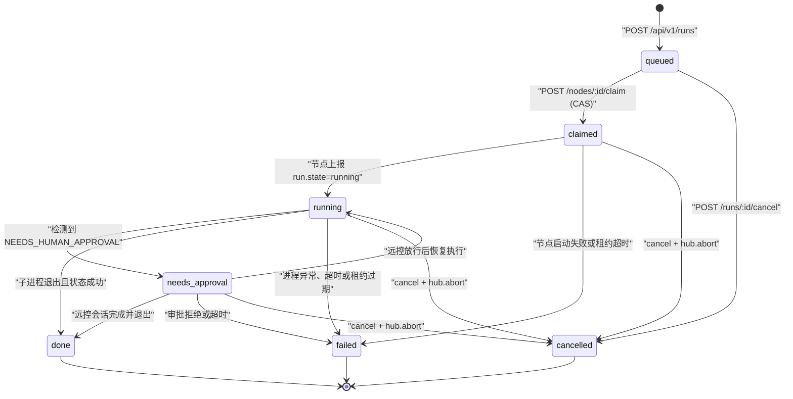

# 02 D1 数据模型与状态机契约

本文档定义 `agent-hub` 在 Cloudflare D1（SQLite）中的唯一事实源表结构、任务状态迁移约束、Compare-And-Swap（CAS）并发守卫、租约超时回收规则以及同机按工作区目录（`workdir`）的并发隔离契约。

## 1. D1 SQLite 初始迁移（`migrations/0001_init.sql`）

以下 DDL 可直接作为首版数据库迁移脚本执行：

```sql
PRAGMA foreign_keys = ON;

-- 1. 工作节点注册表
CREATE TABLE IF NOT EXISTS nodes (
  id TEXT PRIMARY KEY,                              -- 节点短标识，如 macmini / mbp / linux-dev
  display_name TEXT NOT NULL,
  os TEXT NOT NULL DEFAULT '',                      -- darwin / linux / windows
  arch TEXT NOT NULL DEFAULT '',                    -- arm64 / amd64
  version TEXT NOT NULL DEFAULT '',                 -- ahub 二进制版本号
  capabilities_json TEXT NOT NULL DEFAULT '{}',     -- 可用 agent、实时模型目录与推理档位能力
  workspaces_json TEXT NOT NULL DEFAULT '[]',       -- 已发现工作区 [{key, path, default_branch}]
  status TEXT NOT NULL DEFAULT 'offline'
    CHECK (status IN ('online', 'offline', 'draining')),
  max_concurrency INTEGER NOT NULL DEFAULT 4 CHECK (max_concurrency >= 1 AND max_concurrency <= 16),
  active_runs_count INTEGER NOT NULL DEFAULT 0 CHECK (active_runs_count >= 0),
  default_notify_key_id TEXT REFERENCES api_keys(id) ON DELETE SET NULL, -- 节点显式绑定的默认 Bot 通知 Key（migrations/0004）
  last_seen_at TEXT,
  created_at TEXT NOT NULL,
  updated_at TEXT NOT NULL
);

-- 2. 三级鉴权凭证表（仅保存 SHA-256 摘要，绝不存明文；多 Bot Webhook 配置经 AES-256-GCM 密文落库）
CREATE TABLE IF NOT EXISTS api_keys (
  id TEXT PRIMARY KEY,                              -- key_<ulid>
  name TEXT NOT NULL,
  scope TEXT NOT NULL CHECK (scope IN ('admin', 'client', 'node')),
  bound_node_id TEXT REFERENCES nodes(id) ON DELETE CASCADE,
  key_prefix TEXT NOT NULL,                         -- 展示前缀，如 ahub_cli_7f3a
  key_sha256 TEXT NOT NULL UNIQUE,                  -- 64 位小写十六进制 SHA-256
  allowed_nodes_json TEXT NOT NULL DEFAULT '[]',    -- 空数组表示允许全部在线节点
  allow_unsandboxed INTEGER NOT NULL DEFAULT 0 CHECK (allow_unsandboxed IN (0, 1)),
  max_depth_limit INTEGER NOT NULL DEFAULT 1 CHECK (max_depth_limit >= 0 AND max_depth_limit <= 3),
  notify_webhook_ciphertext TEXT NOT NULL DEFAULT '', -- client Key 专属 Webhook URL/Key 密文（AES-256-GCM，`v1:<iv_b64url>:<ct_b64url>`，以 `WEBHOOK_ENCRYPTION_KEY` 加密）
  notify_webhook_host TEXT NOT NULL DEFAULT '',       -- 脱敏 Webhook 目标主机名（如 hooks.x.ai），仅用于控制台展示
  revoked_at TEXT,
  last_used_at TEXT,
  created_at TEXT NOT NULL
);

-- 3. 会话线程表（物理绑定 node_id + workdir + agent + native_session_id）
CREATE TABLE IF NOT EXISTS threads (
  id TEXT PRIMARY KEY,                              -- thr_<ulid>
  title TEXT NOT NULL,
  node_id TEXT NOT NULL REFERENCES nodes(id),
  workdir TEXT NOT NULL,                            -- 节点本地规范化绝对路径
  project_key TEXT NOT NULL,                        -- 短名，如 dds / memctl
  agent TEXT NOT NULL CHECK (agent IN ('agy', 'pi', 'omp', 'codex', 'claude')),
  native_session_id TEXT,                           -- 底层 Agent 会话 UUID，首轮成功后回填
  status TEXT NOT NULL DEFAULT 'active' CHECK (status IN ('active', 'archived')),
  pinned INTEGER NOT NULL DEFAULT 0 CHECK (pinned IN (0, 1)),
  sort_order REAL NOT NULL DEFAULT 0,               -- 供左栏拖拽置顶排序
  last_run_id TEXT,
  created_at TEXT NOT NULL,
  updated_at TEXT NOT NULL
);

-- 4. 单轮执行任务表
CREATE TABLE IF NOT EXISTS runs (
  id TEXT PRIMARY KEY,                              -- run_<ulid>
  thread_id TEXT NOT NULL REFERENCES threads(id) ON DELETE CASCADE,
  root_run_id TEXT NOT NULL,                        -- 顶级任务 ID（root 本身等于自身 id）
  parent_run_id TEXT REFERENCES runs(id),           -- 直接父任务 ID，入口任务为 NULL
  depth INTEGER NOT NULL DEFAULT 0 CHECK (depth >= 0),
  max_depth INTEGER NOT NULL DEFAULT 1 CHECK (max_depth >= 0 AND max_depth <= 3),
  node_id TEXT NOT NULL REFERENCES nodes(id),
  workdir TEXT NOT NULL,
  agent TEXT NOT NULL CHECK (agent IN ('agy', 'pi', 'omp', 'codex', 'claude')),
  model TEXT NOT NULL DEFAULT '',                   -- 请求指定的模型简称或全名
  effort TEXT NOT NULL DEFAULT '',                  -- off / minimal / low / medium / high / xhigh / max / ultra / auto
  sandbox INTEGER NOT NULL DEFAULT 1 CHECK (sandbox IN (0, 1)),
  timeout_sec INTEGER NOT NULL DEFAULT 900 CHECK (timeout_sec >= 10 AND timeout_sec <= 7200),
  prompt TEXT NOT NULL,
  status TEXT NOT NULL DEFAULT 'queued'
    CHECK (status IN ('queued', 'claimed', 'running', 'needs_approval', 'done', 'failed', 'cancelled')),
  priority_order REAL NOT NULL DEFAULT 0,           -- 越小越优先，支持队列内拖拽重排
  idempotency_key TEXT UNIQUE,
  created_by_key_id TEXT REFERENCES api_keys(id),
  lease_owner TEXT,
  lease_expires_at TEXT,
  resolved_model TEXT NOT NULL DEFAULT '',          -- 底层 Agent 实际命中模型
  resolved_effort TEXT NOT NULL DEFAULT '',         -- 底层 Agent 实际思考强度
  native_session_id TEXT,
  remote_control_url TEXT NOT NULL DEFAULT '',      -- agy 触发人工审批时返回
  summary TEXT NOT NULL DEFAULT '',                 -- 截断摘要（供看板与 Webhook）
  output_md TEXT NOT NULL DEFAULT '',               -- 完整 Markdown 输出（单列 <= 900 KB）
  output_bytes INTEGER NOT NULL DEFAULT 0 CHECK (output_bytes >= 0),
  artifact_r2_key TEXT NOT NULL DEFAULT '',         -- 预留超大产物对象存储键
  error_code TEXT NOT NULL DEFAULT '',
  error_message TEXT NOT NULL DEFAULT '',
  notify_policy_json TEXT NOT NULL DEFAULT '{}',    -- 如 {"target":"grok"}
  notify_status TEXT NOT NULL DEFAULT 'none'
    CHECK (notify_status IN ('none', 'queued', 'sent', 'failed')),
  started_at TEXT,
  finished_at TEXT,
  duration_ms INTEGER NOT NULL DEFAULT 0 CHECK (duration_ms >= 0),
  created_at TEXT NOT NULL,
  updated_at TEXT NOT NULL
);

-- 5. 实时执行事件流表
CREATE TABLE IF NOT EXISTS run_events (
  id INTEGER PRIMARY KEY AUTOINCREMENT,
  run_id TEXT NOT NULL REFERENCES runs(id) ON DELETE CASCADE,
  seq INTEGER NOT NULL CHECK (seq >= 1),
  kind TEXT NOT NULL
    CHECK (kind IN ('status', 'tool_use', 'turn_end', 'approval_needed', 'stderr_warn', 'system')),
  payload_json TEXT NOT NULL,
  created_at TEXT NOT NULL,
  UNIQUE (run_id, seq)
);

-- 核心查询与调度索引
CREATE INDEX IF NOT EXISTS idx_runs_node_status_priority
  ON runs (node_id, status, priority_order ASC, created_at ASC);

CREATE INDEX IF NOT EXISTS idx_runs_thread_created
  ON runs (thread_id, created_at ASC);

CREATE INDEX IF NOT EXISTS idx_runs_root
  ON runs (root_run_id);

CREATE INDEX IF NOT EXISTS idx_runs_active_lease
  ON runs (status, lease_expires_at)
  WHERE status IN ('claimed', 'running', 'needs_approval');
-- 注：`migrations/0003_needs_approval_lease_index.sql` 已将 `needs_approval` 纳入活跃租约部分索引。

CREATE INDEX IF NOT EXISTS idx_threads_node_updated
  ON threads (node_id, pinned DESC, sort_order ASC, updated_at DESC);

CREATE INDEX IF NOT EXISTS idx_api_keys_scope_node
  ON api_keys (scope, bound_node_id)
  WHERE revoked_at IS NULL;

-- 6. 节点原生 Agent 事件幂等记录表（migrations/0004_node_default_notify_and_native_events.sql & 0005_native_events_allow_grok.sql）
CREATE TABLE IF NOT EXISTS native_events (
  id TEXT PRIMARY KEY,                              -- evt_<ulid>
  node_id TEXT NOT NULL REFERENCES nodes(id) ON DELETE CASCADE,
  event_id TEXT NOT NULL,                           -- 幂等去重键（由官方 Hook / 调用端生成）
  agent TEXT NOT NULL CHECK (agent IN ('agy', 'pi', 'omp', 'codex', 'claude', 'grok')),
  event_kind TEXT NOT NULL CHECK (event_kind IN ('interaction_needed', 'turn_summary')),
  native_session_id TEXT NOT NULL DEFAULT '',
  workdir TEXT NOT NULL DEFAULT '',
  title TEXT NOT NULL DEFAULT '',
  summary TEXT NOT NULL DEFAULT '',
  source TEXT NOT NULL DEFAULT '',                  -- claude-hook / codex-notify / agy-hook / pi-ext / omp-ext / grok-hook / cli
  notify_key_id TEXT REFERENCES api_keys(id) ON DELETE SET NULL,
  notify_status TEXT NOT NULL DEFAULT 'none'
    CHECK (notify_status IN ('none', 'queued', 'sent', 'failed', 'skipped')),
  notify_error TEXT NOT NULL DEFAULT '',
  created_at TEXT NOT NULL,
  updated_at TEXT NOT NULL,
  UNIQUE (node_id, event_id)
);

CREATE INDEX IF NOT EXISTS idx_native_events_node_created
  ON native_events (node_id, created_at DESC);
```

### 字段语义与容量边界

- 所有时间字段统一使用 RFC 3339 UTC 字符串（精度至毫秒，例如 `2026-11-13T04:15:30.123Z`），确保按字典序比较与索引扫描结果一致。
- `runs.output_md` 在 D1 单行安全上限内截断保留前 900 KB（D1 单行限制为 1 MB）；超出部分在后续阶段可写入 `artifact_r2_key`，并在 `output_bytes` 记录原始字节总长。
- `threads.sort_order` 与 `runs.priority_order` 使用 IEEE 754 `REAL`（如中点插值法或批量整数重编号），以支持前端 `@dnd-kit` 单次拖拽调整顺序而不必重写全表。

## 2. 状态机定义与合法迁移



### CAS 迁移约束矩阵

任何状态更新必须显式匹配前置状态；终态（`done`、`failed`、`cancelled`）一经落盘绝对不可逆。

| 当前状态 | 目标状态 | 触发来源 | 必备 CAS SQL 条件 | 同步副作用 |
| --- | --- | --- | --- | --- |
| `queued` | `claimed` | 节点认领 | `WHERE id = ? AND status = 'queued'` | 写入 `lease_owner`、`lease_expires_at`、递增 `nodes.active_runs_count` |
| `queued` | `cancelled` | 用户或级联取消 | `WHERE id = ? AND status = 'queued'` | 写入 `finished_at`、若配置通知则入队 |
| `claimed` | `running` | 节点事件 | `WHERE id = ? AND status = 'claimed' AND lease_owner = ?` | 写入 `started_at`、广播 `/ws/stream` |
| `claimed` / `running` / `needs_approval` | `needs_approval` | 节点事件或检查点 `POST /runs/:id/approval` | `WHERE id = ? AND status IN ('claimed','running','needs_approval') AND lease_owner = ?` | 续期租约、原子持久化 `remote_control_url` / `native_session_id` / `summary` / `output_md`、回填 `threads.native_session_id`、仅首入时触发通知队列 |
| `needs_approval` | `running` | 节点事件 | `WHERE id = ? AND status = 'needs_approval' AND lease_owner = ?` | 续期 `lease_expires_at` |
| `needs_approval` | `done` | 人工放行结算 `POST /runs/:id/resolve` | `WHERE id = ? AND status = 'needs_approval'` | 写入 `finished_at`、释放 `lease_owner`/`lease_expires_at`、递减 `nodes.active_runs_count`、下发 `hub.abort(approval_resolved)`、触发通知队列 |
| `claimed` / `running` / `needs_approval` | `done` | 节点完成上报 | `WHERE id = ? AND status IN ('claimed','running','needs_approval') AND lease_owner = ?` | 回填 `threads.native_session_id`、释放 `lease_owner`、递减 `nodes.active_runs_count`、触发通知队列 |
| `claimed` / `running` / `needs_approval` | `failed` | 节点上报或 Cron 超时 | `WHERE id = ? AND status IN ('claimed','running','needs_approval')`（节点上报需带 `lease_owner`） | 释放 `lease_owner`、递减 `nodes.active_runs_count`、触发通知队列（审批超时写入 `APPROVAL_TIMEOUT`） |
| `claimed` / `running` / `needs_approval` | `cancelled` | 用户或级联取消 | `WHERE id = ? AND status IN ('claimed','running','needs_approval')` | 向 DO 发 `hub.abort`、递减 `nodes.active_runs_count`、触发通知队列 |

若 `cancelled` 先于节点迟到的 `done` 上报落库，后续节点 `POST /api/v1/runs/:id/complete` 的 CAS 语句因不匹配 `status` 而影响 0 行，服务端返回 `409 INVALID_STATE_TRANSITION` 并保留 `cancelled` 终态。

## 3. 租约（Lease）与超时回收契约

1. **租约签发**：节点在 `POST /api/v1/nodes/:id/claim` 认领成功时，服务端签发 `lease_owner = <node_id>:<conn_nonce>` 与 `lease_expires_at = now + 90s`。
2. **心跳续期**：节点在本地子进程存活期间，每 `30s` 调用一次 `POST /api/v1/runs/:id/heartbeat`（或通过 WebSocket 心跳汇总帧），服务端以 CAS 校验 `lease_owner` 一致后将 `lease_expires_at` 顺延 `90s`。
3. **Needs-Approval 检查点与有界租约驻留**：当 `agy -p` 等适配器输出 `NEEDS_HUMAN_APPROVAL` 并退出 OS 进程时，节点守护进程必须先调用 `POST /api/v1/runs/:id/approval` 将会话 ID、摘要、`output_md` 与 `remote_control_url` 原子持久化并回填 `threads.native_session_id`，随后保留本地 `workdir` 互斥锁与 `30s` 心跳续租并进入有界驻留等待，直到用户在远控完成审批后调用 `POST /api/v1/runs/:id/resolve`（或 `ahub resolve` / Web「标记已放行」）下发 `hub.abort(approval_resolved)` 立即解绑解锁，或取消任务，或单轮 `timeout_sec` 耗尽后节点上报 `failed`（`error_code = 'APPROVAL_TIMEOUT'`）。
4. **僵尸任务回收（Cron Trigger）**：Worker 每分钟运行一次定时检查，扫描满足 `status IN ('claimed', 'running', 'needs_approval') AND lease_expires_at < now` 的记录：
   - 将任务迁移至 `failed`，`error_code = 'NODE_LEASE_EXPIRED'`，`error_message = 'Node lease expired without heartbeat'`；
   - 同步修正所属节点 `active_runs_count`（通过实时统计 `SELECT COUNT(*) FROM runs WHERE node_id = ? AND status IN ('claimed','running','needs_approval')` 重算，防止计数器漂移）；
   - 如任务配置了 `notify_policy_json`，向 `ahub-outbound-notify` 入队失败通知。
5. **为何失联不自动重新入队**：本地 Coding Agent 可能已修改目标仓库文件或执行过外部命令，自动重放极易制造冲突。因此租约过期统一转为 `failed`，交由用户或上层调用 Agent 检查工作区后决定重跑。

## 4. 并发与 `workdir` 互斥隔离契约

为了消除「整台机器一把全局锁」造成的阻塞，同时保护同一项目目录不被并发写坏，调度层与节点层执行双层约束：

1. **同机跨目录并发**：同一节点可同时运行多个不同 `workdir` 的任务，上限由 `nodes.max_concurrency` 控制（默认 `4`）。
2. **同 `(node_id, workdir)` 串行互斥**：
   - 在云端 `claim` 查询中，排除已经存在任意处于 `claimed | running | needs_approval` 状态任务的 `(node_id, workdir)`；
   - 在节点守护进程本地，额外维护 `map[string]struct{}`（以规范化 `filepath.Clean(workdir)` 为键）的本地互斥锁，双重确保同一目录同一时刻最多只有一个子进程在运行。
3. **认领 SQL 选单规则**：
   在满足 `status = 'queued'` 且其 `(node_id, workdir)` 当前无活跃任务的候选中，按 `priority_order ASC, created_at ASC` 选取前 `K` 个（`K = max_concurrency - active_runs_count`），逐条以 CAS 锁定认领。
