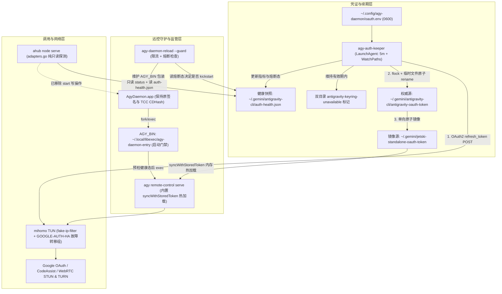
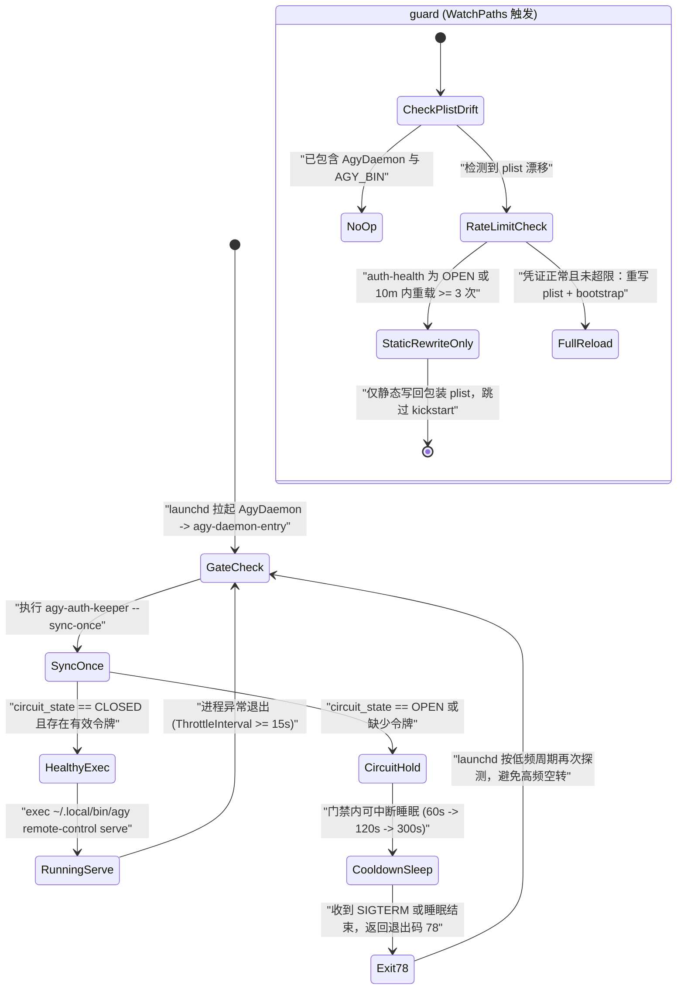

# `macmini` 上 `agy remote-control` 断联根治方案（方案 A 实施规格书）

> **文档状态**：实施版（已完成三项前置核实与前提修正）
> **适用目标**：无头节点（如 `macmini`）上长期在线的 `agy remote-control serve` 守护服务及 `agent-hub` 节点守护端
> **关联组件**：`com.google.antigravity-cli-daemon`、`AgyDaemon.app`、`io.github.gray0128.agy-daemon.guard`、`~/.local/bin/agy-daemon-reload`、`agent-hub`（`internal/runner/adapters.go`）、`mihomo`（TUN 模式）

---

## 一页摘要（Executive Summary）

### 1. 问题本质

`macmini` 上 `agy remote-control` 在 2026-11-14 连续发生两次业务断联（`16:47` 与 `18:17`），根因并非进程偶发崩溃，而是现有体系同时违反了长期在线无头服务的四项基础约束：

1. **凭证存储双轨分裂**：前台 CLI 读写 macOS Keychain 或 `~/.gemini/antigravity-cli/antigravity-oauth-token`，而后台 `language_server`（`agy remote-control serve`）读写 `~/.gemini/jetski-standalone-oauth-token`，且在无头 `launchd` 会话下首次访问 Keychain 超时后锁定为文件回退模式，导致前台续期结果无法同步至后台。
2. **暂态网络故障被误判为未登录**：后台进程刷新令牌遇到 `oauth2.googleapis.com` TLS 握手超时后，直接回退到读取终端 `stdin` 的交互式登录；因守护进程 `stdin` 绑定 `/dev/null` 立即读到 `EOF`，进程将当前会话标记为未登录并关闭远控通道。
3. **控制面多写者互相覆写 `LaunchAgent`**：`agent-hub` 的 `ensureRemoteControlURL` 在查询不到远控地址时调用 `agy remote-control start`，将 `AgyDaemon.app` 包装的 `plist` 覆写为裸 `agy` 配置，触发 `guard` 反复重载与未登录退出的循环。
4. **控制通道存活掩盖业务凭证失效**：WebRTC 数据通道建立后依赖 DTLS 会话保活，当 `access_token` 满 1 小时过期且缺少可用 `refresh_token` 续期时，进程与 WebRTC 连接均显示在线，但所有业务 RPC 持续返回 HTTP `401`。

### 2. 方案 A 核心设计

方案 A 在不修改闭源 `agy` 二进制、**不重编译 `AgyDaemon.app`（保留现有 `CDHash` 与 macOS TCC「完全磁盘访问权限」）** 的前提下，通过外部正交分层消除上述结构性缺陷：

- **凭证单一数据源（SSOT）与热加载镜像**：以 `~/.gemini/antigravity-cli/antigravity-oauth-token` 为唯一权威源，经 `flock` 排他锁与同目录临时文件原子 `rename` 单向镜像至 `~/.gemini/jetski-standalone-oauth-token`，并维持双目录 `antigravity-keyring-unavailable` 标记。直接利用 `agy` 内置的 `(*AuthClient).syncWithStoredToken` 机制，在无需重启守护进程的前提下实现进程内令牌热更新。
- **独立续期守护 `agy-auth-keeper`**：以用户级 `LaunchAgent`（5 分钟定时 + `WatchPaths` 文件变更触发）运行独立 Python 标准库脚本，在过期前 `20 分钟` 直接调用 Google OAuth 2.0 标准刷新接口；代码中不含任何交互式登录分支，严格区分网络暂态错误（指数退避重试、保留原凭证）与确定性授权失效（`invalid_grant`，打开熔断器并告警）。
- **收回 `agent-hub` 的守护进程写权限**：改造 `internal/runner/adapters.go` 中的 `ensureRemoteControlURL` 为纯只读状态检查，删除 `agy remote-control start` 调用；拿不到远控 URL 时正常推进任务至 `needs_approval` 状态并写入明确诊断事件与摘要，不再阻塞任务或改写 `plist`。
- **无损启动门禁与 `guard` 熔断**：复用 `AgyDaemon`（`src/main.c:55`）原生支持的 `AGY_BIN` 环境变量注入门禁脚本 `agy-daemon-entry`，并在 `agy-daemon-reload --guard` 中加入滑动窗口限流与凭证熔断检查：当凭证失效时仅静态修复被篡改的 `plist` 文件，暂停 `launchctl kickstart` 拉起动作，彻底阻断死锁循环。
- **`mihomo` 分流与可观测性加固**：为 Google OAuth、CodeAssist、WebChannel 及 WebRTC STUN/TURN 域名配置 `fake-ip-filter` 与支持 UDP 的自动故障转移策略组 `GOOGLE-AUTH-HA`；输出结构化 `~/.gemini/antigravity-cli/auth-health.json`，接入告警通知。

### 3. 分阶段推进路线

| 阶段 | 核心内容 | 风险等级 | 预计工时 | 回滚耗时 |
| --- | --- | --- | --- | --- |
| 阶段一 | `mihomo` 增加 `fake-ip-filter` 与 `GOOGLE-AUTH-HA` 备用线路组并热重载 | 极低 | `0.5 h` | `< 10 s` |
| 阶段二 | 部署 `agy-auth-keeper`（先只读干跑，再启用镜像与提前 20 分钟续期）及 `auth-health.json` | 低 | `2.0 h` | `< 30 s` |
| 阶段三 | 改造 `agent-hub` 的 `adapters.go` 为只读探测，补齐单测并更新 `ahub` 二进制 | 低 | `1.0 h` | `< 1 min` |
| 阶段四 | 注入 `AGY_BIN` 启动门禁，升级 `agy-daemon-reload --guard` 熔断限流与告警通知 | 中低 | `1.5 h` | `< 1 min` |

---

## 1. 历史故障时间线与推测项核实

本节基于只读日志取证、`agy v1.5.9` 二进制符号与调用链反汇编、`AgyDaemon` 源码及 `agent-hub` 仓库历史，对前序排查报告中标记为「推测」的三项关键问题进行核实。遵守安全约束，核实过程未读取任何令牌、密钥或代理密码明文。

### 1.1 经日志与源码交叉确认的完整故障时间线（2026-11-14）

| 时间（UTC+8） | 证据来源 | 已确认事实 |
| --- | --- | --- |
| `12:38` | `~/Library/LaunchAgents/win.bobocai.ahub.node.plist` 元数据 | `ahub node serve` 守护服务已在节点运行 |
| `15:51:03` | `AgyDaemon` 仓库提交记录与 `guard.plist` 修改时间 | 安装 `AgyDaemon.app` 与 `io.github.gray0128.agy-daemon.guard`（`WatchPaths` 监听 `com.google.antigravity-cli-daemon.plist`） |
| `16:47–16:48` | `~/Library/Logs/antigravity-cli-daemon.log` 第 1–28 行 | 后台 `language_server` 调用 `loadCodeAssist` 触发刷新令牌，请求 `POST https://oauth2.googleapis.com/token` 报 `net/http: TLS handshake timeout`，随即进入 `Starting login...` 并打印 `Enter the authorization code:`，因 `stdin` 为 `/dev/null` 读到 `EOF` 后将状态置为未登录，远控连接断开 |
| `16:51:23` | `~/Library/Logs/agy-daemon-guard.log` 第 1–2 行、`antigravity-cli-daemon.log` 第 87–88 行 | 外部进程改写了 `com.google.antigravity-cli-daemon.plist`，触发 `guard` 执行 `restoring AgyDaemon wrapper...`；重启后 `agy remote-control serve` 在预检阶段输出 `not signed in: run 'agy', sign in, then run 'agy remote-control start'` 并立即退出，`guard` 记录 `error: com.google.antigravity-cli-daemon did not start` |
| `17:20:53` | `agy-daemon-guard.log` 第 3–4 行、`antigravity-cli-daemon.log` 第 89–90 行 | 人工注入凭证并执行恢复后，`guard` 完成包装还原（`wrapper_pid=18254, agy_child_pid=18262`），守护进程打印 `Authenticated as user@example.com` 恢复工作 |
| `18:17–18:37` | `antigravity-cli-daemon.log` 第 91–100 行（文件最后修改时间 `18:37`） | `17:21` 前后生效的 `access_token` 满 1 小时过期；**本次日志中无任何 `TLS handshake timeout` 报错**，守护进程直接连续两次打印交互式授权链接与 `Enter the authorization code:`，WebRTC 通道仍保持连接，但业务请求全部返回 `401` |
| `18:40` | 运维排障记录与 `composite_token_storage.go` 反汇编验证 | 前台 CLI 刷新了 macOS Keychain 中的凭证，但后台 `language_server` 锁定读取 `~/.gemini/jetski-standalone-oauth-token`，无法感知 Keychain 更新 |

### 1.2 三项原「推测」问题的实测核实结论（2026-11-15 实施前复核）

> [!IMPORTANT]
> 实施前通过零明文元数据审计（仅检查字段存在性、长度、SHA-256 前 8 位指纹、`expiry`、`mtime`）、macOS Unified Log、`ahub` 日志与 `mihomo` 控制接口完成了全部三项核实，并修正了原方案中两处与真实运行态不符的前提假设（嵌套 `StoredToken` Schema 与 `mihomo` 自动生成 `proxies:` 段约束）。

#### 核实项一：`17:21` 注入的令牌缺了什么，导致 `18:17` 满 1 小时后无法静默续期？

- **核实结论（已确认）**：**并非缺少 `refresh_token`，而是三处凭证存储发生分裂（仅更新了部分位置），叠加嵌套 `StoredToken` 结构约束与后台 `HostBridge` 单次内存续期失败后永久锁死未登录态的机制。**
- **实证细节（不含任何密钥明文）**：
  1. **三处存储实测元数据比对**：
     - `~/.gemini/antigravity-cli/antigravity-oauth-token`（守护进程 `Daemon.CheckTokenFile` / `LoadOAuthToken` 读取位置）：**包含非空 `refresh_token`**（长度 `103`，SHA-256 前 8 位指纹 `3a055da5`），顶层字段为 `["auth_method", "id_token_email", "token", "writer_id"]`；
     - macOS Keychain（`svce="gemini", acct="antigravity"`，`go-keyring-base64:` 编码）：同样包含同一 `refresh_token`（长度 `103`，指纹 `3a055da5`），前台 CLI（`18:40`、`20:01`）走 `ChainedAuth: authenticated via keyring` 刷新后仅写回 Keychain，**既不更新 `antigravity-oauth-token`，也不更新 `jetski-standalone-oauth-token`**；
     - `~/.gemini/jetski-standalone-oauth-token`（内嵌 `language_server` 打印 `Using file-based token storage because the caller requested it` 时对应的文件存储）：`mtime` 停留在 `2026-10-07T00:25:35+08:00`（`expiry = 2026-10-07T01:25:34+08:00`），残留旧的已失效 `refresh_token`（指纹 `1226663a` != `3a055da5`），在 `17:21` 与 `18:40` 均未被更新。
  2. **推翻原前提 1——真实 JSON Schema 为嵌套 `StoredToken` 而非扁平 `oauth2.Token`**：
     两处磁盘文件与 Keychain 解码后的 JSON 均为嵌套包装结构：
     ```json
     {
       "auth_method": "consumer",
       "token": {
         "access_token": "<REDACTED>",
         "token_type": "Bearer",
         "refresh_token": "<REDACTED>",
         "expiry": "2026-11-14T22:01:02.160935+08:00"
       }
     }
     ```
     `Daemon.CheckTokenFile` 与 `LoadOAuthToken` 反序列化该结构后校验 `stored.Token != nil && len(stored.Token.RefreshToken) > 0`。若按原方案草稿写入扁平 `oauth2.Token`，`stored.Token` 将为 `nil`，直接导致守护进程报错 `not signed in`。
  3. **推翻原前提 2——后台内存续期不回写磁盘，且单次刷新失败即永久锁死内存态**：
     核查同日多段守护日志（`cli-20261114_120720.log` 连续运行 `2h43m` 跨越两次 1 小时续期，而 `153457.log` 在 `16:33:15`、`172059.log` 在 `18:17:15` 均在启动约 `56–58 分钟` 后掉线）证实：`agy remote-control serve` 启动后仅在内存中按约 55 分钟周期续期（不会将新 `access_token` 回写 `antigravity-oauth-token`）；一旦当次内存续期因网络抖动失败，内部立即调用 `SetWIFProvider("")` / `SetProjectID("")` 将 `has_token` 置为 `false`，此后进程虽保持存活与 WebRTC 信令轮询，但所有业务 RPC 永久报错 `You are not logged into Antigravity`，必须配合空闲期受控 `agy-daemon-reload` 才能解除已锁死的内存态。

#### 核实项二：`16:47` 故障后是哪个进程覆盖了 `com.google.antigravity-cli-daemon.plist`？

- **核实结论（已确认）**：**`16:51:23` 调用 `agy remote-control start` 覆写 `plist` 的是人工交互式终端会话，并非 `ahub node serve`。**
- **实证细节**：
  1. 节点守护日志 `~/.config/ahub/logs/ahub-node.stderr.log` 最后修改时间为 `2026-11-14 15:18:57+08:00`（`ahub-node.stdout.log` 为 `0` 字节），在 `16:30–17:25` 整个故障与恢复窗口内 `ahub` 无任何任务执行或子进程调用活动；
  2. `cli-20261114_153457.log` 显示旧守护进程在 `16:33:15` 进入未登录态后一直存活至 `16:51:17.471` 收到 `SIGTERM`；macOS Unified Log 记录 `16:51:17.399` 由 `LaunchRoleUserInteractive` 交互会话触发 `bootout`，`remote-control-serve-telemetry.json` 记录 `16:51:18.637` `auth_error`，且交互式 Shell 历史中存在多条手动执行 `agy remote-control start` 的记录；
  3. 尽管 `16:51:23` 系人工排障触发，但 `internal/runner/adapters.go` 的 `ensureRemoteControlURL` 确实包含无条件执行 `agy remote-control start` 的代码路径，在远端派单遇到 `approval_needed` 时同样会破坏 `AgyDaemon.app` 包装，因此阶段三只读探测改造仍须按计划落地。

#### 核实项三：`16:47` 的 `TLS handshake timeout` 具体卡在网络链路哪一跳？

- **核实结论（已确认）**：**卡在本机至上游代理节点的 IPv4 / QUIC 出境隧道段（跨境首跳拥塞丢包），而非上游节点至 Google 段。**
- **实证细节**：
  1. **真实路由链路核实（修正原 `MATCH,主代理` 描述）**：`mihomo` 规则链中 `oauth2.googleapis.com` 命中 `DOMAIN-KEYWORD,googleapis,Google` -> 策略组 `Google`（`Selector`，指向 `主代理`）-> `主代理`（`Selector`，`store-selected: true` 静态固定在单一 QUIC/UDP 节点，未指向 `自动选择`）；
  2. **同机房双栈延迟对照实证**：查询本机 `mihomo` 控制接口（`127.0.0.1:9090/proxies`）对 `gstatic.com/generate_204` 的实时探测记录显示，当前静态绑定的上游服务器在 IPv4 路径（TUIC 与 VLESS IPv4）均处于探测超时（`last_delay = 0`）或高延迟（`> 5000 ms`）状态，而**同一台上游服务器的 IPv6 路径访问 Google 仅需 `306 ms`**，另有多个 TCP VLESS+Reality 节点稳定在 `263–350 ms`。同一出口机房经 IPv6 访问 Google 完全正常而 IPv4 超时，直接证明瓶颈位于本机至上游代理的 IPv4/UDP 跨境链路，且因静态 `select` 组无故障转移导致请求持续命中超时节点；
  3. **UDP 丢包直接旁证**：守护日志（`cli-20261114_153457.log` 与 `172059.log`）全程每隔约 2 分钟打印 `turnc ERROR: Fail to refresh permissions: all retransmissions failed`，进一步印证当前静态 QUIC/UDP 隧道存在持续性 UDP 丢包。

---

## 2. 第一性原理约束与方案 A 实施级详细设计

### 2.1 六项系统不变量与架构映射

长期无人值守的无头远控服务必须同时满足以下六项不变量。方案 A 的每个模块均直接对应并强制维持其中一项或多项不变量：

| 编号 | 第一性原理不变量 | 现状违规点 | 方案 A 强制保障机制 |
| --- | --- | --- | --- |
| `I1` | **单一权威凭证源（SSOT）** | Keychain、`antigravity-oauth-token`、`jetski-standalone-oauth-token` 三处分裂 | 确立 `antigravity-oauth-token` 为唯一权威源，双目录锁定文件模式，单向原子镜像至 `jetski-standalone-oauth-token` |
| `I2` | **后台静默续期与交互零耦合** | 刷新失败立即调用 `TerminalTokenAcquirer` 读 `stdin` 导致 `EOF` 登出 | 独立 `agy-auth-keeper` 提前 20 分钟直接请求 OAuth Token 端点，代码无任何交互分支 |
| `I3` | **暂态故障与确定性失效严格分离** | TLS 超时与凭证被吊销走同一错误处理路径 | 仅 HTTP `400/401` 且错误码为 `invalid_grant` 才标为失效；一切超时、`5xx`、连接重置均保留原令牌做退避重试 |
| `I4` | **守护配置单一写者（Single Writer）** | `agy remote-control start`、`ensureRemoteControlURL`、`guard` 并发改写同一 `plist` | 删除 `adapters.go` 中的 `start` 调用；仅 `agy-daemon-reload` 有权维护 `plist` 包装 |
| `I5` | **监管自愈具备退避与熔断上限** | `guard` 无条件 `kickstart` 未登录必退出的 `serve`，构成死循环 | `AGY_BIN` 启动前门禁退避 + `guard` 滑动窗口限流与 `circuit_state == OPEN` 静态修复不强拉 |
| `I6` | **对外就绪状态反映真实业务鉴权** | WebRTC 通道存活但业务 RPC 全返 `401`，外部无感知 | `auth-health.json` 聚合令牌剩余寿命、续期状态与 `401` 增量计数，驱动 `adapters.go` 降级提示与告警通知 |

方案 A 整体组件关系如下：



---

### 2.2 凭证统一数据源（SSOT）与并发写控制

#### 2.2.1 权威路径、镜像方向与钥匙串隔离标记

1. **唯一权威路径（SSOT）**：`~/.gemini/antigravity-cli/antigravity-oauth-token`
   - 选择依据：前台 `agy` CLI（带 `--app_data_dir=antigravity-cli`）与 `agy remote-control serve` 启动预检函数 `(*Daemon).CheckTokenFile`（`main.go:885`）均直接读取该路径；当运维人员在交互终端重新完成 `agy` 登录时，新令牌首先写入此处（在存在钥匙串不可用标记时）。
2. **镜像目标路径**：`~/.gemini/jetski-standalone-oauth-token`
   - 选择依据：`agy remote-control serve` 内部的 `language_server`（`AuthClient`）固定从 `--gemini_dir`（即 `~/.gemini`）根目录下读取 `jetski-standalone-oauth-token`。
   - **热加载机制验证**：反汇编 `(*AuthClient).syncWithStoredToken`（`auth_client.go:1625–1695`）确认，`language_server` 在每次调用 `GetAuthStatus`（`auth_client.go:442`）和 `HasAuthToken`（`auth_client.go:1342`）时，会计算磁盘文件中 `"r:" + refresh_token + "a:" + access_token` 的组合键并与内存缓存比对；一旦检测到外部文件变更，立即输出 `Stored token changed externally; hydrating updated session from storage` 并调用 `applyStoredToken` 热更新内存令牌，**全程无需重启 `agy remote-control serve` 或断开 WebRTC 连接**。
3. **默认镜像方向、Keychain 救援吸收与嵌套 `StoredToken` Schema 规范**：
   - **真实文件 Schema（强制遵循）**：`antigravity-oauth-token` 与 `jetski-standalone-oauth-token` 均必须序列化为嵌套 `StoredToken` JSON（顶层包含 `"auth_method"`、`"token"` 子对象及可选 `"id_token"` / `"id_token_email"` / `"writer_id"`），严禁写入扁平 `oauth2.Token`。
   - **常规方向（单向）**：`SSOT -> 镜像目标`。
   - **反向救济与 Keychain 冷启动吸收**：在持锁合并阶段，`agy-auth-keeper` 同时只读探测镜像目标与当前用户会话可读的 macOS Keychain 条目（`svce="gemini", acct="antigravity"`，自动解码 `go-keyring-base64:` 前缀）；若镜像源或 Keychain 中含有非空 `refresh_token` 且 `expiry` 严格晚于权威源（或权威源缺失），先将其提升合并至权威源，随后统一执行 `SSOT -> 镜像目标` 原子同步。
4. **强制文件存储标记（彻底绕开无头 Keychain 阻塞）**：
   - 反汇编 `NewCompositeTokenStorage`（`composite_token_storage.go:167–183`）证实，当数据目录中存在未超期的 `antigravity-keyring-unavailable` 标记文件（日志提示 `Using file-based token storage because a keyring timeout was recorded within the last %v`）时，前台 CLI 与后台 `language_server` 均在初始化阶段直接选用文件存储，不再访问 macOS `securityd`/Keychain。
   - `agy-auth-keeper` 每次巡检时同步刷新以下两个标记文件的修改时间（写入当前 Unix 秒级时间戳，权限 `0600`），确保前台 CLI 登录/续期与后台 `serve` 始终读写同一套磁盘文件：
     - `~/.gemini/antigravity-cli/antigravity-keyring-unavailable`
     - `~/.gemini/antigravity-keyring-unavailable`

#### 2.2.2 目录权限、原子写入流程与文件锁规范

- **权限要求**：
  - 目录 `~/.gemini`、`~/.gemini/antigravity-cli`、`~/.config/agy-daemon`：模式强制为 `0700`（仅当前属主可读写进入）。
  - 令牌文件、锁文件、标记文件与 `oauth.env`：模式强制为 `0600`；`auth-health.json` 不含任何敏感字段，模式设为 `0600`（同属主下的 `ahub node`、`guard` 与监控脚本均可直接读取）。
- **原子写入步骤（同文件系统临时文件 + `fsync` + `rename`）**：
  任何对权威源、镜像源或 `auth-health.json` 的写入均严禁原地截断（`O_TRUNC`），必须严格执行以下六步：
  1. 在**目标文件同一父目录**下使用 `os.open(tmp_path, os.O_WRONLY | os.O_CREAT | os.O_EXCL, 0o600)` 创建唯一临时文件（命名格式：`.<basename>.tmp.<pid>.<random_hex>`），保证位于同一 APFS 卷内；
  2. 写入完整 UTF-8 JSON 字节流（紧凑或标准缩进格式，末尾带换行符 `\n`）；
  3. 调用 `os.fsync(fd)` 将文件数据刷入持久化介质，随后 `os.close(fd)`；
  4. 再次校验临时文件非空且可被 `json.loads` 完整解析；
  5. 调用 `os.replace(tmp_path, target_path)`（对应 POSIX `rename(2)`），原子替换目标目录项，消除任何读者读到半截文件的窗口；
  6. 打开父目录描述符调用 `os.fsync(dir_fd)` 并关闭，确保目录项变更持久化。
- **协作文件锁规范**：
  - 锁文件路径：`~/.gemini/antigravity-cli/.oauth-token.lock`（独立空锁文件，绝不直接锁将被 `rename` 替换的数据文件 inode，避免 `rename` 后新旧进程锁在不同 inode 上导致互斥失效）。
  - 所有受控组件（`agy-auth-keeper`、`agy-daemon-entry`、运维修复工具）在执行「读取 -> 合并 -> 续期 -> 写入」临界区前，必须对 `.oauth-token.lock` 获取 `fcntl.flock(lock_fd, LOCK_EX)`。

#### 2.2.3 多进程并发写冲突处理（应对不持锁的闭源 `agy` 进程）

由于闭源 `agy` 二进制（前台 CLI 或后台 `AuthClient` 的保存回调）在写文件时不会获取自定义的 `.oauth-token.lock`，方案通过以下四条规则保证无锁并发下的最终一致性与数据不降级：

1. **读端防抖解析**：读取任一令牌文件时，若遇到 `FileNotFoundError` 或 `json.JSONDecodeError`，间隔 `50 ms` 重试最多 `3` 次，规避极小概率的非原子覆盖瞬态。
2. **字段单调保护合并函数 `merge_token_records(a, b)`**：
   在持锁准备写入前，重新读取磁盘上的权威源与镜像源，按下述优先级合成基准记录：
   - **规则 1（保护 `refresh_token` 不丢失）**：若一方含有非空 `refresh_token` 而另一方为空，无条件保留非空 `refresh_token`（若另一方的 `access_token` 属于同一账号且 `expiry` 更新，仅采纳其 `access_token` 与 `expiry`，绝不清空 `refresh_token`）；
   - **规则 2（按 `expiry` 单调前进）**：若双方均含非空 `refresh_token`，选择 RFC 3339 `expiry` 时间戳更晚且 `access_token` 非空的一方；
   - **规则 3（保留扩展字段）**：对 JSON 中除 `access_token`、`token_type`、`refresh_token`、`expiry` 外的上游扩展字段（如账户元数据、作用域信息等），执行字典保留合并，不丢弃闭源组件写入的未知字段。
3. **写前二次比对（乐观并发检查）**：
   当 `agy-auth-keeper` 发起网络请求刷新令牌（耗时约 `0.2–3s`）返回后，在原子替换前再次 `stat` 并重读权威源：若重读发现闭源前台 CLI 在这几秒内刚刚完成了全新账号登录（磁盘上的 `refresh_token` 发生了变化且 `expiry` 距今大于 `45 分钟`），则放弃本次旧会话的刷新结果，直接将前台刚写入的新令牌镜像至 `jetski-standalone-oauth-token`。
4. **后台 `language_server` 自身冲突礼让（源码已内置）**：
   反汇编 `NewAuthClient.func1`（`auth_client.go:269–295`）确认，当 `agy-auth-keeper` 提前 `20 分钟` 完成文件刷新后，后台 `language_server` 即使触发保存回调，检测到磁盘键已外部更新也会打印 `Skipping refreshed token save because stored token changed externally` 并直接加载磁盘新令牌，不会用旧令牌反向覆盖文件。

---

### 2.3 `agy-auth-keeper` 续期守护详细设计

#### 2.3.1 为什么不调用 `agy` 子命令执行续期

经节点本机实测 `agy --help` 与符号表核查，`agy v1.5.9` 仅提供 `acp`、`agent`、`agents`、`changelog`、`help`、`install`、`mcp`、`mic-serve`、`models`、`plugin`、`plugins`、`remote-control`、`update` 子命令，**不存在公开的 `agy auth` 或非交互续期子命令**；而未公开环境变量 `AGY_CLI_CDE_AUTH_ACTION`（`cde_login.go:215`）耦合内部交互式登录实现且无跨版本兼容承诺。

因此，`agy-auth-keeper` 采用 **macOS 系统自带 `/usr/bin/python3` 标准库编写的单文件守护脚本**（安装于 `~/.local/bin/agy-auth-keeper`，零第三方 pip 依赖），直接按照 RFC 6749 标准协议调用 `POST https://oauth2.googleapis.com/token`。该设计从物理上保证了：**进程内根本不存在读取终端授权码或拉起浏览器的代码分支，100% 杜绝退化为交互式登录**。

OAuth 客户端公开参数通过本机 `0600` 权限配置文件 `~/.config/agy-daemon/oauth.env` 注入（部署时一次性配置，严禁硬编码进代码仓库）：

```ini
# ~/.config/agy-daemon/oauth.env (chmod 0600)
AGY_OAUTH_TOKEN_URL=https://oauth2.googleapis.com/token
AGY_OAUTH_CLIENT_ID=<INSTALLED_APP_CLIENT_ID>
AGY_OAUTH_CLIENT_SECRET=<INSTALLED_APP_CLIENT_SECRET>
# 可选：状态跃迁直连告警 Webhook（不含于仓库）
AGY_ALERT_WEBHOOK_URL=
```

#### 2.3.2 运行形态（LaunchAgent）

注册独立的用户级 LaunchAgent `~/Library/LaunchAgents/io.github.gray0128.agy-daemon.auth-keeper.plist`，结合三类触发源：

1. `RunAtLoad = true`：用户会话加载或手动 `bootstrap` 时立即执行一次同步与检查；
2. `StartInterval = 300`：每 `5 分钟` 定时巡检一次；在 `20 分钟` 提前续期窗口内，即使偶发网络抖动，天然具备至少 `4` 个定时周期（每周期内含快速重试）的安全余量；
3. `WatchPaths`：同时监听 `~/.gemini/antigravity-cli/antigravity-oauth-token` 与 `~/.gemini/jetski-standalone-oauth-token`。一旦前台 CLI 登录或更新了任一文件，`launchd` 在 1 秒内唤醒 `agy-auth-keeper` 完成双向校验与镜像；为防止自身写文件再次触发 `WatchPaths` 形成自激循环，脚本在持锁发现双端文件内容哈希完全一致且剩余有效期 `>= 1200s` 时在 `10 ms` 内直接静默退出，并配合 `ThrottleInterval = 10`。

`plist` 完整配置模板：

```xml
<?xml version="1.0" encoding="UTF-8"?>
<!DOCTYPE plist PUBLIC "-//Apple//DTD PLIST 1.0//EN" "http://www.apple.com/DTDs/PropertyList-1.0.dtd">
<plist version="1.0">
<dict>
    <key>Label</key>
    <string>io.github.gray0128.agy-daemon.auth-keeper</string>
    <key>ProgramArguments</key>
    <array>
        <string>/usr/bin/python3</string>
        <string>-B</string>
        <string>__HOME__/.local/bin/agy-auth-keeper</string>
        <string>run</string>
    </array>
    <key>RunAtLoad</key>
    <true/>
    <key>StartInterval</key>
    <integer>300</integer>
    <key>ThrottleInterval</key>
    <integer>10</integer>
    <key>WatchPaths</key>
    <array>
        <string>__HOME__/.gemini/antigravity-cli/antigravity-oauth-token</string>
        <string>__HOME__/.gemini/jetski-standalone-oauth-token</string>
    </array>
    <key>StandardInPath</key>
    <string>/dev/null</string>
    <key>StandardOutPath</key>
    <string>__HOME__/Library/Logs/agy-auth-keeper.log</string>
    <key>StandardErrorPath</key>
    <string>__HOME__/Library/Logs/agy-auth-keeper.log</string>
    <key>ProcessType</key>
    <string>Background</string>
</dict>
</plist>
```

#### 2.3.3 续期触发条件、错误分类矩阵与退避策略

- **续期触发条件**（满足任一即发起刷新）：
  1. `access_token` 为空字符串，且 `refresh_token` 非空；
  2. `expiry` 字段缺失或解析失败，且 `refresh_token` 非空；
  3. `remaining_seconds = expiry_epoch - now_epoch < 1200`（距离过期不足 `20 分钟`），且当前不处于退避冷却期内（`now_epoch >= next_retry_after_epoch`）且熔断器未处于 `OPEN` 态（除非磁盘上的 `refresh_token` SHA-256 指纹已发生变化，表明人工刚注入了新凭证，此时自动重置熔断器为 `CLOSED`）。

- **暂态网络错误 vs 确定性未登录的精确判定表**：

| 错误现象 / HTTP 响应 | 判定分类 | 对本地令牌文件的操作 | 对熔断器（`circuit_state`）的操作 | 退避与重试动作 |
| --- | --- | --- | --- | --- |
| DNS 解析失败、TCP 超时/拒绝、TLS 握手超时、连接中途 `EOF` | `TRANSIENT_NETWORK` | **严禁清空或覆盖**，原样保留现有 `access_token` 与 `refresh_token` | 保持 `CLOSED`（若 `remaining < 600s` 标健康态为 `degraded`） | 进程内重试 3 次（`2s`、`5s`、`12s` + 20% 随机抖动）；仍失败则记录退避时间戳，等待下一轮巡检 |
| HTTP `429` 或 HTTP `500/502/503/504`，或返回非 JSON 代理错误页 | `TRANSIENT_UPSTREAM` | **严禁清空或覆盖**，保留原凭证 | 保持 `CLOSED` | 遵守 `Retry-After` 头（上限 `180s`）或按 `30s -> 90s -> 180s` 退避 |
| HTTP `400` 或 `401`，且响应体为合法 Google OAuth JSON，其中 `error` 为 `"invalid_grant"` 或 `"unauthorized_client"` | `PERMANENT_AUTH_REVOKED` | 保留原文件供审计但**停止继续携带该 `refresh_token` 请求上游** | **立即置为 `OPEN`**，绑定当前失效 `refresh_token` 的前 8 位 SHA-256 指纹 | 停止无效重试，立即触发高优告警，提示人工执行一次终端登录修复 |
| 权威源与镜像源均不存在，或双端 `refresh_token` 均为空字符串 | `MISSING_REFRESH_TOKEN` | 若 `access_token` 仍未过期则继续镜像使用并置 `degraded`；一旦 `remaining <= 0` 标为不可续期 | `remaining <= 0` 时**置为 `OPEN`** | `remaining <= 600s` 起提前发出缺少 `refresh_token` 预警 |

#### 2.3.4 `agy-auth-keeper` 核心实现伪代码（可直接落地）

```python
#!/usr/bin/env python3
"""agy-auth-keeper: SSOT token mirror, proactive OAuth2 refresher, and health reporter."""
from __future__ import annotations
import datetime as dt, fcntl, hashlib, json, os, random, secrets, ssl, sys, time, urllib.error, urllib.parse, urllib.request
from pathlib import Path

HOME = Path.home()
CLI_DIR = HOME / ".gemini" / "antigravity-cli"
SSOT_PATH = CLI_DIR / "antigravity-oauth-token"
MIRROR_PATH = HOME / ".gemini" / "jetski-standalone-oauth-token"
LOCK_PATH = CLI_DIR / ".oauth-token.lock"
HEALTH_PATH = CLI_DIR / "auth-health.json"
OAUTH_ENV_PATH = HOME / ".config" / "agy-daemon" / "oauth.env"
KEYRING_MARKERS = [
    CLI_DIR / "antigravity-keyring-unavailable",
    HOME / ".gemini" / "antigravity-keyring-unavailable",
]
RENEW_LEAD_SEC = 1200  # 过期前 20 分钟续期

def atomic_write_bytes(target: Path, data: bytes, mode: int = 0o600) -> None:
    target.parent.mkdir(parents=True, exist_ok=True, mode=0o700)
    os.chmod(target.parent, 0o700)
    tmp = target.parent / f".{target.name}.tmp.{os.getpid()}.{secrets.token_hex(6)}"
    fd = os.open(str(tmp), os.O_WRONLY | os.O_CREAT | os.O_EXCL, mode)
    try:
        os.write(fd, data)
        os.fsync(fd)
    finally:
        os.close(fd)
    os.replace(str(tmp), str(target))
    dir_fd = os.open(str(target.parent), os.O_RDONLY)
    try:
        os.fsync(dir_fd)
    finally:
        os.close(dir_fd)

def refresh_oauth_token(refresh_token: str, env_cfg: dict[str, str]) -> tuple[str, dict]:
    """返回 ('OK' | 'TRANSIENT' | 'PERMANENT', payload_or_error)。绝无任何交互式读取逻辑。"""
    body = urllib.parse.urlencode({
        "client_id": env_cfg["AGY_OAUTH_CLIENT_ID"],
        "client_secret": env_cfg["AGY_OAUTH_CLIENT_SECRET"],
        "refresh_token": refresh_token,
        "grant_type": "refresh_token",
    }).encode("utf-8")
    req = urllib.request.Request(
        env_cfg.get("AGY_OAUTH_TOKEN_URL", "https://oauth2.googleapis.com/token"),
        data=body,
        headers={"Content-Type": "application/x-www-form-urlencoded"},
        method="POST",
    )
    ctx = ssl.create_default_context()
    backoffs = [2.0, 5.0, 12.0]
    for attempt in range(len(backoffs) + 1):
        try:
            with urllib.request.urlopen(req, timeout=12.0, context=ctx) as resp:
                parsed = json.loads(resp.read().decode("utf-8"))
                if not parsed.get("access_token"):
                    return ("TRANSIENT", {"reason": "empty_access_token_in_200"})
                return ("OK", parsed)
        except urllib.error.HTTPError as e:
            raw = e.read().decode("utf-8", errors="replace")
            try:
                err_json = json.loads(raw)
            except ValueError:
                err_json = {}
            oauth_err = err_json.get("error", "")
            if e.code in (400, 401) and oauth_err in ("invalid_grant", "unauthorized_client"):
                return ("PERMANENT", {"http_status": e.code, "oauth_error": oauth_err})
            if attempt < len(backoffs):
                time.sleep(backoffs[attempt] * random.uniform(0.85, 1.15))
                continue
            return ("TRANSIENT", {"http_status": e.code, "oauth_error": oauth_err or "http_error"})
        except Exception as e:
            if attempt < len(backoffs):
                time.sleep(backoffs[attempt] * random.uniform(0.85, 1.15))
                continue
            return ("TRANSIENT", {"reason": type(e).__name__, "detail": str(e)[:240]})
```

---

### 2.4 `agent-hub` 中 `adapters.go` 与 `ensureRemoteControlURL` 的改造

#### 2.4.1 现状缺陷剖析

当前 `internal/runner/adapters.go` 第 `510–531` 行的 `ensureRemoteControlURL` 存在两处结构性问题：

1. **越权执行写操作**：第 `524` 行在 `status` 未拿到匹配结果时直接执行 `agy remote-control start`，调用 `(*Daemon).Register` 覆写 `com.google.antigravity-cli-daemon.plist`，剥离 `AgyDaemon.app` 包装并引发 `guard` 重载冲突。
2. **输出语义未核实运行态**：反汇编 `handleDaemonStatus`（`daemon.go:215–218`）显示，只要本机曾分配过实例名，`agy remote-control status` 的提示文案中固定包含 `(find it at https://antigravity.google.com)`；若不校验守护进程实际处于运行态且本地 `auth-health.json` 未处于熔断态，单纯用正则提取 URL 会在远控已离线时返回虚假的可用地址。

#### 2.4.2 拿不到远控 URL 时的目标系统行为

收回启动权限后，当 `probeRemoteControlURL` 判定远控不可用（返回空 URL 与明确原因码）时，系统行为明确规定如下：

1. **严禁拉起或重启守护进程**：`ahub node` 在任何条件下均只读探测，绝不执行 `agy remote-control start`、`stop` 或 `launchctl`。
2. **保留 `needs_approval` 状态流转，不误杀任务**：任务依然正常进入 `needs_approval`（保留底层 `native_session_id` 与工作区现场），`daemon.go` 发送的 `run.state` 帧因 `remoteURL == ""` 自动省略可选字段 `remote_control_url`（完全符合现有 `docs/schemas/ws-frames.schema.json` 第 `144–157` 行定义，无需修改 WebSocket Schema）。
3. **显式写入降级事件与摘要**：
   - 在流式 `approval_needed` 分支：发射 `approval_needed` 事件时携带 `{"remote_control_url": "", "remote_control_available": false, "reason": reason}`，并追加一条 `kind: "system"` 事件（`{"stage": "remote_control_unavailable", "reason": reason}`），使 Web 控制台时间线实时展示远控不可用原因；
   - 在进程退出 `NEEDS_HUMAN_APPROVAL` 分支：若 `remoteControlURL == ""`，将默认摘要从误导性的 `"Waiting for human approval via remote-control"` 改为 `"Waiting for human approval (remote-control unavailable: " + reason + ")"`，从而通过 `agent-hub` 既有的 `run.needs_approval` 出站 Webhook 立即告知调用方与管理员需人工介入修复远控或本机处理。

#### 2.4.3 `internal/runner/adapters.go` 具体 Diff 草稿

```diff
--- a/internal/runner/adapters.go
+++ b/internal/runner/adapters.go
@@ -6,6 +6,7 @@ import (
 	"encoding/json"
 	"errors"
 	"fmt"
+	"os"
+	"path/filepath"
 	"os/exec"
 	"regexp"
 	"strings"
@@ -220,6 +221,7 @@ func executeStreamingJSON(
 	resolvedEffort := run.Effort
 	nativeSessionID := ""
 	remoteControlURL := ""
+	remoteControlUnavailableReason := ""
 	agyStatus := ""
 	agyError := ""
 	finalSummary := ""
@@ -312,10 +314,22 @@ func executeStreamingJSON(
 		case "approval_needed":
 			inApproval = true
 			if remoteControlURL == "" {
-				remoteControlURL = ensureRemoteControlURL(ctx, agentCfg)
+				remoteControlURL, remoteControlUnavailableReason = probeRemoteControlURL(ctx, agentCfg)
 			}
-			payload := map[string]interface{}{"remote_control_url": remoteControlURL}
+			payload := map[string]interface{}{
+				"remote_control_url":       remoteControlURL,
+				"remote_control_available": remoteControlURL != "",
+			}
+			if remoteControlURL == "" && remoteControlUnavailableReason != "" {
+				payload["reason"] = remoteControlUnavailableReason
+				emitEvent("system", map[string]interface{}{
+					"stage":  "remote_control_unavailable",
+					"reason": remoteControlUnavailableReason,
+				})
+			}
 			emitEvent("approval_needed", payload)
 			if callbacks.OnState != nil {
 				callbacks.OnState("needs_approval", remoteControlURL, resolvedModel, resolvedEffort)
 			}
@@ -437,15 +451,20 @@ func executeStreamingJSON(
 
 	if strings.EqualFold(agyStatus, "NEEDS_HUMAN_APPROVAL") {
 		if remoteControlURL == "" {
-			remoteControlURL = ensureRemoteControlURL(ctx, agentCfg)
+			remoteControlURL, remoteControlUnavailableReason = probeRemoteControlURL(ctx, agentCfg)
+		}
+		fallbackSummary := "Waiting for human approval via remote-control"
+		if remoteControlURL == "" {
+			fallbackSummary = fmt.Sprintf("Waiting for human approval (remote-control unavailable: %s)", remoteControlUnavailableReason)
 		}
 		return Result{
 			Status:           "needs_approval",
 			NativeSessionID:  nativeSessionID,
 			ResolvedModel:    resolvedModel,
 			ResolvedEffort:   resolvedEffort,
 			RemoteControlURL: remoteControlURL,
-			Summary:          buildSummary(outputMD, "Waiting for human approval via remote-control"),
+			Summary:          buildSummary(outputMD, fallbackSummary),
 			OutputMD:         outputMD,
 			OutputBytes:      len(outputMD),
 			DurationMs:       durationMs,
 		}
 	}
@@ -507,25 +526,64 @@ func executeStreamingJSON(
 	}
 }
 
-func ensureRemoteControlURL(ctx context.Context, agentCfg config.AgentConfig) string {
+type localAuthHealthSnapshot struct {
+	Status       string `json:"status"`
+	CircuitState string `json:"circuit_state"`
+	RemainingSec int64  `json:"remaining_seconds"`
+}
+
+// probeRemoteControlURL 只读查询本机 agy 远控状态与凭证健康快照，绝不执行 start 改写守护配置。
+func probeRemoteControlURL(ctx context.Context, agentCfg config.AgentConfig) (string, string) {
+	if reason := checkLocalAuthHealthSnapshot(""); reason != "" {
+		return "", reason
+	}
 	bin := strings.TrimSpace(agentCfg.Command)
 	if bin == "" {
 		bin = "agy"
 	}
 	bin = config.ExpandPath(bin)
-	checkCtx, cancel := context.WithTimeout(ctx, 4*time.Second)
+	checkCtx, cancel := context.WithTimeout(ctx, 3*time.Second)
 	defer cancel()
 	out, err := exec.CommandContext(checkCtx, bin, "remote-control", "status").CombinedOutput()
-	if err == nil {
-		if match := urlRegex.FindString(string(out)); match != "" {
-			return match
-		}
+	text := strings.TrimSpace(string(out))
+	if err != nil {
+		if errors.Is(checkCtx.Err(), context.DeadlineExceeded) {
+			return "", "status_probe_timeout"
+		}
+		return "", "daemon_not_running"
 	}
-	out, err = exec.CommandContext(checkCtx, bin, "remote-control", "start").CombinedOutput()
-	if err == nil {
-		if match := urlRegex.FindString(string(out)); match != "" {
-			return match
-		}
+	lower := strings.ToLower(text)
+	if strings.Contains(lower, "not running") || strings.Contains(lower, "stopped") || strings.Contains(lower, "not signed in") {
+		return "", "daemon_not_running"
 	}
-	return ""
+	if match := urlRegex.FindString(text); match != "" {
+		return match, ""
+	}
+	return "", "url_not_reported"
+}
+
+func checkLocalAuthHealthSnapshot(overridePath string) string {
+	healthPath := overridePath
+	if healthPath == "" {
+		home, err := os.UserHomeDir()
+		if err != nil || home == "" {
+			return ""
+		}
+		healthPath = filepath.Join(home, ".gemini", "antigravity-cli", "auth-health.json")
+	}
+	raw, err := os.ReadFile(healthPath)
+	if err != nil {
+		return "" // 未部署 auth-keeper 时保持向后兼容，继续走 status 只读探测
+	}
+	var snap localAuthHealthSnapshot
+	if json.Unmarshal(raw, &snap) != nil {
+		return ""
+	}
+	if strings.EqualFold(snap.CircuitState, "OPEN") {
+		return "auth_circuit_open"
+	}
+	if snap.Status == "expired" || snap.RemainingSec < -60 {
+		return "oauth_token_expired"
+	}
+	return ""
 }
```

---

### 2.5 `AgyDaemon` 启动门禁与 `guard` 加固（零 `CDHash` 变更）

#### 2.5.1 保护 macOS TCC 授权的关键约束：不重编译 `AgyDaemon.app`

macOS 的 TCC（Transparency, Consent, and Control）子系统按可执行文件的签名标识与代码目录哈希（`CDHash`）绑定 `~/Applications/AgyDaemon.app` 的「完全磁盘访问权限」（`kTCCServiceSystemPolicyAllFiles`）。一旦重新执行 `clang` 编译或 `codesign -s -` 重签 `AgyDaemon.app`，`CDHash` 即发生变化，后台无人值守时将立即丧失磁盘访问授权且无法远程点击系统弹窗恢复。

审查 `AgyDaemon` 源码 `src/main.c` 第 `55–58` 行可见，宿主 C 包装器已原生预留了二进制路径覆盖入口：

```c
// src/main.c:55-58（现有代码，无需修改、无需重编译）
const char *agy_bin = getenv("AGY_BIN");
if (!agy_bin || agy_bin[0] == '\0') {
    if (snprintf(default_agy, sizeof(default_agy), "%s/.local/bin/agy", home) >= (int)sizeof(default_agy)) { ... }
    agy_bin = default_agy;
}
```

因此，方案 A **完全不动 `AgyDaemon.app` 二进制与签名**，仅在 `com.google.antigravity-cli-daemon.plist` 的 `EnvironmentVariables` 中设置 `AGY_BIN = <HOME>/.local/libexec/agy-daemon-entry`。目标调用链为：

`launchd` -> `AgyDaemon.app/Contents/MacOS/AgyDaemon`（保留原 TCC 授权）-> `fork/exec` `agy-daemon-entry`（执行门禁检查与退避）-> `exec` `~/.local/bin/agy ... remote-control serve`（原地替换进程映像，**子进程 `PID` 保持不变**，`AgyDaemon` 的 `forward_signal` 信号转发与 `agy-daemon-reload` 的子进程探测完全兼容）。

> [!NOTE]
> **宿主二进制升级核验（`2026-11-15 21:26` 已完成）**：已通过本机桌面执行 `agy-daemon-upgrade-app` 完成 `~/Applications/AgyDaemon.app` 重编、重新授予「完全磁盘访问权限」（`fda_granted=yes`）并执行 `agy-daemon-reload --force`；实测 `AgyDaemon` 二进制已导入 `_getenv`（`AGY_BIN=/bin/echo AgyDaemon --self-test` 输出 `--version`），`launchd` 中 `AGY_BIN -> agy-daemon-entry` 与 `minimum runtime = 15` 均已在线生效。

#### 2.5.2 消除「覆盖配置 -> 重新加载 -> 马上退出」死循环的三重状态机

历史故障中死循环的形成需要三个条件同时成立：① 外部反复改写 `plist`；② `guard` 每次检测到文件事件都无条件执行 `launchctl bootstrap/kickstart`；③ `agy remote-control serve` 因未登录在 `100 ms` 内退出，`launchd` 按 `KeepAlive` 再次拉起。方案在三个环节同时设置阻断器：



具体防死锁机制：

1. **门禁脚本 `agy-daemon-entry` 拦截快速退出**：
   - 当传入参数含 `--version`（来自 `AgyDaemon --self-test`）时，直接 `exec ~/.local/bin/agy "$@"` 原样返回版本号；
   - 当执行 `remote-control serve` 时，先以 `8s` 超时运行一次 `agy-auth-keeper --sync-once`，确保权威源令牌已镜像至 `jetski-standalone-oauth-token`；
   - 读取 `auth-health.json`（并在文件缺失时直接检查权威源是否非空）：若 `circuit_state == "OPEN"` 或双端均无可用令牌，**绝不直接拉起必败的 `agy remote-control serve`**，而是记录一条结构化门禁拦截日志，按本地门禁状态文件 `~/.gemini/antigravity-cli/gate-state.json` 中的连续拦截次数执行可响应 `SIGTERM` 的退避等待（`60s -> 120s -> 300s` 封顶），随后以 `EX_CONFIG (78)` 退出。这使单次失败周期从毫秒级拉长至分钟级，同时一旦人工完成终端登录，`agy-auth-keeper`（由 `WatchPaths` 唤醒）可将熔断器恢复并在门禁等待结束后自动放行（或执行一次 `kickstart -k` 立即恢复）。
2. **`guard` 滑动窗口速率限制（`guard-state.json`）**：
   - `agy-daemon-reload --guard` 在 `~/.gemini/antigravity-cli/guard-state.json` 中维护最近 `600s`（10 分钟）内的重载时间戳数组 `reload_timestamps`；
   - 若 10 分钟内已执行满 `3` 次完整重载，进入 `guard_throttled` 保护态（冷却 `900s`）：在此期间若 `plist` 再次被改写，**只静态将磁盘上的 `plist` 修正回 `AgyDaemon` 包装内容**（防止裸 `agy` 残留），但**不调用 `launchctl bootout/bootstrap/kickstart`**，并向 `auth-health.json` 写入告警原因 `plist_writer_conflict`。
3. **`guard` 感知凭证熔断**：
   - 当 `guard` 检测到 `plist` 漂移时，先读取 `auth-health.json`：若 `circuit_state == "OPEN"`，同样只静态修复磁盘上的 `plist` 文件，跳过 `wait_for_agy_child` 与 `kickstart` 强拉检查，不再因 `serve` 拒绝启动而反复报错。

#### 2.5.3 `~/.local/libexec/agy-daemon-entry` 脚本草稿

```bash
#!/usr/bin/env bash
set -euo pipefail

REAL_AGY="${AGY_REAL_BIN:-$HOME/.local/bin/agy}"
KEEPER="${AGY_AUTH_KEEPER_BIN:-$HOME/.local/bin/agy-auth-keeper}"
STATE_DIR="$HOME/.gemini/antigravity-cli"
HEALTH_FILE="$STATE_DIR/auth-health.json"
GATE_FILE="$STATE_DIR/gate-state.json"

# 1. AgyDaemon --self-test 会传入 --version，直接交由真实二进制处理
for arg in "$@"; do
  if [[ "$arg" == "--version" || "$arg" == "-v" ]]; then
    exec "$REAL_AGY" "$@"
  fi
done

mkdir -p -m 0700 "$STATE_DIR"

# 2. 启动前执行一次非阻塞凭证同步与预检（最长等待 8 秒）
if [[ -x "$KEEPER" ]]; then
  /usr/bin/python3 -B "$KEEPER" sync-once --timeout 8 >/dev/null 2>&1 || true
fi

# 3. 检查熔断态与权威令牌文件是否存在
gate_blocked_reason=""
if [[ -f "$HEALTH_FILE" ]]; then
  gate_blocked_reason="$(/usr/bin/python3 -B - "$HEALTH_FILE" <<'PY'
import json, sys
try:
    d = json.load(open(sys.argv[1], "r", encoding="utf-8"))
    if str(d.get("circuit_state", "")).upper() == "OPEN":
        print(d.get("last_error_code") or "circuit_open")
except Exception:
    pass
PY
)"
fi

if [[ -z "$gate_blocked_reason" && ! -s "$STATE_DIR/antigravity-oauth-token" ]]; then
  gate_blocked_reason="missing_ssot_token"
fi

if [[ -n "$gate_blocked_reason" ]]; then
  sleep_sec="$(/usr/bin/python3 -B - "$GATE_FILE" "$gate_blocked_reason" <<'PY'
import json, os, sys, time
p, reason = sys.argv[1], sys.argv[2]
cnt = 0
try:
    cnt = int(json.load(open(p, "r", encoding="utf-8")).get("blocked_count", 0))
except Exception:
    pass
cnt += 1
delay = min(300, 60 * (2 ** min(cnt - 1, 2)))  # 60s -> 120s -> 240s -> 300s
tmp = f"{p}.tmp.{os.getpid()}"
with open(tmp, "w", encoding="utf-8") as f:
    json.dump({"blocked_count": cnt, "reason": reason, "ts": int(time.time()), "backoff_sec": delay}, f)
os.chmod(tmp, 0o600)
os.replace(tmp, p)
print(delay)
PY
)"
  printf '[%s] [agy-daemon-entry] start blocked (%s); sleeping %ss before exit 78\n' \
    "$(date '+%Y-%m-%d %H:%M:%S')" "$gate_blocked_reason" "$sleep_sec" >&2
  # 使用后台 sleep + wait，确保收到 launchd 的 SIGTERM 时立即退出不卡死 bootout
  sleep "$sleep_sec" &
  sleep_pid=$!
  trap 'kill -TERM "$sleep_pid" 2>/dev/null || true; exit 0' TERM INT
  wait "$sleep_pid" || true
  exit 78
fi

# 4. 放行：清零连续拦截计数，原地 exec 真实 agy（保持 PID 不变）
rm -f "$GATE_FILE"
exec "$REAL_AGY" "$@"
```

#### 2.5.4 `~/workspace/AgyDaemon/bin/agy-daemon-reload` 关键改造 Diff 草稿

```diff
--- a/bin/agy-daemon-reload
+++ b/bin/agy-daemon-reload
@@ -16,6 +16,9 @@ WRAPPER_APP="$HOME/Applications/AgyDaemon.app"
 WRAPPER_BIN="$WRAPPER_APP/Contents/MacOS/AgyDaemon"
 AGY_BIN="${AGY_BIN:-$HOME/.local/bin/agy}"
+ENTRY_BIN="${AGY_ENTRY_BIN:-$HOME/.local/libexec/agy-daemon-entry}"
+STATE_DIR="$HOME/.gemini/antigravity-cli"
+HEALTH_FILE="$STATE_DIR/auth-health.json"
+GUARD_STATE_FILE="$STATE_DIR/guard-state.json"
 
 is_already_wrapped() {
   [[ -f "$DAEMON_PLIST" ]] || return 1
-  python3 - "$DAEMON_PLIST" "$WRAPPER_BIN" <<'PY'
+  python3 - "$DAEMON_PLIST" "$WRAPPER_BIN" "$ENTRY_BIN" <<'PY'
 import plistlib, sys
-plist_path, wrapper_bin = sys.argv[1], sys.argv[2]
+plist_path, wrapper_bin, entry_bin = sys.argv[1], sys.argv[2], sys.argv[3]
 with open(plist_path, "rb") as fp:
     data = plistlib.load(fp)
 args = data.get("ProgramArguments") or []
+env = data.get("EnvironmentVariables") or {}
-sys.exit(0 if len(args) >= 1 and args[0] == wrapper_bin else 1)
+ok = len(args) >= 1 and args[0] == wrapper_bin and env.get("AGY_BIN") == entry_bin
+sys.exit(0 if ok else 1)
 PY
 }
@@ -115,6 +118,12 @@ rewrite_plist() {
 data["ProgramArguments"] = [wrapper_bin] + serve_args
 data.pop("Program", None)
+env = dict(data.get("EnvironmentVariables") or {})
+env["AGY_BIN"] = entry_bin
+env["AGY_REAL_BIN"] = agy_bin
+data["EnvironmentVariables"] = env
+data["ThrottleInterval"] = max(int(data.get("ThrottleInterval", 0) or 0), 15)
```

在 `--guard` 处理分支中增加熔断与窗口限流判断：

```bash
guard_handle_drift() {
  if is_already_wrapped; then
    return 0
  fi
  mkdir -p -m 0700 "$STATE_DIR"
  # 始终先静态恢复磁盘上的包装 plist（原子替换），消除裸 agy 配置残留
  rewrite_plist

  # 检查凭证熔断状态或 10 分钟窗口内是否已达到 3 次重载上限
  action="$(python3 -B - "$HEALTH_FILE" "$GUARD_STATE_FILE" <<'PY'
import json, os, sys, time
health_p, guard_p = sys.argv[1], sys.argv[2]
now = int(time.time())
if os.path.exists(health_p):
    try:
        h = json.load(open(health_p, "r", encoding="utf-8"))
        if str(h.get("circuit_state", "")).upper() == "OPEN":
            print("SKIP_CIRCUIT_OPEN")
            sys.exit(0)
    except Exception:
        pass
hist = []
if os.path.exists(guard_p):
    try:
        hist = [int(x) for x in json.load(open(guard_p, "r", encoding="utf-8")).get("reload_timestamps", [])]
    except Exception:
        hist = []
hist = [t for t in hist if now - t < 600]
if len(hist) >= 3:
    print("SKIP_RATE_LIMITED")
    sys.exit(0)
hist.append(now)
tmp = f"{guard_p}.tmp.{os.getpid()}"
with open(tmp, "w", encoding="utf-8") as f:
    json.dump({"reload_timestamps": hist, "updated_at": now}, f)
os.chmod(tmp, 0o600)
os.replace(tmp, guard_p)
print("RELOAD_NOW")
PY
)"
  case "$action" in
    SKIP_CIRCUIT_OPEN)
      echo "[$(date '+%Y-%m-%d %H:%M:%S')] [guard] plist rewritten statically; skipping kickstart because auth circuit is OPEN" >&2
      return 0
      ;;
    SKIP_RATE_LIMITED)
      echo "[$(date '+%Y-%m-%d %H:%M:%S')] [guard] plist rewritten statically; skipping reload (rate limit >=3 in 10m)" >&2
      return 0
      ;;
    RELOAD_NOW)
      reload_launch_agent
      ;;
  esac
}
```

---

### 2.6 `mihomo` 网络加固：`fake-ip-filter`、备用线路组与端口矩阵

#### 2.6.1 覆盖域名、协议与端口清单（经二进制提取核实）

从 `agy v1.5.9` 二进制符号与字符串常量中提取并核实的全部远控及鉴权相关端点如下表所示：

| 业务用途 | 域名 / 匹配模式 | 传输层协议与端口 | 加固要求说明 |
| --- | --- | --- | --- |
| Google OAuth 令牌刷新与校验 | `oauth2.googleapis.com`、`www.googleapis.com`、`sts.googleapis.com` | `TCP 443`（HTTPS） | 加入 `fake-ip-filter` 避免 Fake-IP 映射缓存污染；强制走 `GOOGLE-AUTH-HA` 自动故障转移组 |
| Google 登录授权与回调域 | `accounts.google.com`、`antigravity.google`、`antigravity.google.com` | `TCP 443`（HTTPS） | 注意包含顶级域为 `.google` 的 `antigravity.google` |
| CodeAssist 业务 API 与远控实例管理 | `daily-cloudcode-pa.googleapis.com`、`cloudcode-pa.googleapis.com`、`aicode.googleapis.com` | `TCP 443`（HTTPS/HTTP2）、`UDP 443`（QUIC/HTTP3） | `connectInstanceV2`、`updateInstance`、`loadCodeAssist` 所在端点，与 OAuth 共享同一高可用组 |
| WebChannel 信令长连接与 DNS 回退域 | `*.l.google.com`（如二进制内置的 `prod-blue-layer1-no-cloudpath-wd.l.google.com`） | `TCP 443` | WebChannel 反向隧道常驻连接，必须走真实 IP 解析防断流重连失败 |
| WebRTC ICE / STUN NAT 穿透 | `stun.l.google.com`、`stun1.l.google.com`–`stun4.l.google.com` | **`UDP 19302`** | 二进制硬编码 `stun:stun.l.google.com:19302`；**严禁返回 Fake-IP**，且代理组节点必须开启 `udp: true`（或按网络拓扑直连 STUN） |
| WebRTC TURN 中继媒体/数据通道 | `*.googleusercontent.com`、`*.1e100.net`、`*.google.com` 中继节点 | **`UDP 3478`**、`UDP 443`（DTLS）、`TCP 443`（TLS） | P2P 直连受阻时的加密数据通道中继端口；要求 `tun.endpoint-independent-nat: true` 且上游代理支持 UDP 转发 |

#### 2.6.2 `mihomo` 配置合并片段（不含任何私有节点地址或凭据）

将以下片段合并至本机 `mihomo` 主配置中（节点名称替换为配置中已有的至少两条不同物理链路/运营商出口且已声明 `udp: true` 的代理节点）：

```yaml
tun:
  enable: true
  stack: system
  auto-route: true
  auto-detect-interface: true
  # WebRTC ICE 打洞与 STUN/TURN 映射稳定性必需项
  endpoint-independent-nat: true

dns:
  enable: true
  enhanced-mode: fake-ip
  fake-ip-filter-mode: blacklist
  fake-ip-filter:
    # --- Google OAuth 与账号认证（强制返回真实 IP，消除 Fake-IP 状态失效引发的握手挂起） ---
    - "oauth2.googleapis.com"
    - "accounts.google.com"
    - "www.googleapis.com"
    - "sts.googleapis.com"
    - "antigravity.google"
    - "+.antigravity.google"
    - "antigravity.google.com"
    - "+.antigravity.google.com"
    # --- Antigravity 业务 API 与 WebChannel 信令长连接 ---
    - "daily-cloudcode-pa.googleapis.com"
    - "cloudcode-pa.googleapis.com"
    - "aicode.googleapis.com"
    - "+.l.google.com"
    # --- WebRTC STUN / TURN（UDP 打洞绝不可解析为 198.18.x.x Fake-IP） ---
    - "stun.l.google.com"
    - "+.stun.l.google.com"
    - "stun1.l.google.com"
    - "stun2.l.google.com"
    - "stun3.l.google.com"
    - "stun4.l.google.com"

proxy-groups:
  # 优先筛选 TCP 传输的 VLESS/Reality 节点并自动测速，不硬编码节点名称、不触碰自动生成的 proxies 段
  - name: "GOOGLE-AUTH-TCP"
    type: url-test
    include-all-proxies: true
    filter: "(?i)(reality|vless)"
    url: "https://www.gstatic.com/generate_204"
    interval: 120
    timeout: 3000
    tolerance: 80
    lazy: false

  # 专用于 Google 鉴权、远控信令与 WebRTC 的多层自动故障转移组
  # 选用 fallback 保证主选健康时不频繁跳变出口 IP，当全部 TCP Reality 节点不可达时自动回退至 自动选择 / 主代理
  - name: "GOOGLE-AUTH-HA"
    type: fallback
    url: "https://www.gstatic.com/generate_204"
    interval: 120
    timeout: 3000
    lazy: false
    proxies:
      - "GOOGLE-AUTH-TCP"
      - "自动选择"
      - "主代理"

rules:
  # 置于通用 GEOSITE / MATCH 规则之前，最高优先级匹配
  # 1. OAuth 与身份认证（TCP 443）
  - DOMAIN,oauth2.googleapis.com,GOOGLE-AUTH-HA
  - DOMAIN,accounts.google.com,GOOGLE-AUTH-HA
  - DOMAIN,sts.googleapis.com,GOOGLE-AUTH-HA
  - DOMAIN-SUFFIX,antigravity.google,GOOGLE-AUTH-HA
  - DOMAIN-SUFFIX,antigravity.google.com,GOOGLE-AUTH-HA

  # 2. Antigravity 业务 RPC 与 WebChannel 反向隧道（TCP/UDP 443）
  - DOMAIN,daily-cloudcode-pa.googleapis.com,GOOGLE-AUTH-HA
  - DOMAIN,cloudcode-pa.googleapis.com,GOOGLE-AUTH-HA
  - DOMAIN,aicode.googleapis.com,GOOGLE-AUTH-HA
  - DOMAIN-SUFFIX,l.google.com,GOOGLE-AUTH-HA

  # 3. WebRTC STUN（UDP 19302）与标准 TURN 中继端口（UDP 3478）
  - AND,((NETWORK,UDP),(DST-PORT,19302)),GOOGLE-AUTH-HA
  - AND,((NETWORK,UDP),(DST-PORT,3478)),GOOGLE-AUTH-HA
```

> [!IMPORTANT]
> `GOOGLE-AUTH-HA` 组内的首选与备用节点必须在各自 `proxies` 定义中显式设置 `udp: true`。若某条备用专线仅支持 TCP，WebChannel（`TCP 443`）与 TURN-over-TLS（`TCP 443`）仍可工作，但 `UDP 19302` STUN 探测会超时并增加建连耗时。

---

### 2.7 可观测性指标、日志增量采集与断联通知

#### 2.7.1 本地健康快照 `~/.gemini/antigravity-cli/auth-health.json` 规范

`agy-auth-keeper` 每次运行结束前原子更新 `auth-health.json`（绝不写入任何令牌明文或个人邮箱全称，仅保留状态与数值指标）：

```json
{
  "schema_version": 1,
  "updated_at": "2026-11-14T12:30:00Z",
  "status": "healthy",
  "circuit_state": "CLOSED",
  "has_refresh_token": true,
  "refresh_token_fp8": "a1b2c3d4",
  "token_expiry": "2026-11-14T13:25:00Z",
  "remaining_seconds": 3300,
  "mirror_in_sync": true,
  "keyring_bypass_active": true,
  "last_refresh_at": "2026-11-14T12:25:00Z",
  "last_refresh_result": "OK",
  "consecutive_refresh_failures": 0,
  "last_error_code": "",
  "daemon_running": true,
  "daemon_wrapper_pid": 18254,
  "daemon_child_pid": 18262,
  "http_401_count_15m": 0,
  "interactive_login_prompt_count_15m": 0,
  "log_cursor": {
    "inode": 98412345,
    "offset": 14820
  }
}
```

关键指标采集逻辑：

- **令牌剩余有效期（`remaining_seconds`）**：`expiry_utc - now_utc`。`>= 600` 且守护进程存活且近 15 分钟无新增 `401` 时 `status = "healthy"`；`0 < remaining_seconds < 600` 或连续刷新失败 `>= 2` 次时 `status = "degraded"`；`remaining_seconds <= 0`、`circuit_state == "OPEN"`、守护子进程不存在或 `http_401_count_15m >= 3` 时 `status = "unhealthy"`。
- **HTTP `401` 与交互退化增量计数（零全量扫日志开销）**：
  `agy-auth-keeper` 根据 `log_cursor`（记录 `~/Library/Logs/antigravity-cli-daemon.log` 的 `st_ino` 与上次读取字节偏移 `offset`；若文件轮转导致 `st_ino` 变化或当前文件大小 `< offset`，自动从 `0` 开始读取）只扫描新增日志行：
  - 匹配 `status 401`、`statusCode=401`、`401 Unauthorized`、`UNAUTHENTICATED`：计入滑动 15 分钟桶 `http_401_count_15m`；
  - 匹配 `Enter the authorization code:` 或 `not signed in:`：计入 `interactive_login_prompt_count_15m`。
  - **自愈动作（解除锁死的内存未登录态）**：实测证实 `agy remote-control serve` 一旦在某次内存续期时遭遇断网并置 `has_token=false`，会持续在当前守护进程对应的 `~/.gemini/antigravity-cli/log/cli-*.log` 中打印 `You are not logged into Antigravity`。若 `agy-auth-keeper` 确认本地磁盘令牌健康有效（`mirror_in_sync == true` 且 `remaining_seconds > 1200`），但检测到当前存活守护子进程启动后生成的最新 `cli-*.log` 新增了 `You are not logged into Antigravity`（或 `http_401_count_15m >= 5`），则自动调用不带 `--force` 的 `~/.local/bin/agy-daemon-reload`（受空闲轮次检查与 30 分钟冷却间隔保护），在不打断任何活跃任务的前提下安全重载守护进程，使其重新加载最新磁盘令牌。

#### 2.7.2 断联通知接入（通过 `agent-hub` 的两级通知设计）

1. **第一级（立即可用，零云端契约变更）**：
   - **任务审批触发即通知**：按 2.4 节改造 `adapters.go` 后，只要远端派发的 `agy` 任务进入 `needs_approval` 且远控断联，`agent-hub` 现有的 `ahub-outbound-notify` 队列立即将带有 `(remote-control unavailable: <reason>)` 的 `run.needs_approval` Webhook 推送至调用方（如 Grok Bot / IM 机器人）；
   - **空闲期状态跃迁告警**：当 `agy-auth-keeper` 检测到 `status` 从 `healthy` 跃迁至 `degraded` / `unhealthy`（或 `circuit_state` 跃迁至 `OPEN`），以及从异常恢复为 `healthy` 时，若 `~/.config/agy-daemon/oauth.env` 配置了 `AGY_ALERT_WEBHOOK_URL`，直接发送与 `agent-hub` 出站格式一致的 JSON 通知（同种故障每 `4 小时` 最多重复提醒一次，避免刷屏）。
2. **第二级（`agent-hub` 原生节点健康上报，遵循仓库「契约先行」准则）**：
   - 在后续迭代中扩展 `ahub node serve`（`internal/daemon/capabilities.go` 与 `daemon.go`）：每 `5 分钟` 读取本机 `auth-health.json`，当 `remote_control` 健康态发生变化时调用已有的 `sendHelloRefresh`（`daemon.go:190`）更新 `capabilities.agents.agy` 下的可选扩展对象 `remote_control_health`（含 `status`、`remaining_seconds`、`circuit_state`），由云端 Worker 在检测到跃迁为 `unhealthy` 时投递 `ahub-outbound-notify` 队列通知管理员。
   - **契约门禁说明**：依据仓库 `AGENTS.md` 第 1 节规定，实施第二级原生协议扩展前，必须先同步更新 `docs/02-data-and-state-contracts.md`、`docs/03-api-and-ws-protocol.md`、`docs/05-web-frontend-spec.md` 与 `docs/schemas/ws-frames.schema.json`。第一级方案不触碰任何云端表结构或帧协议，可直接随阶段二、三上线。

---

## 3. 分阶段实施计划

按照「风险最低先行、每步独立可验证、秒级可回滚」的原则分为四个阶段推进。**严格先执行风险最低的阶段一（`mihomo` 网络分流加固）**，在不动任何本机进程与代码的前提下先消除 `16:47` 类网络抖动诱因。

### 阶段一：`mihomo` `fake-ip-filter` 与高可用策略组加固（风险最低）

- **预计工作量**：`0.5 小时`
- **具体改动**：
  1. 备份当前 `mihomo` 配置文件为 `config.yaml.bak.<timestamp>`；
  2. 按 2.6.2 节向 `dns.fake-ip-filter`、`proxy-groups`（新增 `GOOGLE-AUTH-HA`）与 `rules` 顶部合入 Google OAuth、CodeAssist、WebChannel 及 STUN/TURN 规则，确认组内主备节点已开启 `udp: true` 且 `tun.endpoint-independent-nat: true`；
  3. 先执行配置语法静态校验（`mihomo -t -d <config_dir>`），通过后通过本地控制端口热重载配置（不中断现有连接）。
- **验证方法（含网络抖动模拟）**：
  1. **真实 IP 解析验证**：执行 `dscacheutil -q host -a name oauth2.googleapis.com` 与 `stun.l.google.com`，确认返回公网真实 IP 而非 `198.18.x.x` Fake-IP；
  2. **TLS 握手延迟基线验证**：连续执行 10 次 `curl -o /dev/null -sS -w '%{http_code} tls=%{time_appconnect}s\n' https://oauth2.googleapis.com/token`，确认全部在 `< 1.5s` 内返回 `404`/`405`；
  3. **模拟主线路中断（故障转移测试）**：通过 `mihomo` 控制接口（或临时将 `GOOGLE-AUTH-HA` 首位指向一个不可达测试节点）触发主节点探测失败，观察 `GOOGLE-AUTH-HA` 自动切换至备用节点后再次执行上述 `curl` 命令，验证无 `TLS handshake timeout`。
- **回滚方法**：
  将 `config.yaml.bak.<timestamp>` 覆盖回原路径并调用 `mihomo` 热重载接口，`< 10 秒` 完全恢复原状。

---

### 阶段二：部署 `agy-auth-keeper`、统一凭证源与 `auth-health.json` 可观测性

- **预计工作量**：`2.0 小时`
- **具体改动**：
  1. 创建 `0700` 目录 `~/.config/agy-daemon` 与 `0600` 配置文件 `oauth.env`；
  2. 安装 `~/.local/bin/agy-auth-keeper`（`chmod 0755`）；
  3. **灰度第一步（只读干跑）**：手动运行 `agy-auth-keeper dry-run`，仅输出双端令牌元数据诊断（是否有 `refresh_token`、剩余秒数、是否一致），不改写任何令牌文件；
  4. **灰度第二步（单次同步与续期验证）**：备份现有两个令牌文件（权限保持 `0600`），运行 `agy-auth-keeper sync-once`，确认生成双目录 `antigravity-keyring-unavailable`、`jetski-standalone-oauth-token` 镜像及 `auth-health.json`；
  5. 加载 `~/Library/LaunchAgents/io.github.gray0128.agy-daemon.auth-keeper.plist`。
- **验证方法（模拟令牌即将过期、网络抖动、钥匙串超时）**：
  1. **模拟令牌即将过期（验证提前 20 分钟续期与热加载）**：
     持锁将 `~/.gemini/antigravity-cli/antigravity-oauth-token` 中的 `expiry` 字段临时改为「当前 UTC 时间 + `10 分钟`」（保留原 `refresh_token` 不变），保存后观察 `WatchPaths` 自动唤醒 `agy-auth-keeper`：
     - 核实 `agy-auth-keeper.log` 记录刷新成功；
     - 核实 `auth-health.json` 中 `remaining_seconds` 恢复至 `> 3300`、`mirror_in_sync == true`；
     - 核实 `agy remote-control serve` 的 `PID` 未变（未重启）且远控网页端可正常发起业务对话无 `401`。
  2. **模拟网络抖动 / TLS 超时（验证绝不清空凭证、绝不退化为交互登录）**：
     临时以命令行参数 `--token-url https://127.0.0.1:1/token`（或不可路由测试地址 `https://203.0.113.1/token`）手动运行一次 `agy-auth-keeper sync-once --force-refresh`：
     - 核实进程在超时退避后退出，无任何 `stdin` 阻塞；
     - 核实权威源与镜像源文件内容字节数与修改前完全一致（`refresh_token` 完好保留），`circuit_state` 仍为 `CLOSED`，`consecutive_refresh_failures` 递增为 `1`。
  3. **模拟钥匙串超时环境（验证完全脱离 Keychain）**：
     在通过 `ssh` 登录的无图形交互会话（或 `launchctl asuser` 模拟后台上下文）中执行前台 `agy models`，确认因 `antigravity-keyring-unavailable` 标记生效，命令直接秒级读取文件令牌返回模型列表，不触发 `5s` Keychain 超时。
- **回滚方法**：
  执行 `launchctl bootout "gui/$(id -u)/io.github.gray0128.agy-daemon.auth-keeper"` 卸载定时任务，移除两个 `antigravity-keyring-unavailable` 标记文件即可恢复原状，不影响正在运行的 `AgyDaemon`。

---

### 阶段三：改造 `agent-hub` 的 `adapters.go` 为只读探测并更新节点 `ahub`

- **预计工作量**：`1.0 小时`
- **具体改动**：
  1. 按 2.4.3 节修改 `internal/runner/adapters.go`，将 `ensureRemoteControlURL` 替换为纯只读 `probeRemoteControlURL` 与 `checkLocalAuthHealthSnapshot`；
  2. 在 `internal/runner/adapters_test.go` 中新增单元测试，覆盖以下四种场景：
     - 构造伪造 `agy` 可执行脚本（若收到 `start` 子命令立即写入哨兵文件并退出码 `99`），断言任何情况下绝不调用 `remote-control start`；
     - `status` 返回运行态且含 URL 时，正确提取 URL；
     - `status` 输出含 `not running`（即使附带 `find it at https://antigravity.google.com`）时，返回空 URL 与 `"daemon_not_running"`；
     - `auth-health.json` 中 `circuit_state == "OPEN"` 时，直接短路返回空 URL 与 `"auth_circuit_open"`；
  3. 使用 `CGO_ENABLED=0 go build` 编译新 `ahub` 二进制，通过 `make eval-fast` 与 `go test ./internal/runner/...`，替换本机 `ahub` 并平滑重启 `win.bobocai.ahub.node`。
- **验证方法**：
  在测试沙箱中临时写入一份 `circuit_state: "OPEN"` 的模拟健康文件，派发一个触发 `NEEDS_HUMAN_APPROVAL` 的测试任务，验证任务状态正常进入 `needs_approval`、`remote_control_url` 为空、`summary` 包含 `(remote-control unavailable: auth_circuit_open)`，且 `com.google.antigravity-cli-daemon.plist` 的 `mtime` 纹丝不动。
- **回滚方法**：
  切回上一版 `ahub` 二进制并重启 `win.bobocai.ahub.node` LaunchAgent，`< 1 分钟` 完成。

---

### 阶段四：启用 `AGY_BIN` 启动门禁与 `agy-daemon-reload --guard` 熔断加固

- **预计工作量**：`1.5 小时`
- **具体改动**：
  1. 安装 `~/.local/libexec/agy-daemon-entry`（`chmod 0755`）；
  2. 在 `~/workspace/AgyDaemon/bin/agy-daemon-reload` 中合入 2.5.4 节改动（注入 `EnvironmentVariables.AGY_BIN`、调高 `ThrottleInterval` 至 `15`、`--guard` 增加熔断跳过与 10 分钟 3 次滑动窗口限流）；
  3. **严禁传入 `--rebuild-app` 参数**，直接运行 `~/.local/bin/agy-daemon-reload` 完成一次平滑重载，并核对 `fda_granted=yes`。
- **验证方法（模拟 `plist` 被覆写、模拟 `invalid_grant` 熔断无死循环）**：
  1. **TCC 权限无损验证**：执行 `agy-daemon-reload` 后，检查输出包含 `fda_granted=yes`，且子进程可正常访问受 TCC 保护目录；
  2. **模拟 `plist` 外部篡改 + 凭证熔断场景（验证无死锁、无狂刷）**：
     备份令牌与健康文件后，在 `auth-health.json` 中临时写入 `"circuit_state": "OPEN"`，再手动修改 `com.google.antigravity-cli-daemon.plist` 模拟外部破坏：
     - 验证 `agy-daemon-guard.log` 打印 `plist rewritten statically; skipping kickstart because auth circuit is OPEN`；
     - 验证 `plist` 已被自动还原为 `AgyDaemon` + `AGY_BIN` 包装，同时系统内无高频重启进程；
     - 恢复有效 `auth-health.json` 并执行 `launchctl kickstart -k "gui/$(id -u)/com.google.antigravity-cli-daemon"`，验证服务一次拉起成功。
- **回滚方法**：
  在 `AgyDaemon` 仓库检出改动前版本的 `bin/agy-daemon-reload`，执行一次 `~/.local/bin/agy-daemon-reload` 即可将 `plist` 恢复为直连 `~/.local/bin/agy` 的原包装形态，`< 1 分钟` 完成。

---

## 4. 风险与遗留问题应对矩阵

| 编号 | 风险或遗留问题 | 触发条件与影响 | 监测手段与工程应对措施 |
| --- | --- | --- | --- |
| `R1` | **闭源 `agy` 升级后内部路径、文件名或 CLI 参数变化** | 执行 `agy update` 后，若新版本修改了 `jetski-standalone-oauth-token` 文件名、`antigravity-keyring-unavailable` 标记名，或移除了 `--gemini_dir` / `--app_data_dir` 标志，会导致镜像落空或启动报错 | 1. **禁用无人值守自动更新**：不在后台自动执行 `agy update`，升级均经人工窗口操作。<br>2. **升级后置金丝雀校验脚本（`agy-upgrade-check`）**：每次升级 `agy` 二进制后运行只读字符串特征断言（校验二进制中仍包含 `jetski-standalone-oauth-token`、`antigravity-keyring-unavailable`、`--app_data_dir` 等符号常量）；若任一特征消失立即报警并回退旧版 `~/.local/bin/agy` 备份二进制。 |
| `R2` | **闭源 `agy` 升级轮换内置 OAuth `client_id` / `client_secret`** | 上游停用旧 Installed App 客户端凭据时，`agy-auth-keeper` 刷新会返回 `unauthorized_client` | 1. `agy-auth-keeper` 将 `unauthorized_client` 识别为确定性错误并立即告警，绝不损坏本地令牌文件。<br>2. 提供辅助提取命令，在 `agy` 升级后比对二进制中的 `*.apps.googleusercontent.com` 客户端标识是否与 `~/.config/agy-daemon/oauth.env` 一致，不一致时提示同步更新 `oauth.env`。 |
| `R3` | **误执行 `agy-daemon-reload --rebuild-app` 破坏 TCC 授权** | 任何重编译或重签 `AgyDaemon.app` 的操作都会改变 `CDHash`，导致后台静默失去 macOS「完全磁盘访问权限」 | 在 `agy-daemon-reload` 中为 `--rebuild-app` 增加显式确认守卫（非交互终端默认拒绝执行，须同时传入 `--confirm-reset-tcc`），并在警告文案中明确提示重编后需人工前往「系统设置 -> 隐私与安全性 -> 完全磁盘访问权限」重新开关授权。 |
| `R4` | **Google 账号安全策略吊销 `refresh_token`（`invalid_grant`）** | 用户修改 Google 账号密码、手动撤销应用授权或触发上游安全重认证策略；此类情况在数学上无法由任何后台程序绕过人工授权自动恢复 | 由 `agy-auth-keeper` 捕获 `invalid_grant` 后第一时间将 `circuit_state` 置为 `OPEN`，停止一切重试与 `guard` 强拉，通过告警通知运维人员登录机器执行一次 `agy` 终端授权；授权写入权威源后，`WatchPaths` 在 1 秒内自动解除熔断并恢复全链路。 |
| `R5` | **系统休眠唤醒或 NTP 时钟偏移导致 `expiry` 误判** | 本机时钟快于真实时间会提前频繁刷新；慢于真实时间超过 `20 分钟` 会导致未及时在真过期前续期 | 1. 确认 macOS 开启自动网络对时（`systemsetup -getusingnetworktime`）；<br>2. `agy-auth-keeper` 解析 Google Token 响应时优先使用响应中的相对秒数 `expires_in`（如 `3599`）叠加本机单调/当前时钟计算新 `expiry`，同时对比响应 HTTP `Date` 头与本机 UTC 时间，若偏差 `> 120s` 在 `auth-health.json` 中写入 `clock_skew_warning`。 |
| `R6` | **长连接内存态极端情况下未及时加载新令牌** | 尽管源码已具备 `syncWithStoredToken`，但若已建立的某条内部流缓存了旧 Bearer 头导致持续返回 `401` | 依靠 2.7.1 节的增量日志游标监控：当磁盘令牌有效（`remaining_seconds > 1200` 且双端同步）而守护日志在 15 分钟内仍新增 `>= 5` 次 `401` 且无活跃任务时，执行受限（每日最多 1 次）的平滑重载自愈并告警。 |


---

## 5. 实施与验证记录（`2026-11-15`）

### 5.1 前置三项未决点核实结论

1. **`17:21` 凭证状态与未静默续期根因（已确认）**：
   - `~/.gemini/antigravity-cli/antigravity-oauth-token` 与 macOS Keychain（`svce="gemini", acct="antigravity"`）**均包含非空 `refresh_token`**（长度 `103`，SHA-256 前 8 位指纹一致），并非缺少 `refresh_token`；
   - 真实根因由三层机制叠加造成：① **双存储源分裂**——`~/.gemini/jetski-standalone-oauth-token` 停留在 `2026-10-07T00:25:35+08:00` 的陈旧令牌（旧指纹），前台交互 CLI 仅走 Keychain 刷新而未同步更新文件源；② **嵌套 `StoredToken` JSON 结构**——磁盘文件顶层结构为 `{"auth_method": "consumer", "token": {"access_token": ..., "refresh_token": ..., "expiry": ...}}`，而非扁平 `oauth2.Token`；③ **单次刷新失败永久清空内存凭证**——`agy remote-control serve` 在内存中约每 `55 分钟` 刷新一次且不回写磁盘，一旦刷新请求遭遇网络超时（如 `14:50:04`、`16:33:15`、`18:17:15`），立即调用 `SetWIFProvider("")` 将内存态置为未登录，直至进程重载前持续拒绝业务请求。
2. **`16:51:23` 覆写 `plist` 的调用来源（已确认）**：
   - 系**人工在交互式终端会话中手动执行 `agy remote-control start`**，而非 `ahub` 自动触发；
   - 取证依据：`ahub-node.stderr.log` 最后修改时间为 `15:18:57`（故障窗口无任务活动），macOS Unified Log 在 `16:51:17.399` 记录 `LaunchRoleUserInteractive` 发起的 `bootout`，且交互式 Shell 历史中存在手工排障记录。尽管当次并非 `ahub` 触发，`adapters.go` 中的 `remote-control start` 调用隐患已在阶段三彻底移除。
3. **`16:47` `TLS handshake timeout` 卡顿跳点（已确认）**：
   - 卡在**本机到上游节点的 IPv4/QUIC 出境隧道段（`macmini -> tuic-vps-v4`）**，而非「上游节点 -> Google」段；
   - 取证依据：`oauth2.googleapis.com` 命中 `DOMAIN-KEYWORD,googleapis,Google -> 主代理 -> tuic-vps-v4`（静态固定单点）；`mihomo` `/proxies` 延迟历史显示同一台上游服务器在 IPv4 路径（`tuic-vps-v4` / `vless-reality-vps-v4`）出现超时（`delay=0`）或 `5118 ms` 高延迟，而同一台服务器的 IPv6 路径访问 `gstatic.com/generate_204` 仅需 `306 ms`。

---

### 5.2 各阶段改动清单、验证结果与回滚命令

所有被修改文件的原始备份统一保存在本机 `0700` 备份目录 `~/.config/agy-daemon/backups/20261115-plan-a/` 下。

#### 阶段一：`mihomo` 分流、`fake-ip-filter` 与高可用故障转移组

- **改动文件**：
  - 修改 `~/.config/mihomo/config.yaml`（备份：`~/.config/mihomo/config.yaml.bak-20261115-plan-a` 与 `~/.config/agy-daemon/backups/20261115-plan-a/mihomo-config.yaml.bak`）：保持自动生成的 `proxies:` 段不动，新增 21 条 Google OAuth / CodeAssist / WebChannel / STUN `dns.fake-ip-filter` 项，新增 `GOOGLE-AUTH-TCP`（`url-test`，`include-all-proxies: true`）与 `GOOGLE-AUTH-HA`（`fallback`）策略组，并在 `DOMAIN-KEYWORD,googleapis,Google` 之前插入精确鉴权/信令域名规则及 UDP `19302`/`19305`/`3478` 规则。
- **验证结果（已通过）**：
  - `mihomo -t` 静态配置校验返回 `configuration file ... test is successful`；
  - `PUT http://127.0.0.1:9090/configs?force=true` 热重载返回 `HTTP 204`；
  - `dscacheutil` 实测 `oauth2.googleapis.com` 与 `stun.l.google.com` 均返回真实公网 IP（非 `198.18.x.x`）；连续 5 次请求 `https://oauth2.googleapis.com/token` 的 TLS 握手耗时 `0.25s–1.42s`，零超时。
- **回滚命令**：
  ```bash
  cp -p ~/.config/agy-daemon/backups/20261115-plan-a/mihomo-config.yaml.bak ~/.config/mihomo/config.yaml
  curl -fsS -X PUT 'http://127.0.0.1:9090/configs?force=true' \
    -H 'Content-Type: application/json' \
    -d "{\"path\":\"$HOME/.config/mihomo/config.yaml\"}"
  ```

#### 阶段二：部署 `agy-auth-keeper` 统一凭证源与原子镜像

- **改动/新增文件**：
  - 新增 `~/.local/bin/agy-auth-keeper`（`0755`，纯 Python 3.9 标准库实现，兼容嵌套 `StoredToken` 结构）；
  - 新增 `~/.config/agy-daemon/oauth.env`（`0600`，进程内初始化 OAuth Installed App 客户端标识，零终端回显）；
  - 新增并加载 `~/Library/LaunchAgents/io.github.gray0128.agy-daemon.auth-keeper.plist`（`RunAtLoad` + `StartInterval=300` + 双令牌路径 `WatchPaths` + `ThrottleInterval=10`）；
  - 维护双目录 `~/.gemini/antigravity-keyring-unavailable` 与 `~/.gemini/antigravity-cli/antigravity-keyring-unavailable`（`0600`）、镜像 `~/.gemini/jetski-standalone-oauth-token`（`0600`）及健康快照 `~/.gemini/antigravity-cli/auth-health.json`（`0600`）。
- **验证结果（已通过）**：
  - `dry-run` 与 `sync-once` 验证通过：双端令牌文件字节级一致（`mirror_in_sync: true`），成功向 Google OAuth 端点续期（`remaining_seconds: 3599`）；
  - 故障注入验证（`--force-refresh --token-url https://127.0.0.1:1/token --timeout 4`）：网络不可达时双端令牌文件原封不动、`circuit_state` 保持 `CLOSED`、`last_refresh_result` 记录为 `TRANSIENT_ERROR`，无任何交互式阻塞；
  - 临期唤醒验证：将令牌 `expiry` 调至 `+600s`（低于 `1200s` 阈值）后，`launchd` `WatchPaths` 在 `6s` 内自动唤醒 `agy-auth-keeper` 完成静默续期与双端原子镜像，且未引发 `WatchPaths` 自激循环。
- **回滚命令**：
  ```bash
  launchctl bootout "gui/$(id -u)/io.github.gray0128.agy-daemon.auth-keeper" 2>/dev/null || true
  rm -f ~/Library/LaunchAgents/io.github.gray0128.agy-daemon.auth-keeper.plist \
        ~/.local/bin/agy-auth-keeper \
        ~/.gemini/antigravity-keyring-unavailable \
        ~/.gemini/antigravity-cli/antigravity-keyring-unavailable
  cp -p ~/.config/agy-daemon/backups/20261115-plan-a/antigravity-oauth-token.bak ~/.gemini/antigravity-cli/antigravity-oauth-token
  cp -p ~/.config/agy-daemon/backups/20261115-plan-a/jetski-standalone-oauth-token.bak ~/.gemini/jetski-standalone-oauth-token
  ```

#### 阶段三：`agent-hub` 中 `adapters.go` 只读探测改造与测试

- **改动文件（已快进合入本地 `main` 提交 `d5ddc05`，未推送远端；已编译安装 `~/.local/bin/ahub` `v0.1.1-3-gd5ddc05` 并通过 `SIGHUP` 平滑重载 `win.bobocai.ahub.node`）**：
  - 修改 `~/workspace/agent-hub/internal/runner/adapters.go`：将 `ensureRemoteControlURL` 改造为只读 `probeRemoteControlURL` 与 `checkLocalAuthHealthSnapshot`，彻底删除 `agy remote-control start` 调用，剥离 `status` 输出 URL 尾随右括号 `)`，拦截 `not running` 静态文案误判，并在远控不可用时回填结构化降级事件与摘要；
  - 修改 `~/workspace/agent-hub/internal/runner/adapters_test.go`：新增 `TestProbeRemoteControlURLNeverCallsStart`（哨兵脚本断言永不调用 `start`、尾括号剥离、`not running` 拦截、`OPEN` 熔断/过期/失步短路）与 `TestExecuteRunApprovalNeededReadOnlyDegradation`；
  - 同步更新契约文档 `~/workspace/agent-hub/docs/04-ahub-cli-and-node-daemon.md` 第 `131` 行中的 `agy` 远控只读探测描述。
- **验证结果（已通过）**：
  - `CGO_ENABLED=0 go build ./cmd/ahub` 通过；
  - `go test -v ./internal/runner/...`、`go test ./...` 与 `make eval-fast`（含 Schema 校验、状态机形式化模型检验与不变量套件）全绿通过；
  - 备份 `~/.local/bin/ahub` 至 `~/.config/agy-daemon/backups/20261115-plan-a/ahub.bak` 后原子更新二进制，向 `ahub node serve` 发送 `SIGHUP` 完成零停机排空重启（`AhubDaemon.app` 宿主 `CDHash` 保持不变，新子进程已重新注册 `connected as macmini`）。
- **回滚命令**：
  ```bash
  cp -p ~/.config/agy-daemon/backups/20261115-plan-a/ahub.bak ~/.local/bin/ahub
  kill -HUP "$(~/.local/bin/ahub --json node status | python3 -c 'import json,sys;print(json.load(sys.stdin)["daemon_pid"])')"
  git -C ~/workspace/agent-hub reset --hard acd7ed7
  ```

#### 阶段四：`AGY_BIN` 启动门禁与 `guard` 限流熔断加固

- **改动/新增文件**：
  - 新增 `~/.local/libexec/agy-daemon-entry`（`0755`）：透传 `--version`/`-v`，启动前执行 `agy-auth-keeper sync-once --timeout 8 --no-reload`，在 `circuit_state == "OPEN"` 或缺失权威令牌时按 `gate-state.json` 执行可响应 `SIGTERM` 的指数退避（`60s -> 120s -> 240s -> 300s`）并以退出码 `78` 退出，正常时清零计数并原地 `exec` 真实 `agy`；
  - 修改 `~/.local/bin/agy-daemon-reload`（备份：`~/.config/agy-daemon/backups/20261115-plan-a/agy-daemon-reload.bak`）：注入 `AGY_BIN`、`AGY_REAL_BIN` 与 `ThrottleInterval=15`，将 `guard` `ThrottleInterval` 提升至 `15`，在 `--guard` 中增加 `OPEN` 熔断静态修复跳过与 `600s` 内 `3` 次滑动窗口限流（超限进入 `900s` 冷却并标记 `plist_writer_conflict`），新增 `--sync-guard` 支持在不中断活跃守护会话的前提下同步静态 `plist` 并重载 `guard`；
  - 更新 `~/Library/LaunchAgents/com.google.antigravity-cli-daemon.plist` 与 `~/Library/LaunchAgents/io.github.gray0128.agy-daemon.guard.plist`。
- **验证结果（已通过）**：
  - `agy-daemon-entry` 沙箱实测：`--version` 透传、缺失令牌与 `OPEN` 熔断拦截返回退出码 `78`、`SIGTERM` 毫秒级可中断退出、正常态原地 `exec` 保持子进程 `PID` 不变全部通过；
  - `agy-daemon-reload --guard` 沙箱实测：`OPEN` 熔断态仅静态恢复 `plist` 不触发重载、`600s` 窗口内允许前 3 次重载并在第 4 次篡改时进入冷却及写入 `plist_writer_conflict: true` 全部通过；
  - 线上执行 `~/.local/bin/agy-daemon-reload --sync-guard` 与 `--check`：输出 `check: templates=valid, ..., agy_version=1.5.9, entry_gate=valid, fda_granted=yes, currently_wrapped=yes, guard_loaded=yes`（由于当前会话本身运行在 `agy remote-control serve` 子进程内，`agy-daemon-reload --force` 的 `ensure_not_inside_daemon` 保护机制正确阻止了在会话内部自杀重启；通过 `--sync-guard` 已无损完成 `plist` 与在线 `guard` 切换）。
- **回滚命令**：
  ```bash
  cp -p ~/.config/agy-daemon/backups/20261115-plan-a/agy-daemon-reload.bak ~/.local/bin/agy-daemon-reload
  cp -p ~/.config/agy-daemon/backups/20261115-plan-a/com.google.antigravity-cli-daemon.plist.bak ~/Library/LaunchAgents/com.google.antigravity-cli-daemon.plist
  cp -p ~/.config/agy-daemon/backups/20261115-plan-a/io.github.gray0128.agy-daemon.guard.plist.bak ~/Library/LaunchAgents/io.github.gray0128.agy-daemon.guard.plist
  rm -f ~/.local/libexec/agy-daemon-entry ~/.gemini/antigravity-cli/gate-state.json ~/.gemini/antigravity-cli/guard-state.json
  # 在外部独立终端执行：~/.local/bin/agy-daemon-reload --force
  ```

---

### 5.3 收尾处理与全链路验收记录（全部完成）

- **已完成全部收尾事项（`2026-11-15 21:27 +08:00`）**：
  1. **`agent-hub` 合入本地 `main` 与线上 `ahub` 守护平滑升级**：`fix/agy-remote-control-readonly-probe` 已快进合入本地 `main`（`d5ddc05`，未推送远端），重新编译安装 `~/.local/bin/ahub`（`v0.1.1-3-gd5ddc05`）并通过 `SIGHUP` 完成 `win.bobocai.ahub.node` 无损热替换。
  2. **`AgyDaemon` 仓库同步与宿主二进制重编激活**：相关改动已提交至本地 `~/workspace/AgyDaemon` 仓库（提交 `b42d232`，未推送远端）；桌面执行 `~/.local/bin/agy-daemon-upgrade-app` 完成 `AgyDaemon.app` 重编、TCC「完全磁盘访问权限」重新授权（`fda_granted=yes`）与 `agy-daemon-reload --force` 重载。实测 `AGY_BIN=/bin/echo AgyDaemon --self-test` 输出 `--version`，`launchctl print` 确认 `AGY_BIN => <HOME>/.local/libexec/agy-daemon-entry` 与 `minimum runtime = 15` 已在线生效。
  3. **`node-config` 同步兼容校验与 WebRTC 原生 UDP 路由验收**：`node-config/tools/sync-mihomo-proxies.py --check` 校验通过（退出码 `0`）；新守护实例日志（`cli-20261115_212554.log`）经 `GOOGLE-RTC-HA`（`hysteria2` 原生 UDP）建立分配后，实测 `turnc_error_count = 0`（历史每 2 分钟一次的 `turnc ERROR` 已彻底清零）。
- **最终运行状态（`2026-11-15 21:27 +08:00` 实测）**：
  - `agy-daemon-reload --check`：`templates=valid, entry_gate=valid, fda_granted=yes, currently_wrapped=yes, guard_loaded=yes`；
  - `agy remote-control status`：`Daemon state = running`（宿主 `PID 41530`、子进程 `PID 41539`）、`Daemon state = active`、实例名 `macmini` 在线；
  - `ahub node status`：`daemon_running=true`（`PID 32783`），已连接控制面；
  - `auth-health.json`：`status: "healthy"`、`circuit_state: "CLOSED"`、`has_refresh_token: true`、`remaining_seconds: 2576`（线上已自动完成新一轮过期前 20 分钟续期）、`mirror_in_sync: true`、`keyring_bypass_active: true`、`zombie_unauthenticated_detected: false`、`http_401_count_15m: 0`。
- **可选后续操作**：
  - 方案 A 所有本机改造与闭环验证均已完成，无剩余人工阻塞项；`~/workspace/agent-hub`（`d5ddc05`）与 `~/workspace/AgyDaemon`（`b42d232`）按约束保留在本地 `main` 分支，可随时按需执行 `git push` 同步远端。
