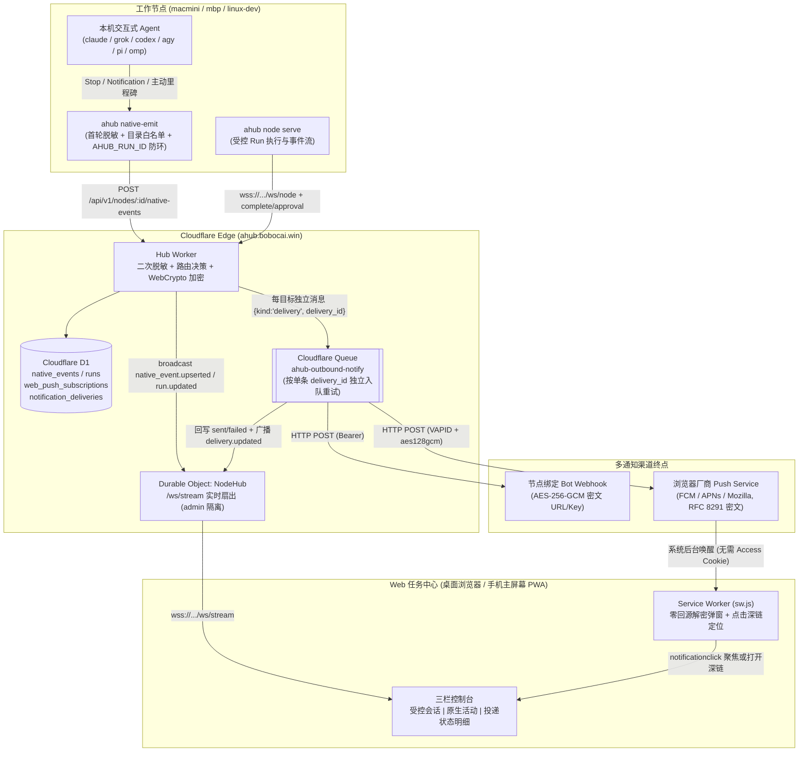

# 独立「原生活动记录」与浏览器通知渠道调研及架构方案报告

> **文档状态**：调研与方案设计稿（待评审确认后进入契约更新与编码切片）
> **适用范围**：`apps/hub-worker`（Cloudflare Workers / D1 / Durable Object `NodeHub` / Queues）、`apps/web`（`radix-nova` 三栏控制台 + Service Worker）、`cmd/ahub` 与 `internal/cli`（`ahub native-emit` / `ahub activity`）
> **基线版本**：`v0.1.6`（提交 `e573ce4`）

---

## 一页摘要（Executive Summary）

### 1. 目标与核心矛盾

用户在多台工作机（如 `macmini`、`mbp`、`linux-dev`）上同时存在两类 Agent 工作流：一类是由 `agent-hub` 云端派发并托管进程生命周期的「受控任务」（`Thread` / `Run`），另一类是开发者在节点本机终端或 IDE 直接启动的「原生交互会话」（`claude`、`grok`、`codex`、`agy`、`pi`、`omp`）。

对使用控制台的开发者而言，目标是把所有节点上的原生会话摘要、卡在人工确认处的互动请求以及每条通知的真实送达状态集中收拢到 Web 任务中心，并让桌面与手机浏览器本身成为独立的系统级通知渠道，摆脱对单一外部聊天机器人（如 Grok Bot Webhook）的强依赖。对维护后续代码的工程师而言，核心约束是不污染受控 `Run` 的状态机与 `(node_id, workdir)` 租约互斥锁，不向 `apps/hub-worker` 引入外部运行时 npm 依赖，也不放宽 `client` 凭证的最小权限隔离边界。

### 2. 现状一手取证结论

基于仓库 `v0.1.6` 源码核查，节点侧 `ahub native-emit` 采集链路与 D1 `native_events` 表已经落盘，但面向人的消费与多渠道投递存在五处结构性断点：

1. **有写无读（黑盒账本）**：控制面仅有节点写入接口 `POST /api/v1/nodes/:id/native-events`（`apps/hub-worker/src/index.ts:266-277`），不存在任何 `GET` 查询接口、已读确认接口或 CLI 查看子命令。
2. **无实时扇出（零推送帧）**：`createNativeEvent`（`apps/hub-worker/src/db.ts:1230-1320`）与队列消费端 `processNativeEventNotifyMessage`（`apps/hub-worker/src/notify-queue.ts:291-380`）均绕过 Durable Object `NodeHub`（`apps/hub-worker/src/node-hub.ts`），`/ws/stream` 不会收到任何原生事件或投递状态变更；同时核查发现，受控任务通知消费函数 `processRunNotifyMessage`（`apps/hub-worker/src/notify-queue.ts:243-288`）在异步更新 `runs.notify_status` 为 `sent` 或 `failed` 后同样未调用 `broadcastRun`，导致前端受控任务的通知状态长期滞留在 `queued` 直至手动刷新页面。
3. **通知渠道与 `client` API Key 强耦合**：当前「节点默认通知通道」被硬编码为 `nodes.default_notify_key_id REFERENCES api_keys(id)` 单一外键（`apps/hub-worker/migrations/0004_node_default_notify_and_native_events.sql:2`）。若节点未绑定外部 Bot Key，`createNativeEvent` 直接标记 `notify_status = 'skipped'`（`NODE_DEFAULT_CHANNEL_UNBOUND`，`apps/hub-worker/src/db.ts:1258-1260`），无法向浏览器渠道投递；若同时启用 Bot Webhook 与多台设备的浏览器通知，单标量字段 `notify_key_id` 与 `notify_status` 无法表达多目标独立成败。
4. **宿主 Hook 离散快照与「连续进度汇报」存在物理边界**：6 类本地 Agent 官方 Hook 仅在「等待人工交互」或「单轮回合结束」时触发短进程 `ahub native-emit`（`internal/cli/native_emit.go:314-772`），没有实时心跳、没有进程租约，也没有统一的「用户已在终端完成回答」回调事件。
5. **缺少数据留存回收**：1 分钟定时任务 `scheduled` 仅执行 `reapExpiredLeases`（`apps/hub-worker/src/index.ts:693-698`），未对高频累积的 `native_events` 执行过期清理。

### 3. 核心架构决策

本方案采用 `principle-redesign-from-first-principles`、`principle-model-the-domain`、`principle-boundary-discipline` 与 `principle-separate-before-serializing-shared-state` 四项设计原则，从根源重塑「原生活动域」与「多通道通知投递域」：

1. **双域物理隔离，会话级逻辑聚合**：保持 `native_events` 与受控 `threads` / `runs` 表物理分离，绝不占用 `workdir` 调度锁；前端与查询层按 `(node_id, agent, native_session_id)` 聚合展示「原生会话摘要时间线」，并增加可选的 `progress` 事件类型（`ahub native-emit --kind progress`），供长耗时本地自主任务主动上报阶段里程碑。
2. **互动请求状态自动消解（防幽灵红点）**：将 `interaction_needed` 的待处理态定义为可派生的注意力状态。当同一 `(node_id, agent, native_session_id)` 后续到达新的 `turn_summary`、`progress` 或新一轮 `interaction_needed` 时，自动将前序未确认互动收敛为已消解（`superseded`），同时支持控制台一键「标记已处理」（`ack_at`）与 `24 小时` 陈旧降级。
3. **引入独立投递账本 `notification_deliveries` 与每渠道隔离入队**：保留现有 `api_keys` 与 `nodes.default_notify_key_id` 契约不变，新增 `web_push_subscriptions` 表与 `notification_deliveries` 明细账本。单个事件扇出至「节点默认 Bot Webhook + N 个已订阅浏览器端」时，按 `(source, channel)` 拆分为独立的 Cloudflare Queue 消息：任一浏览器端点返回 `503` 重试时，绝不重复触发已成功的 Bot Webhook 或其他设备弹窗。
4. **基于标准 Web Push（RFC 8030 / RFC 8291 / RFC 8292）构建零外部依赖边缘推送渠道**：在 `apps/hub-worker/src/web-push.ts` 中完全基于 Workers 原生 WebCrypto（`crypto.subtle` 的 `ECDSA P-256`、`ECDH P-256`、`HKDF-SHA-256` 与 `AES-128-GCM`）实现 VAPID 签发与 `aes128gcm` 载荷加密，维持 `apps/hub-worker/package.json` 零运行时依赖。将脱敏摘要加密装入 Push 帧（`<= 3 KB`），使浏览器 `sw.js` 在标签页关闭甚至 Cloudflare Access `CF_Authorization` Cookie 过期期间仍能离线解密弹窗，并在云端真实记录 `queued -> sent / failed` 状态。
5. **三栏控制台原生融合**：左栏升级为「`受控会话` | `原生活动` | `节点`」三标签切换；选中「原生活动」时中栏切换为专用的 `NativeActivityPane`（高可读性渲染 Markdown 总结、突出展示待互动问题、提供一键复制本机终端续接命令与「携带上下文新建受控任务」，不提供伪造的终端直连输入框），右栏同步检视逐渠道投递明细与单通道失败重推。

---

## 1. 需求本质拆解与五大架构盲区审视

在进入表结构与接口细节前，需要先刺破需求表述背后隐藏的五个工程盲区，明确哪些能力由底层物理事实决定，哪些需要通过数据模型化解。

### 1.1 盲区一：「集中收集任务进度汇报」与本地宿主 Hook 离散事件模型的错位

#### 已证实事实（基于 `internal/cli/native_emit.go` 与本地 Hook 核查）

受控任务由 `ahub node serve` 直接作为父进程拉起（`docs/04-ahub-cli-and-node-daemon.md:142-150`），因此控制面拥有标准输出管道、`30s` 租约心跳、工具调用流（`run_events`）与确定的终态退出码。而本地原生 Agent 由开发者在各自终端模拟器或 IDE 窗口中直接启动，脱离 `ahub node serve` 管控，仅靠宿主官方 Hook 触发短生命周期命令 `ahub native-emit`：

| 本地 Agent | 宿主触发入口 | 实际上报时机（`native_emit.go` 行号） | 物理盲区与客观限制 |
| --- | --- | --- | --- |
| `claude` | `~/.claude/settings.json`（`Notification`、`Stop`） | `Notification`（排除 `idle_prompt`）映射 `interaction_needed`；`Stop` 提取 `last_assistant_message` 映射 `turn_summary`（`314-378`） | 无回合开始事件、无中间工具进度、用户在终端输入确认后**无「已解除等待」事件** |
| `grok` | `~/.grok/hooks/ahub-native-notify.json`（`Notification`、`Stop`） | 同上，兼容驼峰与下划线字段并提取 `promptId` / `transcriptPath` 行数构造幂等键（`392-471`） | 同 `claude`，且 `grok` 不属于受控 `runs.agent` 支持列表（`apps/hub-worker/migrations/0005_native_events_allow_grok.sql`） |
| `codex` | `~/.codex/config.toml`（`notify = [...]`） | 仅 `type == "agent-turn-complete"` 映射 `turn_summary`（`473-506`） | Codex TUI 弹出命令审批时官方不触发 `notify`，因此**无法捕获原生互动请求** |
| `agy` | `~/.gemini/config/hooks.json`（`Stop`） | 仅在 `Stop` 且 `fullyIdle != false`、非 `USER_CANCELED`、非 `exit_plan_mode` 交接时触发；末步含 `ask_question` 映射 `interaction_needed`，否则提取末条 `PLANNER_RESPONSE` 映射 `turn_summary`（`519-725`） | 非工具类内置权限弹窗不触发 `Stop`；规划到执行的内部切换已被正确过滤防误报 |
| `pi` / `omp` | `~/.pi` 与 `~/.omp` 自动扩展 `ahub-native-notify.ts` | `tool_approval_requested` / `ui_prompt_start` 映射 `interaction_needed`；`agent_settled` / `agent_end` 映射 `turn_summary`（`727-772`） | 具备进程内状态跟踪，但同样不向云端持续发送心跳或流式 `tool_use` |

#### 风险与重构定义

如果无视上述边界，会产生两个严重后果：

1. **若挂载 `PostToolUse` 强行采集「实时工具进度」**：开发者本机每次 `read_file` 或执行 Shell 都会拉起一次 `ahub native-emit` 进程并发起 HTTPS 请求写入 D1，单次编码会话即可产生数百次进程派生与 D1 写放大，拖慢宿主响应并淹没真正重要的总结。
2. **若将 `interaction_needed` 当作受控 `needs_approval` 持久挂起态**：当开发者回到 `macmini` 终端敲下回车放行后，宿主不会通知云端「已放行」；若控制台缺少自动消解机制，所有历史审批请求都会永远挂着琥珀色「待处理」告警，三天后徽标沦为无人信任的噪音。

**工程解法**：
- 将「任务进度汇报」精确收敛为**「回合总结（`turn_summary`）+ 阻塞互动请求（`interaction_needed`）+ 显式阶段里程碑（新增 `progress`）」**三类高信噪比事件，严禁接入 `PreToolUse` / `PostToolUse` 高频钩子。
- 新增 `--kind progress` 支持：当本地 Agent 运行长周期任务（如 `/goal`、多阶段迁移或长时间自治脚本）时，可在关键阶段主动调用一次 `ahub native-emit --agent <agent> --kind progress --session-id <sid> --dir "$PWD" --title "阶段 1/3 已验证" --summary -`，以极低开销实现真正的跨节点主动进度汇报。
- 对 `interaction_needed` 实施**「同会话后继事件自动覆盖 + 手动已读确认 + 24 小时超时陈旧化」**三层消解规则（详见 §2.3）。

---

### 1.2 盲区二：把「页内 `window.Notification`」误认为「独立通知渠道」

#### 三种浏览器通知路径对比

| 维度 | 方案 A：仅前端 WS + `new Notification()` | 方案 B：纯标准 Web Push（Service Worker + VAPID） | 方案 C（推荐）：Web Push 主通道 + 页内锁选主降级 |
| --- | --- | --- | --- |
| 关闭标签页 / 浏览器后台可达性 | **不可达**（关页即断 `/ws/stream`） | **可达**（系统级 Push 守护唤醒 `sw.js`） | **可达**（已订阅走 Web Push，未配置 VAPID 时可降级页内） |
| 移动端锁屏通知（iOS 16.4+ PWA / Android） | **不可达** | **可达**（主屏幕 Web App 经 APNs / FCM 推送） | **可达** |
| 云端能否记录真实 `notify_status` | **不能**（服务端不知浏览器是否弹窗） | **能**（Push Service 返回 `201` / `410` / `5xx`） | **能**（Web Push 写入 `notification_deliveries` 账本） |
| 多开标签页防重复弹窗 | 极易重复弹窗（3 个标签页响 3 次） | 浏览器按订阅端点单发 + `tag` 去重 | 启用 Web Push 时自动抑制页内弹窗；降级态用 `navigator.locks` 选主 |
| Cloudflare Access Cookie 过期影响 | Cookie 过期后重连 `/ws/stream` 失败即断流 | **不受影响**（RFC 8291 密文内嵌载荷，`sw.js` 零回源解密） | **不受影响** |

#### 必须跨越的三个浏览器与网关深水区

1. **Cloudflare Access 下 Service Worker 零回源铁律**：
   `agent-hub` 生产入口受 Cloudflare Access 保护（`apps/hub-worker/src/auth.ts:149-193`）。当 `CF_Authorization` 会话过期后，若后台唤醒的 `sw.js` 试图调用 `fetch('/api/v1/native-events/...')` 拉取通知正文，请求会被拦截返回 `401` 或 `302` 登录跳转，导致通知丢失或退化为空白提示。因此，控制面必须在入站脱敏后直接将结构化通知摘要（控制在 `<= 3072` 字节内）用 **RFC 8291（`aes128gcm`）** 端到端加密放进 Web Push 请求体，`sw.js` 在本地直接调用 `event.data.json()` 渲染系统通知，全程零回源 HTTP 请求。
2. **Apple WebKit / APNs 的三项硬门禁**：
   - **手势约束**：Safari（macOS 与 iOS）强制要求 `Notification.requestPermission()` 与 `registration.pushManager.subscribe()` 在用户直接点击事件（Transient User Activation）中同步发起，页面加载自动请求会被静默拒绝。
   - **可见通知强约束**：通过 `web.push.apple.com` 投递的每一条 Web Push，在 `sw.js` 的 `push` 事件内必须返回 `event.waitUntil(self.registration.showNotification(...))`；若因为「检测到前台标签页已打开」而在 `sw.js` 内跳过 `showNotification`，累计几次后 Safari 会直接吊销该站点的推送权限。因此去重必须通过反向抑制前端 WebSocket 弹窗 + 传入确定性 `NotificationOptions.tag` 由操作系统通知中心原地替换实现，绝不在 `sw.js` 内吞掉 Push。
   - **iOS 主屏幕 Manifest 凭据传递**：iOS Safari 仅允许「添加到主屏幕」的独立模式 Web App（`display: "standalone"`）使用 `PushManager`。在受 Cloudflare Access 保护的域名下，`apps/web/index.html` 引用清单时必须写明 `<link rel="manifest" href="/manifest.webmanifest" crossorigin="use-credentials">`（或在 Access 策略中将纯静态无敏感数据的 `/manifest.webmanifest`、`/sw.js`、`/icons/*` 与 `/dl/*` 一并设为 `Bypass`），否则匿名抓取清单会命中 `302` 登录页导致无法安装与订阅。
3. **SSRF 边界防护**：
   浏览器提交的 `PushSubscription.endpoint` 本质上是一个外部 URL，控制面队列消费者会向其发起 `POST`。即使订阅接口限 `admin` 调用，入库校验也必须实施**浏览器厂商 Push 域名白名单**（`fcm.googleapis.com`、`*.push.apple.com`、`*.push.services.mozilla.com`、`*.notify.windows.com`，本地集成测试仅在显式注入测试开关时放行 `127.0.0.1` / `localhost`），杜绝将 Worker 当作任意内网/公网 POST 跳板。

---

### 1.3 盲区三：单槽 `default_notify_key_id` 与单标量 `notify_status` 无法承载多渠道扇出

当前 `nodes.default_notify_key_id` 只能指向一枚 `client` Scope 的 API Key，且 `native_events.notify_status` 只有一个字符串列（`none | queued | sent | failed | skipped`）。一旦把浏览器通知纳入正式渠道，单列模型立即面临两个冲突：

1. **无 Bot 场景被误判跳过**：用户没有配置 Grok Bot，只开启了 MacBook 与 iPhone 的浏览器通知，此时 `nodes.default_notify_key_id` 为 `NULL`，现有 `createNativeEvent`（`db.ts:1258-1260`）会直接写入 `skipped` 而不触发队列。
2. **部分成功与重试放大**：当同一事件需投递给「Grok Bot + MacBook 浏览器 + iPhone PWA」三个目标时，若共用同一条队列消息，只要其中一个端点返回 `502` 触发 `message.retry()`（最多重试 5 次），其余两个已成功的目标就会收到最多 5 次重复轰炸！

**工程解法（`principle-separate-before-serializing-shared-state`）**：
- 将「通知渠道目标解析」与「单目标投递状态」拆入独立表 `notification_deliveries`（一行代表「某事件向某一具体渠道目标的一次投递生命周期」）。
- 入队阶段在 D1 批量写入 N 条 `status = 'queued'` 的 `notification_deliveries` 记录，并向 `NOTIFY_QUEUE` 发送 N 条独立的 `{ kind: "delivery", delivery_id }` 消息（单条 `< 256 B`）。每个渠道独立重试、独立落盘 HTTP 状态码与错误原因，外层 `native_events.notify_status` 与 `runs.notify_status` 由明细表确定性汇总得出。

---

### 1.4 盲区四：`client` 凭证越权访问个人交互式会话隐私

`client` API Key 分发给云端容器中的外部 Bot 或节点子任务（`delegation_token`）使用。在现有安全架构中，`client` Key 只能读取自己创建的 `Run`（`created_by_key_id == principal.keyId`，`apps/hub-worker/src/auth.ts:325`），并且 `GET /api/v1/nodes` 对 `client` Key 显式剥离了 `default_notify_*` 字段（`db.ts:289-299`）。

原生事件记录的是人类开发者在本机终端的所有对话总结与提问，不属于任何 `client` Key 创建的资产。因此：
- 新增的 `GET /api/v1/native-events`、`POST /api/v1/native-events/:id/ack`、`POST /api/v1/native-events/:id/redeliver`、`/ws/stream` 中的原生事件帧以及全部 `/api/v1/push-subscriptions` 接口，**必须严格限制为 `admin` Scope（即通过 Cloudflare Access 登录的人类用户或 `ahub_adm_*` 密钥）**。
- `client` Scope 凭证仅在被管理员显式绑定为某节点的 `default_notify_key_id` 时，被动接收发往其加密 Webhook 的脱敏推送，绝不可主动拉取原生活动列表或注册浏览器推送。

---

### 1.5 盲区五：受控任务与原生活动混排引发的「伪交互错觉」

部分方案容易把 `native_events` 强塞进现有的 `threads` / `runs` 表，或在左栏与受控会话混排并复用底部的「多机任务派发台（Composer）」。这会违背两类对象的基本物理规律：

| 对比维度 | 受控任务（`Thread` + `Run`） | 原生活动记录（`NativeActivity`） |
| --- | --- | --- |
| 发起入口与进程归属 | 云端入队，`ahub node serve` 派生无头子进程并持独立进程组 `-pgid` | 开发者在本机终端/IDE 手动交互运行，由宿主 Hook 旁路上报 |
| 目录并发互斥锁 | **持有** `(node_id, workdir)` 云端与本地双层互斥锁 | **不持有锁**（纯只读旁路观察账本，绝不阻塞调度器） |
| 支持的 Agent 集合 | `agy \| pi \| omp \| codex \| claude` | `agy \| pi \| omp \| codex \| claude \| grok`（`grok` 无无头受控适配器） |
| 生命周期状态机 | `queued -> claimed -> running / needs_approval -> done / failed / cancelled` | 离散事实流：`interaction_needed` / `progress` / `turn_summary` |
| 租约与取消能力 | `90s` 租约续期，支持云端 `POST /runs/:id/cancel` 强杀进程组 | 无租约，**不支持**从云端向本机交互式 TTY 注入 `SIGTERM` 或键入字符 |
| 用户收到互动请求后的真实操作 | 点击 `remote_control_url` 远控审批，并点「标记已放行」释放目录锁 | 回到对应机器终端/IDE 回答，或在控制台「标记已处理 / 复制终端续接命令 / 携带摘要另起受控会话」 |

因此，UI 必须在左栏导航与中栏主视图上将「`受控会话`」与「`原生活动`」明确分区：选中原生活动时隐藏底部的「直接续聊输入框」，改为渲染诚实反映物理边界的快捷接管栏（复制本机续接命令、标记已读、或一键将节点+目录+摘要预填至新建受控会话派发台）。

---

## 2. 目标系统架构与数据模型设计

### 2.1 全局数据流与通知扇出拓扑



### 2.2 D1 数据库迁移设计（`migrations/0006_native_activity_and_web_push.sql`）

以下 DDL 在完全保留 `0001`–`0005` 既有字段兼容性的前提下完成演进：

```sql
PRAGMA foreign_keys = ON;

-- 1. 重建 native_events：扩展 event_kind 支持 'progress'，新增人工确认时间 ack_at 与多通道聚合状态 'partial'
CREATE TABLE native_events_v2 (
  id TEXT PRIMARY KEY,                              -- evt_<ulid>
  node_id TEXT NOT NULL REFERENCES nodes(id) ON DELETE CASCADE,
  event_id TEXT NOT NULL,                           -- (node_id, event_id) 幂等键
  agent TEXT NOT NULL CHECK (agent IN ('agy', 'pi', 'omp', 'codex', 'claude', 'grok')),
  event_kind TEXT NOT NULL CHECK (event_kind IN ('interaction_needed', 'turn_summary', 'progress')),
  native_session_id TEXT NOT NULL DEFAULT '',
  workdir TEXT NOT NULL DEFAULT '',
  title TEXT NOT NULL DEFAULT '',
  summary TEXT NOT NULL DEFAULT '',
  source TEXT NOT NULL DEFAULT '',
  notify_key_id TEXT REFERENCES api_keys(id) ON DELETE SET NULL,
  notify_status TEXT NOT NULL DEFAULT 'none'
    CHECK (notify_status IN ('none', 'queued', 'sent', 'partial', 'failed', 'skipped')),
  notify_error TEXT NOT NULL DEFAULT '',
  ack_at TEXT,                                      -- 人工在控制台点击「标记已处理」的 RFC 3339 UTC 时间
  created_at TEXT NOT NULL,
  updated_at TEXT NOT NULL,
  UNIQUE (node_id, event_id)
);

INSERT INTO native_events_v2 (
  id, node_id, event_id, agent, event_kind, native_session_id, workdir,
  title, summary, source, notify_key_id, notify_status, notify_error,
  ack_at, created_at, updated_at
)
SELECT
  id, node_id, event_id, agent, event_kind, native_session_id, workdir,
  title, summary, source, notify_key_id, notify_status, notify_error,
  NULL, created_at, updated_at
FROM native_events;

DROP TABLE native_events;
ALTER TABLE native_events_v2 RENAME TO native_events;

CREATE INDEX IF NOT EXISTS idx_native_events_created
  ON native_events (created_at DESC, id DESC);

CREATE INDEX IF NOT EXISTS idx_native_events_node_created
  ON native_events (node_id, created_at DESC, id DESC);

CREATE INDEX IF NOT EXISTS idx_native_events_session
  ON native_events (node_id, agent, native_session_id, created_at DESC)
  WHERE native_session_id != '';

-- 2. 浏览器 Web Push 订阅注册表（仅限 admin 作用域管理，端点与 ECDH 密钥经 AES-256-GCM 密文落库）
CREATE TABLE IF NOT EXISTS web_push_subscriptions (
  id TEXT PRIMARY KEY,                              -- wps_<ulid>
  label TEXT NOT NULL,                              -- 设备显示名，如 "MacBook Chrome" / "iPhone PWA"
  endpoint_sha256 TEXT NOT NULL UNIQUE,             -- 64 位小写十六进制 SHA-256，用于同浏览器幂等续订去重
  endpoint_host TEXT NOT NULL,                      -- 脱敏展示主机名，如 web.push.apple.com / fcm.googleapis.com
  subscription_ciphertext TEXT NOT NULL,            -- AES-256-GCM 加密的 {endpoint, keys:{p256dh, auth}}
  node_filter_json TEXT NOT NULL DEFAULT '[]',      -- 空数组表示接收全部节点；非空如 ["macmini","mbp"]
  event_filter_json TEXT NOT NULL DEFAULT '["run_needs_approval","run_failed","native_interaction_needed"]',
  enabled INTEGER NOT NULL DEFAULT 1 CHECK (enabled IN (0, 1)),
  failure_count INTEGER NOT NULL DEFAULT 0 CHECK (failure_count >= 0),
  last_sent_at TEXT,
  last_error_code TEXT NOT NULL DEFAULT '',
  last_error_message TEXT NOT NULL DEFAULT '',
  revoked_at TEXT,                                  -- 收到 404/410 Gone 或用户主动解绑时写入
  created_at TEXT NOT NULL,
  updated_at TEXT NOT NULL
);

CREATE INDEX IF NOT EXISTS idx_web_push_active
  ON web_push_subscriptions (enabled)
  WHERE revoked_at IS NULL AND enabled = 1;

-- 3. 统一多渠道通知投递明细账本（覆盖受控 Run 与原生活动 NativeEvent）
CREATE TABLE IF NOT EXISTS notification_deliveries (
  id TEXT PRIMARY KEY,                              -- dlv_<ulid>
  source_kind TEXT NOT NULL CHECK (source_kind IN ('run', 'native_event')),
  source_id TEXT NOT NULL,                          -- run_<ulid> 或 evt_<ulid>
  trigger_event TEXT NOT NULL,                      -- needs_approval / done / failed / cancelled / interaction_needed / turn_summary / progress
  node_id TEXT NOT NULL,
  channel_kind TEXT NOT NULL CHECK (channel_kind IN ('bot_webhook', 'web_push', 'legacy_webhook')),
  channel_id TEXT NOT NULL,                         -- key_<ulid> / wps_<ulid> / 'global_legacy'
  channel_label TEXT NOT NULL,                      -- 脱敏渠道名，如 "grok-bot-macmini" / "MacBook Safari"
  target_host TEXT NOT NULL,                        -- 脱敏主机名，如 hooks.x.ai / web.push.apple.com
  route_mode TEXT NOT NULL DEFAULT 'node_default'
    CHECK (route_mode IN ('key', 'node_default', 'web_push', 'global_legacy')),
  status TEXT NOT NULL DEFAULT 'queued'
    CHECK (status IN ('queued', 'sent', 'failed', 'skipped')),
  attempts INTEGER NOT NULL DEFAULT 0 CHECK (attempts >= 0),
  http_status INTEGER,
  error_code TEXT NOT NULL DEFAULT '',
  error_message TEXT NOT NULL DEFAULT '',
  sent_at TEXT,
  created_at TEXT NOT NULL,
  updated_at TEXT NOT NULL,
  UNIQUE (source_kind, source_id, trigger_event, channel_kind, channel_id)
);

CREATE INDEX IF NOT EXISTS idx_deliveries_source
  ON notification_deliveries (source_kind, source_id, created_at ASC);

CREATE INDEX IF NOT EXISTS idx_deliveries_status_updated
  ON notification_deliveries (status, updated_at DESC)
  WHERE status IN ('queued', 'failed');
```

### 2.3 核心领域状态推导规则

#### 规则一：互动请求注意力状态（`attention_state`）确定性推导

服务端查询与前端 Store 共享同一纯函数推导每条 `event_kind == 'interaction_needed'` 记录的展示态，不依赖额外后台扫描器：

1. **`acked`（已人工确认）**：`ack_at IS NOT NULL`。
2. **`superseded`（同会话已推进）**：当 `native_session_id != ''` 时，同一 `(node_id, agent, native_session_id)` 下存在 `created_at > current.created_at` 的任意后续记录（表明开发者已在本地回答问题并完成了后续回合或进入了下一步提问）。
3. **`stale`（超时陈旧）**：未满足前两条，但距离 `created_at` 已超过 `24 小时`（本地终端大概率已被关闭或中断，不再计入顶栏紧急红点，卡片降级为灰色历史记录）。
4. **`open`（待人工响应）**：未满足以上任一条件，计入顶栏与左栏「待互动」实时徽标计数。

#### 规则二：多渠道投递状态聚合（`computeAggregateNotifyStatus`）

每当任一 `notification_deliveries` 行状态更新时，通过单条 SQL 子查询回写所属 `native_events`（或 `runs`）的汇总状态：

- 无任何目标通道命中过滤规则：`skipped`（`native_events`）或 `none`（未请求通知的 `runs`）。
- 任意一条明细仍为 `queued`：`queued`（进行中优先展示）。
- 全部明细均为 `sent`：`sent`。
- 全部明细均为 `failed`：`failed`（`notify_error` 填入首条错误码）。
- 同时存在 `sent` 与 `failed`：`native_events.notify_status` 置为 `partial`（对于 `runs.notify_status`，为严格兼容现有外部 CLI 与 Schema 枚举 `none | queued | sent | failed`，若至少一个主通道 `sent` 则保持 `sent`，同时在扩展字段 `deliveries_summary: { total, sent, queued, failed }` 中精确暴露部分失败计数，避免破坏既有调用端解析）。

#### 规则三：浏览器通知与 `client` 隔离路由矩阵

为严防跨作用域干扰，浏览器通知订阅仅订阅「归属管理员全局视角」的事件，具体路由边界如下：

| 事件来源 | Bot Webhook 路由规则（保持 v0.1.6 不变） | 浏览器 Web Push 路由规则（新增） |
| --- | --- | --- |
| 原生活动（`native_events`） | 按 `nodes.default_notify_key_id` Fail-Closed 投递；未绑定则仅跳过 Bot 通道，**不再阻断浏览器通道** | 匹配所有 `enabled = 1 AND revoked_at IS NULL`、节点过滤包含该 `node_id`、且事件过滤包含 `native_<event_kind>` 的浏览器订阅 |
| 人工或 `admin` 发起的受控根任务（`depth == 0`） | 按 `--notify` 或 `nodes.default_notify_key_id` 路由 | 匹配节点过滤与 `run_<status>`（如 `run_needs_approval`、`run_failed`、`run_done`）的浏览器订阅 |
| 外部 `client` Bot 发起的受控任务（如 Grok Bot 派单） | 严格锁定发起方 `client` Key 自身 Webhook（未传 `--notify` 则不发 Bot 回调） | 默认匹配 `run_needs_approval` 与 `run_failed`（让人类管理员在手机/桌面及时感知 Bot 派单卡在人工审批或报错）；子派单 `depth >= 1` 默认静默防风暴 |

---

## 3. 零外部依赖 Web Push 边缘引擎设计（RFC 8030 / 8291 / 8292）

### 3.1 为什么采用原生 `crypto.subtle` 自研轻量模块而非引入 npm 库

`apps/hub-worker/package.json` 目前保持 **0 个 `dependencies`**，构建快、冷启动轻、无供应链漂移风险；而社区常见的 `web-push` 包强耦合 Node.js `Buffer`、`crypto` 与 `https` 模块，且体积庞大。Cloudflare Workers 运行时原生提供完整的 W3C Web Cryptography API（`crypto.subtle`），仅需约 `180 行` 纯 TypeScript（`apps/hub-worker/src/web-push.ts`）即可完整实现 RFC 8292（VAPID）与 RFC 8291（`aes128gcm`）标准协议，且便于使用确定性测试向量执行端到端加解密往返单测。

### 3.2 算法与二进制帧封装规格

1. **VAPID 密钥配置与签发（RFC 8292）**：
   - Worker 环境变量新增：`VAPID_PUBLIC_KEY`（65 字节非压缩 P-256 公钥点的 Base64URL 编码，可写入 `wrangler.jsonc` `vars` 或 Secret）、`VAPID_SUBJECT`（如 `mailto:admin@bobocai.win` 或 `https://ahub.bobocai.win`），以及加密 Secret `VAPID_PRIVATE_JWK`（含 `kty:"EC", crv:"P-256", x, y, d` 的紧凑 JSON）。未配置 VAPID 时，`GET /api/v1/push/config` 返回 `{ enabled: false, reason: "VAPID_NOT_CONFIGURED" }`，前端优雅降级为「仅标签页打开期间提醒」。
   - 对目标 `endpoint` 取 `new URL(endpoint).origin` 作为 `aud`（例如 `https://web.push.apple.com` 或 `https://fcm.googleapis.com`），设置 `exp = Math.floor(Date.now() / 1000) + 12 * 3600`（12 小时有效期，满足 RFC 8292 `<= 24h` 要求）。
   - 使用 `crypto.subtle.sign({ name: "ECDSA", hash: "SHA-256" }, vapidPrivateKey, signingInput)` 直接产出 JWS `ES256` 所需的 64 字节 `r || s` IEEE P1363 原始签名，拼装请求头：`Authorization: vapid t=<jwt>, k=<VAPID_PUBLIC_KEY>`。
2. **消息体端到端加密（RFC 8291 + RFC 8188 `aes128gcm`）**：
   - 每次投递调用 `crypto.subtle.generateKey({ name: "ECDH", namedCurve: "P-256" }, true, ["deriveBits"])` 生成服务端临时密钥对 `(as_private, as_public_raw_65b)`，并生成 16 字节随机 `salt`。
   - 导入浏览器订阅公钥 `ua_public`（Base64URL 解码 `keys.p256dh`，严格校验长度 `65` 且首字节为 `0x04`）与 `auth_secret`（Base64URL 解码 `keys.auth`，严格校验长度 `16`），计算 32 字节 ECDH 共享密钥。
   - 第一步 HKDF-SHA-256（以 `auth_secret` 为 salt，`ecdh_secret` 为 IKM，`info = "WebPush: info\0" || ua_public(65B) || as_public(65B)`）派生 32 字节 `IKM`。
   - 第二步 HKDF-SHA-256（以随机 `salt(16B)` 为 salt，`IKM` 为输入）：
     - `info = "Content-Encoding: aes128gcm\0"` 派生 16 字节 `CEK`（AES-128-GCM 密钥）；
     - `info = "Content-Encoding: nonce\0"` 派生 12 字节 `Nonce`。
   - 明文 JSON UTF-8 编码后在末尾追加单字节记录分隔符 `0x02`（最终记录标记），经 `crypto.subtle.encrypt({ name: "AES-GCM", iv: Nonce }, CEK, paddedPlaintext)` 得到 `ciphertext_with_tag`。
   - 拼装 86 字节固定二进制头部与密文：
     ```text
     salt (16B) || rs = 0x00001000 (4B Big-Endian, 4096) || idlen = 65 (1B) || as_public (65B) || ciphertext_with_tag
     ```
   - 发送 HTTP `POST` 至 `endpoint`，固定携带头部：
     - `Content-Type: application/octet-stream`
     - `Content-Encoding: aes128gcm`
     - `TTL: 86400`（Apple APNs 强制正整数）
     - `Urgency: high`（针对 `interaction_needed`、`needs_approval`、`failed`）或 `Urgency: normal`（针对 `turn_summary`、`progress`、`done`）

### 3.3 Push 载荷结构与状态码处置矩阵

加密前的 JSON 载荷严格限制总长 `<= 3072` UTF-8 字节（超出自动裁剪 `body`），确保加上 86 字节头与 16 字节 GCM Tag 后恒小于各大 Push 网关 `4096` 字节硬上限：

```json
{
  "v": 1,
  "kind": "native_event",
  "id": "evt_01J...",
  "tag": "ahub-native-evt_01J...",
  "urgent": true,
  "title": "[macmini · claude] 需要人工确认",
  "body": "~/workspace/demo: 是否允许执行数据库迁移脚本？",
  "target_url": "/?pane=native&session=macmini:claude:sess_1&event=evt_01J...",
  "ts": "2026-11-18T05:30:00.000Z"
}
```

Push 网关响应处置规则：

| 下游 HTTP 状态码 | 投递账本 `status` | 订阅表 `web_push_subscriptions` 副作用 | 队列重试策略 |
| --- | --- | --- | --- |
| `200` / `201` / `202` | `sent` | 更新 `last_sent_at = now`，清零 `failure_count` 与错误字段 | `message.ack()` |
| `404` / `410` | `failed`（`SUBSCRIPTION_EXPIRED`） | 立即写入 `revoked_at = now, enabled = 0`，自动清理失效浏览器订阅 | **不重试**，直接 `message.ack()` |
| `400` / `401` / `403` / `413` | `failed`（`PUSH_REJECTED_<status>`） | 递增 `failure_count`，记录响应原因供控制台诊断 | 确定性客户端/签名错误，**不重试**，直接 `message.ack()` |
| `429` / `5xx` / 网络超时 | 重试未尽保 `queued`，耗尽置 `failed` | 耗尽 5 次后递增 `failure_count` 并记录 `PUSH_UPSTREAM_TIMEOUT` | 指数退避重试（`2s -> 4s -> 8s -> 16s -> 30s`，最多 5 次） |

---

## 4. API、WebSocket、CLI 与 Web 控制台交互规格

### 4.1 控制面 REST 接口扩展清单

所有新增接口均强制 `requireScope(principal, ["admin"])`，`client` 与 `node` 凭证调用一律返回 `403 FORBIDDEN_SCOPE`：

| 方法与路径 | 功能说明 | 关键请求参数与响应结构 |
| --- | --- | --- |
| `GET /api/v1/native-events` | 分页查询原生活动记录及每条记录关联的投递状态摘要 | 查询参数：`?node_id=&agent=&event_kind=&notify_status=&unacked_only=false&q=&limit=50&before_ts=&before_id=`；返回 `{ ok: true, events: NativeEventView[], open_interaction_count: number, next_cursor }` |
| `GET /api/v1/native-events/:id` | 获取单条原生活动详情及其完整 `deliveries[]` 账本 | 返回 `{ ok: true, event: NativeEventView, deliveries: NotificationDeliveryRecord[] }` |
| `GET /api/v1/runs/:id/deliveries` | 获取指定受控 `Run` 的各渠道通知投递账本明细 | 返回 `{ ok: true, deliveries: NotificationDeliveryRecord[] }` |
| `POST /api/v1/native-events/:id/ack` | 人工将指定 `interaction_needed`（或同会话未读互动）标记为已处理 | 可选 `{ scope?: "single" \| "session" }`；幂等更新 `ack_at` 并向 `/ws/stream` 广播 `native_event.upserted` |
| `POST /api/v1/native-events/:id/redeliver` | 对该事件下状态为 `failed`（或指定 `delivery_id`）的通道重新入队投递 | 可选 `{ delivery_id?: string }`；重置目标明细为 `queued`、重发队列并广播更新 |
| `GET /api/v1/push/config` | 查询服务端 Web Push VAPID 就绪态与公钥 | 返回 `{ ok: true, enabled: boolean, vapid_public_key: string \| null }` |
| `GET /api/v1/push-subscriptions` | 列出所有已注册浏览器通知渠道（仅含脱敏 `endpoint_host` 与 `endpoint_sha256` 前缀，绝不回传密文或完整 Endpoint URL） | 返回 `{ ok: true, subscriptions: WebPushSubscriptionRecord[] }` |
| `POST /api/v1/push-subscriptions` | 注册或幂等刷新当前浏览器的 Web Push 订阅（按 `endpoint_sha256` Upsert） | 请求 `{ label, subscription: { endpoint, keys: { p256dh, auth } }, node_filter?: string[], event_filter?: string[] }`；返回 `{ ok: true, subscription }` |
| `PATCH /api/v1/push-subscriptions/:id` | 修改设备备注名、启停开关、节点过滤或事件过滤 | 请求 `{ label?, enabled?, node_filter?, event_filter? }` |
| `DELETE /api/v1/push-subscriptions/:id` | 解绑并吊销指定浏览器推送订阅 | 写入 `revoked_at` 并返回 `{ ok: true }` |
| `POST /api/v1/push-subscriptions/:id/test` | 立即向该浏览器订阅发送一条端到端测试通知并同步返回 Push 网关结果 | 用于用户在设置弹窗一键验证系统通知权限与链路连通性 |

### 4.2 `/ws/stream` 实时帧扩展与既有缺陷修复

在 `apps/hub-worker/src/node-hub.ts` 中，仅面向 `att.scope === "admin" && !att.runId` 的全局控制台订阅连接扩展三项实时帧（单任务 `ahub wait` 订阅与 `client` 连接完全隔离，零额外带宽消耗）：

1. **`snapshot` 帧扩展字段**：初始建连并发查询补充最近 `100` 条 `native_events`（含派生 `attention_state` 与 `deliveries_summary`）以及全局 `open_interaction_count`。
2. **`native_event.upserted` 帧**：在 `POST /api/v1/nodes/:id/native-events` 新建事件、`POST .../ack` 标记已读、或队列更新聚合 `notify_status` 时即时推送 `{ type: "native_event.upserted", event, open_interaction_count }`。
3. **`delivery.updated` 帧与 `run.updated` 补播**：队列消费端 `notify-queue.ts` 在更新任意 `notification_deliveries` 行及外层 `runs.notify_status` / `native_events.notify_status` 后，统一调用 `NodeHub` 内部广播接口下发 `{ type: "delivery.updated", delivery }` 及最新的 `run.updated` / `native_event.upserted`，顺手根治现有受控任务通知状态卡在 `queued` 不刷新的缺陷。

### 4.3 Go CLI 增量设计（`cmd/ahub` & `internal/cli`）

1. **`ahub native-emit` 扩展 `--kind progress`**：
   - `internal/cli/native_emit.go` 校验放开 `kindFlag` 为 `interaction_needed | turn_summary | progress`（同步更新 `apps/hub-worker/src/validation.ts` 中的 `parseNativeEventCreateRequest`）。
   - 保持现有全部安全门禁不变：`AHUB_RUN_ID` / `AHUB_DEPTH` 非空静默跳过、仅读 `node.json` 节点凭据、`allowed_roots -> project_roots` 目录白名单校验与本地预脱敏。
2. **新增只读巡检子命令 `ahub activity`（`admin` Scope）**：
   - 用法：`ahub activity [--node <node_id>] [--agent <agent>] [--kind <interaction_needed|turn_summary|progress>] [--unacked] [--limit 20] [--json]`。
   - 遵循 `AGENTS.md` 第 2 节硬性规范：`--json` 时 `stdout` 仅输出单个合法 JSON 对象。

### 4.4 Web 任务中心（`radix-nova`）三栏视图与交互设计

遵守 `docs/05-web-frontend-spec.md` 与 `evals/web/lint-hygiene.mjs` 全部门禁：零新增第三方 UI/状态库（新增独立 Store `apps/web/src/stores/native-activity-store.ts` 与推送协调器 `apps/web/src/lib/browser-notify.ts`，所有 `/api/` 请求统一封装在 `apps/web/src/lib/api-client.ts` 内，零 `transition-all`，零卡片嵌套卡片，动态数字一律 `tabular-nums`）。

桌面端切换至「原生活动」视角时的三栏布局如下：

```text
┌───────────────────────────────────────────────────────────────────────────────────────┐
│ agent-hub | 实时已连接 | 在线 3/3 | 运行 1 排队 0 审批 0 | 互动 2 | [通知渠道: 已开启] │
├──────────────────────┬───────────────────────────────────────────┬────────────────────┤
│ 左栏: 导航与会话列表 │ 中栏: 原生活动详情流 (NativeActivityPane) │ 右栏: 投递与检视   │
│                      │                                           │                    │
│ [受控会话|原生活动•2|节点] │ macmini / ~/workspace/demo · claude │ [投递明细|队列|控制]│
│                      │ 会话 sess_9f8e · 最近活跃 13:24:10        │                    │
│ [搜索目录 / 标题...] │ [复制本机续接命令] [携带摘要新建受控任务] │ 当前事件 evt_01M7..│
│ [全部][待互动 2][异常]│ ----------------------------------------- │ 汇总状态: 已送达   │
│                      │ [琥珀色高亮条: 等待人工确认 · 待处理]     │                    │
│ ● macmini / demo     │  标题: Claude 需要确认                    │ 1. grok-bot-macmini│
│   claude · 待互动    │  内容: 是否允许执行 migrations/0006.sql？ │    hooks.x.ai      │
│   13:24 · 送达 2/2   │  [标记已处理]                             │    200 OK · 已送达 │
│                      │ ----------------------------------------- │                    │
│ ○ mbp / frontend     │ [阶段里程碑 · 13:20:05 · 送达 2/2]        │ 2. MacBook Safari  │
│   agy · 回合总结     │  已完成单元测试回归 (18/18 通过)          │    push.apple.com  │
│   13:18 · 送达 2/2   │ ----------------------------------------- │    201 · 已送达    │
│                      │ [回合总结 · 13:12:40 · 部分失败 1/2]      │                    │
│ ○ linux-dev / api    │  (Markdown 渲染正文，>60 行默认折叠高度， │ 3. iPhone PWA      │
│   codex · 回合总结   │   支持一键展开全文与复制)                 │    410 已失效      │
│   12:55 · 未绑跳过   │ ----------------------------------------- │    [重推失败通道]  │
│                      │ 只读提示: 原生会话运行在节点本机终端中。  │                    │
└──────────────────────┴───────────────────────────────────────────┴────────────────────┘
```

关键交互细节：

1. **左栏双粒度浏览与状态徽标**：
   - `FleetThreadsPane` 顶部标签栏扩展为 `受控会话`、`原生活动`（存在 `open` 态互动请求时显示琥珀色 `tabular-nums` 计数徽标）与 `节点`。
   - `原生活动` 标签页默认按 `(node_id, agent, native_session_id || workdir)` 聚合成「原生会话条目」（避免同一长对话刷屏），同时提供一键切换「按时间平铺流」开关，以及 `全部` / `待互动` / `投递失败` / `仅当前节点` 筛选胶囊。
2. **中栏 `NativeActivityPane`（杜绝伪输入框）**：
   - 按时间顺序展示所属原生会话下的 `turn_summary`、`progress` 与 `interaction_needed` 条目，正文复用 `.ahub-markdown` 与超长折叠（`> 4000` 字符或 `> 60` 行默认折叠）。
   - 对于 `attention_state === "open"` 的 `interaction_needed` 条目，渲染琥珀色左边框提示区与「标记已处理」按钮。
   - 顶部工具条根据 `agent` 自动生成精确的本机终端续接命令供一键复制（例如 `claude` 生成 `cd ~/workspace/demo && claude --resume <sid>`，`agy` 生成 `cd ~/workspace/demo && agy --conversation <sid>`，`codex` 生成 `cd ~/workspace/demo && codex resume <sid>`，`pi` 生成 `cd ~/workspace/demo && pi --session <sid>`），并提供「携带摘要新建受控任务」按钮（对于 `agent !== 'grok'` 自动切回受控派发台预填节点、目录、Agent 与前序摘要；对于 `grok` 自动回退该节点首个可用受控 Agent 并明确提示原因）。
3. **顶栏「通知渠道」抽屉/弹窗（`BrowserNotifyDialog`）**：
   - 显示当前浏览器的三态健康度：`Web Push 已激活（离线可达）`、`仅页内提醒（未配置 VAPID 或 iOS 未添加主屏幕）`、`浏览器权限已拒绝（附恢复指引）`。
   - 点击「开启本设备浏览器通知」按钮时，在同一次点击手势内依次执行 `Notification.requestPermission()` -> 注册 `/sw.js` -> `pushManager.subscribe()` -> `POST /api/v1/push-subscriptions`，支持勾选本设备关心的节点范围与事件级别（默认勾选「需人工确认 / 审批 / 失败」高优事件，可按需勾选「回合总结 / 任务完成」），并提供「发送测试通知」按钮实时回显网关状态码。
   - 同时列出账号下所有已注册设备（如台式机 Chrome、笔记本 Safari、手机 PWA），支持随时暂停、重命名或吊销旧设备。

---

## 5. 分阶段实施路线、验证门禁与待决策事项

### 5.1 四个可独立验证的实施切片（Slices）

遵循仓库 `AGENTS.md` 契约先行与小步可验证原则，建议拆分为 4 个顺序切片落地：

| 切片 | 范围与涉及文件 | 验收命令与完成判据 |
| --- | --- | --- |
| **Slice 0：契约与 Schema 同步** | 更新 `docs/01`–`05`、新增 `docs/schemas/native-event.schema.json`、扩展 `docs/schemas/ws-frames.schema.json` | Schema 自校验通过，文档与字段命名 100% 对齐 |
| **Slice 1：多通道投递账本与零依赖 Web Push 底座** | 新增 `migrations/0006_*.sql`、`apps/hub-worker/src/web-push.ts` + `web-push.test.mjs`，改造 `db.ts` 与 `notify-queue.ts` 接入 `notification_deliveries` 并补齐 `run.updated` 实时广播 | RFC 8291 加解密往返单测、VAPID 验签单测、单通道失败重试不放大变异测试、`make test-unit` 全绿 |
| **Slice 2：原生活动读接口、实时流与 CLI 扩展** | `apps/hub-worker/src/index.ts`、`node-hub.ts`、`validation.ts` 新增 `native-events` 与 `push-subscriptions` 路由及 `admin` 门禁；`internal/cli` 新增 `--kind progress` 与 `ahub activity` | `client` 越权访问 `403` 单测、`interaction_needed` 同会话自动消解单测、Cron 留存清理单测、`make eval-fast` 全绿 |
| **Slice 3：Web 三栏「原生活动」视图与 `sw.js` 集成** | 新增 `apps/web/public/sw.js`、`manifest.webmanifest`、`native-activity-store.ts`、`browser-notify.ts`、`NativeActivityPane.tsx`、`BrowserNotifyDialog.tsx`；扩展 `FleetThreadsPane.tsx`、`InspectorPane.tsx` 与 `evals/web/cdp-runtime-eval.mjs` | 通过变异门禁、`make eval-ui`（含无头 Chromium CDP 验证实时流、已读消解、多标签页防重、`390x844` 零横向溢出）与真实浏览器渲染核查 |

### 5.2 变异门禁（Mutation Gate）设计

按 `docs/07-eval-framework.md` §5.1 要求，新增评测断言合入前必须在以下基准变异体上实测标红：

1. **多通道重试隔离变异体**：临时将 `notify-queue.ts` 退化为在单条队列消息中串行投递 Bot Webhook 与 Web Push，当模拟第二个通道返回 `503` 重试时，断言第一个通道收到 `> 1` 次请求的检测器必须立即报错失败。
2. **`client` 作用域泄漏变异体**：临时在 `GET /api/v1/native-events` 或 `/ws/stream` 的 `native_event.upserted` 广播中放行 `scope === "client"`，权限隔离单测必须立即拦截失败。
3. **互动状态幽灵残留变异体**：移除同 `(node_id, agent, native_session_id)` 后继 `turn_summary` 对前序 `interaction_needed` 的 `superseded` 推导条件，CDP 与单元断言中的 `open_interaction_count` 必须立即报错失败。
4. **前端门禁变异体**：在新增组件中临时植入裸 `fetch()` 或遗漏 `tabular-nums`，`evals/web/lint-hygiene.mjs`（`L1`）必须在 `1s` 内报错拦截。

### 5.3 待确认的四项产品与架构决策

在启动 Slice 0 契约更新前，请确认以下四项存在业务偏好取舍的决策（若无异议可直接按推荐方案推进）：

1. **浏览器通知渠道的技术深度**：
   - **推荐方案**：一步到位实现**标准 Web Push（Service Worker + VAPID + RFC 8291 端到端加密 + PWA Manifest）**，支持关闭标签页与手机锁屏推送，并由云端记录真实 `sent / failed` 投递状态；未配置 VAPID 时自动回退页内提醒。
   - **备选轻量方案**：仅做标签页打开期间的前端 WebSocket + `window.Notification` 弹窗（实现更薄，但关掉页面即收不到任何通知，且云端无法统计送达率）。
2. **浏览器通知的默认订阅事件级别**：
   - **推荐方案**：新订阅浏览器默认仅勾选**高优需介入事件**（原生 `interaction_needed`、受控 `needs_approval`、受控 `failed`），并在设置面板允许按设备自由勾选 `turn_summary`、`progress` 与 `done`（避免多机并行编码时频繁弹出回合完成通知造成打扰）。
   - **备选方案**：默认勾选全量事件（包含每一次 `turn_summary` 与 `done`）。
3. **本地原生会话的「进度汇报」采集粒度**：
   - **推荐方案**：维持宿主自动上报 `turn_summary` + `interaction_needed`，并开放 `ahub native-emit --kind progress` 供长周期自治任务（如 `/goal`）按阶段里程碑主动上报，**不挂载** `PostToolUse` 级别高频工具钩子。
   - **备选方案**：对部分 Agent 额外增加节流后的工具级活动心跳（写入量与本地 Hook 耗时更高）。
4. **D1 原生活动与投递明细留存周期**：
   - **推荐方案**：由 Worker Cron 默认保留最近 **`30 天`** 的 `native_events` 与 `notification_deliveries`（可通过环境变量 `NATIVE_EVENTS_RETENTION_DAYS` 调整），超期分批滚动删除；受控 `threads` / `runs` 保持现有留存策略不变。

---

## 6. 一手参考来源索引

1. **本仓库源码与数据库契约**：
   - `apps/hub-worker/migrations/0004_node_default_notify_and_native_events.sql`、`0005_native_events_allow_grok.sql`（`native_events` 与 `nodes.default_notify_key_id` 现行表结构）
   - `apps/hub-worker/src/db.ts:202-299, 1161-1320`（节点默认通道校验、`client` 字段裁剪、受控与原生事件入库及入队逻辑）
   - `apps/hub-worker/src/notify-queue.ts:78-394`（Fail-Closed 路由复核、AES-256-GCM 解密、指数退避重试及缺失 WS 回推定位）
   - `apps/hub-worker/src/node-hub.ts:83-270`（Durable Object `NodeHub` WebSocket Hibernation 订阅附件与作用域过滤广播）
   - `apps/hub-worker/src/auth.ts:149-328`（Cloudflare Access RS256 JWKS 验签、同源 `CF_Authorization` Cookie 防跨站校验与三级权限边界）
   - `apps/hub-worker/src/webhook-crypto.ts:77-134`（WebCrypto `AES-GCM` 密文存储实现，供 `web_push_subscriptions` 直接复用）
   - `apps/hub-worker/wrangler.jsonc:14-61`（Static Assets SPA 路由、`NOTIFY_QUEUE` 重试参数与 Cron 触发器配置）
   - `internal/cli/native_emit.go:26-772`（6 类本地 Agent Hook 解析器、`AHUB_RUN_ID` 防环门禁、流式 Transcript 解析与本地预脱敏）
   - `apps/web/src/App.tsx:212-270, 848-1052`、`FleetThreadsPane.tsx`、`InspectorPane.tsx:504-563`、`evals/web/lint-hygiene.mjs:53-119`（前端三栏结构、实时水合与 `L1` 门禁）
2. **外部协议与浏览器标准**：
   - IETF RFC 8030: *Generic Event Delivery Using HTTP Push*（`TTL`、`Urgency`、`Topic` 头部与状态码契约）
   - IETF RFC 8291 & RFC 8188: *Message Encryption for Web Push*（`aes128gcm` 内容编码、ECDH P-256 与 HKDF-SHA-256 密钥派生、86 字节二进制头布局）
   - IETF RFC 8292: *Voluntary Application Server Identification (VAPID) for Web Push*（`vapid t=<jwt>, k=<key>` 认证头与 `ES256` 声明约束）
   - W3C Push API & Notifications API / Apple WebKit Web Push Guidelines（用户手势激活约束、iOS 独立主屏幕 Web App 要求、APNs 每次推送强制调用 `showNotification` 规则）
