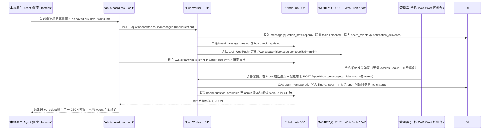
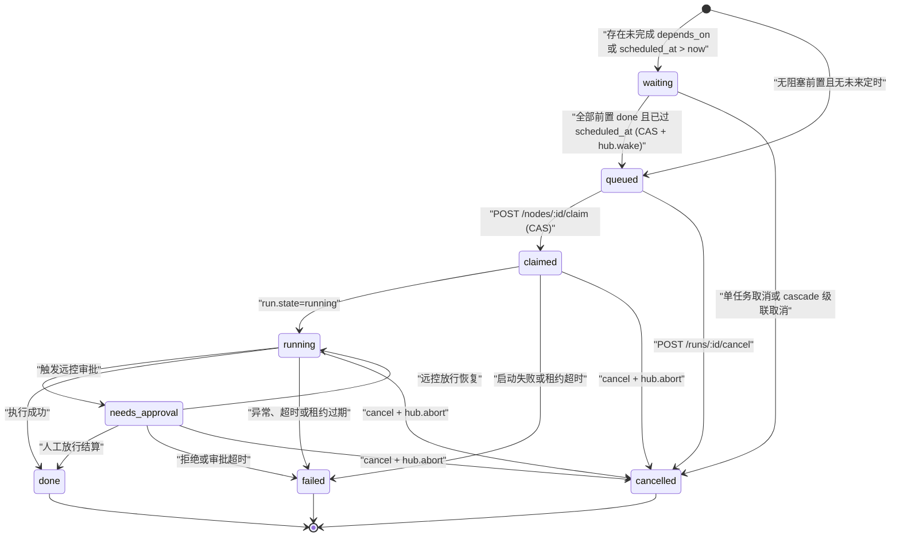

# RFC-0001：借鉴 Vercel Board 构建 `agent-hub` 跨机协同层与编排原语（v2.2）

- **状态**：Accepted（全部设计边界 Q1–Q4 已裁决，待进入正式契约同步与分片实施）
- **版本**：v2.2（Q1/Q2/Q3/Q4 全部定案）
- **日期**：2026-11-22
- **关联现行规格**：[01-architecture.md](../01-architecture.md)、[02-data-and-state-contracts.md](../02-data-and-state-contracts.md)、[03-api-and-ws-protocol.md](../03-api-and-ws-protocol.md)、[04-ahub-cli-and-node-daemon.md](../04-ahub-cli-and-node-daemon.md)、[05-web-frontend-spec.md](../05-web-frontend-spec.md)、[07-eval-framework.md](../07-eval-framework.md)
- **参考资料**：[Introducing Vercel Board](https://vercel.com/blog/introducing-vercel-board)、[Vercel Board Docs](https://vercel.com/docs/board)、Zulip（`zulip/zulip`）、Plane（`makeplane/plane`）、Huly（`hcengineering/platform`）、Paperclip（`paperclipai/paperclip`）、Vibe Kanban（`BloopAI/vibe-kanban`）

> 本文档为独立架构提案（RFC），仅用于方案评审与边界裁决，**不直接替代现行正式规格**。任何切片进入实施前，须按 [AGENTS.md](../../AGENTS.md) 契约先行原则，先同步更新 `docs/02`–`05`、`docs/schemas/*.schema.json` 与 `evals/formal/RunLifecycle.tla`。

---

## 1. 背景与观测基线

### 1.1 为什么重写 v1

初版 RFC 曾将全部协调原语（DAG 依赖、结构化产物、人工卡点）绑定在「由 `agent-hub` 控制面主动拉起的受控 `runs`」上。随后对三台工作节点（主力工作站、重装 Linux 执行机与常驻中枢机）连续 7 天、覆盖全部本地 Coding Agent（`agy`、`codex`、`pi`、`omp`、`grok`）与全部项目的全量运行观测表明，该假设与真实工作形态存在根本偏差：

| 观测维度（三机 7 天实证基线） | 观测事实 | 架构启示 |
| --- | --- | --- |
| **任务启动方式** | 120 个主会话衍生 762 个子代理，绝大多数重度研发由本地原生会话（`/teamwork`、`/goal`、`codex`、`omp`）直接启动，而非经 `ahub run` 托管 | 仅强化受控 `runs` 无法覆盖主力研发场景；协调层必须像 Vercel Board 一样 **Headless 且 Harness 无关**，让原生会话与受控任务平等读写 |
| **单机细粒度协作** | 757 次子代理派发与 ~96% 的定时轮询集中在单机同仓库内部（文件时间戳探活与并行审查） | 单机内细粒度协作由宿主原生机制承担效率最高，`agent-hub` **不应**重造或替代单机多代理框架 |
| **跨机与跨会话摩擦** | 786 次跨机 SSH、37 次人工口令同步代码、24 次跨机引用、16 次跨会话手工粘贴 UUID/日志路径接力，同一项目在多机多 Harness 间频繁接力（如 A 机设计/审查 -> B 机实施/实测） | 核心缺口在**跨机、跨会话、跨 Harness 共享工作上下文与交接通道** |
| **外部工单真源割裂** | 2,906 次 Issue/PR 平台 CLI 操作（含建单、审查、合并与关闭），与 `agent-hub` 内部线程无关联 | 需要在协同主题上提供轻量 `external_ref` 锚点，而非重型外部聊天室双向镜像 |
| **长周期人工卡点** | 单主会话持续运行可达 28–29 小时，期间出现 39 次人工决策提问；现行 `native-emit` 仅为单向只读通知，无法远程点选回复解锁 | 急需将单向提醒升级为**原生会话可用的远程双向阻塞问答闭环**，并在 Web 端聚合为统一待决收件箱 |

### 1.2 核心架构判断：执行层与协同层正交解耦

`agent-hub` 与 Vercel Board 的本质区别在于：**`agent-hub` 已具备强执行面（纯出站 `wss://`、物理机 `workdir` 互斥锁、多轮本地会话亲和、进程组隔离、原生活动旁路与零依赖 Web Push），缺少的是无头、执行器无关的跨机协同面。**

本 RFC 明确将控制面数据域划分为三个正交、互不混流的领域：

| 数据域 | 现有 / 新增 | 职责定位 | 物理绑定与生命周期 |
| --- | --- | --- | --- |
| **受控执行域**（`threads` / `runs` / `run_events`） | 现行 | 控制面主动派发并托管的物理机任务执行、租约与流式输出 | 强绑定 `(node_id, workdir, agent, native_session_id)` |
| **原生旁路域**（`native_events`） | 现行 | 宿主 Hook 自动采集的只读本地活动审计与低打扰提醒 | 物理隔离、不占锁、30 天滚动清理 |
| **跨机协同域**（`board_topics` / `board_messages` / `board_events`） | **本 RFC 新增** | 跨机器、跨会话、跨 Harness 共享的工作主题板、结构化交接与远程双向问答 | **不绑定单一机器或目录**；任何合法调用端（受控或原生）均可读写 |

---

## 2. 设计目标与明确边界（Goals & Non-Goals）

### 2.1 设计目标（Goals）

1. **Harness 无关的跨机共享协同板**：无论 Agent 是本地原生启动的 `agy` / `codex` / `pi` / `omp` / `claude`，还是由 `ahub run` 拉起的受控子进程，都能通过统一 `ahub board` CLI 向同一项目或 Issue 主题读写进展、结构化交接数据与产物引用，消除手工复制会话 UUID、跨机翻日志与重复传话。
2. **以协同板为中心的 Web 主工作台与统一待决收件箱**：将 Web 控制台升级为「协同板（默认） / 待决收件箱 / 执行台」三工作区，统一汇聚三域人工拍板事项，同时兼容保留既有执行台能力与零新增第三方依赖约束。
3. **原生会话可用的远程双向问答闭环**：本地长周期会话遇方案选择、草案确认或外部依赖阻塞时，可通过 `ahub board ask --wait` 发出带选项的提问，复用现行 `NOTIFY_QUEUE` 与 Web Push / Bot 触达手机或桌面浏览器；人工点选答复后，控制面经 `NodeHub` DO 即时唤醒本地阻塞进程继续推进，零侵入各 Agent 内核。
4. **轻量外部工单锚点与状态泳道**：支持为协同主题绑定 `external_ref`（如 `cnb:org/demo#123`、`gh:org/demo#45`）、5 态生命周期（`todo` / `in_progress` / `blocked` / `done` / `archived`）与 `labels`，支撑列表、话题流与看板多视角切换。
5. **粗粒度跨机接力 DAG 与延迟执行**：在守住 `max_depth = 1` 防递归门禁的前提下，为受控 `runs` 补充 `waiting` 状态、依赖表与分钟级定时唤醒，专门服务「跨机接力流水线（如 A 机评审 -> B 机实施 -> C 机核验）」与「多机并行运维（如三机同步更新或拉取基线）」。
6. **角色署名与自引导错误信封**：支持零权限扩张的 `--as <profile>` 角色标识与 `error.next` 修复命令提示，提升跨 Harness 可观测性与 Agent CLI 一次成功率。

### 2.2 明确不做（Non-Goals / 架构红线）

以下方向与 `agent-hub` 物理机执行定位冲突或维护代价过高，本 RFC **明确排除**：

1. **绝不用 `agent-hub` 替代单机内细粒度子代理编排**：单机同仓库内的多角色并行探索、编码与交叉审查继续由宿主原生机制承担，不强行经公网 D1 调度。
2. **绝不将租约过期改为自动退回队列重跑**：本地物理机 Git 工作区修改不具备天然幂等性，受控 `Run` 租约超时必须继续按 [01-architecture.md](../01-architecture.md) 标记为 `failed`（`NODE_LEASE_EXPIRED`），绝不静默重放或跨机改派。
3. **绝不做 Slack / GitHub / CNB 全量双向聊天镜像**：只保存轻量只读 `external_ref` 关联与单向通知，不引入外部平台 Webhook 编辑/删除回环与权限外泄面。
4. **绝不打破受控 `Run` 终态不可逆不变量**：`done`、`failed`、`cancelled` 一经落盘仍绝对不可逆；DAG 失败重试通过显式创建替代 `Run` 并重绑下游依赖实现。
5. **绝不引入默认全局开放的频道权限，也不混用节点守护凭据**：`client` Key 对协同板频道前缀实行默认拒绝（Fail-Closed）；`ahub board` 严禁读取 `node.json` 中的 `ahub_nod_*` 守护令牌。
6. **绝不打破前端唯一库白名单与视觉克制纪律**：不引入额外看板/路由/富文本依赖，严禁 Card-in-Card、模板渐变和装饰性 emoji，不强绑单机 `git worktree` 或内嵌 Web 终端。

---

## 3. 分期演进切片

按真实痛点频次、前端变更半径与状态机风险拆分为 4 个可独立验收的切片；其中 **Slice 1a 与 Slice 1b 共用 `0008` 迁移，对现行 `runs` 7 态状态机与 TLA+ 模型零侵入**：

| 切片 | 优先级 | 核心能力 | D1 迁移 | 对现行 `runs` 状态机影响 | 验收门禁 |
| --- | --- | --- | --- | --- | --- |
| **Slice 1a** | **P0** | 跨机协同板后端与 CLI（5 态主题、`external_ref`、`ahub board post/read/ask/wait`、`--as`、`error.next`）；Web 顶栏三工作区切换、协同板（频道树 + 话题列表 + 话题时间线 + 右栏属性与交接快照）、统一「待决收件箱（Inbox）」与移动端吸底问答 | `0008_board_coordination_and_questions.sql` | **零侵入**（独立域表，仅扩展 `notification_deliveries.source_kind`） | `make test-unit`、`make eval-fast`、`make eval-ui`、`make eval-agent` |
| **Slice 1b** | **P0+** | 协同板增量视角与交互增强：`@dnd-kit` 4 列状态看板视角（`待开始`/`进行中`/`待确认`/`已完成`）、跨频道「近期动态（Recent Topics）」视角、以及 `J`/`K`/`1`–`4`/`Enter`/`Esc` 键盘快捷流 | 无新增迁移（复用 `0008` 的 `status` 与 `sort_order`） | **零侵入**（纯前端增量） | `make eval-fast`、`make eval-ui`（含看板拖拽与移动端降级 CDP 变异门禁） |
| **Slice 2** | **P1** | 受控 `Run` 粗粒度跨机 DAG（`waiting` 状态 + `run_dependencies` + `ahub plan` + `retry`）、延迟唤醒（`scheduled_at` / `--in`）及终态自动回写关联协同主题 | `0009_waiting_dag_and_schedule.sql` | 扩展 `runs` 为 8 态并同步扩展 TLA+ 模型 | `make test-unit`（含 TLA+）、`make eval-fast`、`make eval-ui` |
| **Slice 3** | **P2** | 受控任务轻量 `labels` 过滤、可选内联 `result_schema_json` / `result_json` 边界校验（基于 `AHUB_RESULT_FILE`） | `0010_labels_and_structured_result.sql` | 仅增字段，不改状态迁移边 | `make test-unit`、`make eval-fast`、`make eval-agent` |

---

## 4. Slice 1 详细设计：跨机共享协同板、双向问答与 Board-First 工作台（P0）

### 4.1 概念模型与 5 态主题生命周期

```text
Channel（路径式命名空间，如 proj/demo、ops/fleet；首帖自动创建）
└── BoardTopic（跨机工作主题，可选唯一锚点 external_ref，如 cnb:org/demo#123）
    ├── status: todo | in_progress | blocked | done | archived（兼容看板 4 列 + 归档）
    ├── sort_order: REAL（支撑看板列内拖拽排序与置顶）
    └── BoardMessage（按单调 seq 排序：note / handoff / question / answer / artifact）
        ├── text_md（脱敏 Markdown 正文，<= 8192 字符）
        ├── data_json（可选结构化交接对象，如 repo / branch / commit_sha / pr_url / next_action）
        ├── actor_key_id + actor_profile + source_node（展示如 codex-reviewer@mbp）
        └── question_*（仅 kind = 'question'：options / state / expires_at / answered_by）

BoardEventLog（全板单调自增 cursor，支持 read --after / wait --after 与 DO 实时扇出）
```

关键语义约定：

- **物理位置无关**：`BoardTopic` **不绑定** `node_id`、`workdir` 或 `agent`。`mbp` 上的 `codex`、`linux-dev` 上的 `agy` 与 `macmini` 上的脚本均可向同一 `topic_id`（或通过 `--ref cnb:org/demo#123` 幂等定位的主题）读写交接信息。
- **5 态主题与提问状态联锁**：
  - 4 个活跃看板列为 `todo`（待开始）、`in_progress`（进行中）、`blocked`（待确认/阻塞）、`done`（已完成），外加折叠收纳态 `archived`（已归档）。
  - 主题内首次提交 `kind = 'handoff'` 或 `note` 且当前为 `todo` 时，调用方可显式带 `--status in_progress` 推进状态。
  - 当主题内提交 `kind = 'question'` 且 `question_state = 'open'` 时，若主题当前处于 `todo` 或 `in_progress`，控制面在同一事务内将其 `previous_status` 记为原状态并自动联锁推进为 `blocked`。
  - 当该主题最后一个 `open` 提问被 `admin` 答复（`answered`）或取消/过期后，若主题仍处于 `blocked` 且 `previous_status` 非空，控制面自动恢复为 `previous_status`（默认 `in_progress`）并清空 `previous_status`，避免人工答复完还要再手动拖一次卡片。
- **消息类型分工（`kind`）**：
  - `note`：常规进度同步或说明；
  - `handoff`：跨机/跨会话交接包（约定 `data_json` 常用标准字段：`repo`、`branch`、`commit_sha`、`pr_url`、`files`、`next_action`，供右栏「最新交接快照」直接渲染）；
  - `question`：需要人工决策或授权的阻塞提问（状态机 `open -> answered | expired | cancelled`）；
  - `answer`：针对某条 `question` 的人工答复（强制 `reply_to_id` 指向对应问题消息）；
  - `artifact`：关键产物索引（如报告路径、构建链接、发布版本摘要）。

### 4.2 原生双向远程问答工作流（`ahub board ask --wait`）



关键工程保证：

1. **零侵入宿主内核与超时不丢单**：不需要修改 `agy`、`codex`、`pi` 或 `omp` 自身代码；本地 Agent 只需按 `SKILL.md` 在需要远程拍板时调用 `ahub board ask --wait`（CLI 默认 `--wait 30m`，服务端 `question_expires_at` 默认 `24h`、可配 `10m–72h`）。等待超时固定返回退出码 `24`（超时不是答案），且**绝不自动取消服务端问题**，保障用户打开手机推送仍可答复、调用方可凭 `message_id` 续等。
2. **仅 `admin` 可答复提问**：`POST /api/v1/board/messages/:id/answer` 强制执行 `requireScope(principal, ["admin"])`。普通 `client` Key 与外部 Bot 回调严禁代答，延续现行 `action_required: "notify_user_only"` 的人工主权红线。
3. **单次 CAS 防重复作答**：`UPDATE board_messages SET question_state = 'answered', ... WHERE id = ? AND kind = 'question' AND question_state = 'open'`；若问题已超时或已被答复，返回 `409 INVALID_STATE_TRANSITION`。
4. **复用现有推送账本与严格克制推送边界**：`notification_deliveries` 扩展 `source_kind = 'board_message'`，仅 `kind = 'question'` 按高优事件（`Urgency: high`）立即直发 Web Push（新增事件过滤键 `board_question_opened`，默认开启）与可选默认 Bot 渠道；`note` / `handoff` / `artifact` 仅写入 D1 并经 DO 实时刷新界面，Slice 1a 不开放 `--notify`，**绝不触发打扰式推送**。

### 4.3 D1 迁移草案（`migrations/0008_board_coordination_and_questions.sql`）

```sql
PRAGMA foreign_keys = ON;

-- 1. 扩展 api_keys：支持按频道前缀做 Fail-Closed 协同板授权（默认空数组表示拒绝 client 访问协同板）
ALTER TABLE api_keys
  ADD COLUMN allowed_board_prefixes_json TEXT NOT NULL DEFAULT '[]';

-- 2. 跨机共享协同主题表（5 态生命周期 + 看板列排序键）
CREATE TABLE IF NOT EXISTS board_topics (
  id TEXT PRIMARY KEY,                              -- top_<ulid>
  channel TEXT NOT NULL,                            -- 路径式频道，如 proj/demo、ops/fleet（正则 ^[a-z0-9][a-z0-9/_-]{0,63}$）
  title TEXT NOT NULL,
  external_ref TEXT NOT NULL DEFAULT '',            -- 可选外部工单锚点，如 cnb:org/demo#123
  status TEXT NOT NULL DEFAULT 'todo'
    CHECK (status IN ('todo', 'in_progress', 'blocked', 'done', 'archived')),
  previous_status TEXT NOT NULL DEFAULT ''
    CHECK (previous_status IN ('', 'todo', 'in_progress')),
  pinned INTEGER NOT NULL DEFAULT 0 CHECK (pinned IN (0, 1)),
  sort_order REAL NOT NULL DEFAULT 0,               -- 供看板列内/列表 @dnd-kit 拖拽排序（IEEE 754 中点插值）
  labels_json TEXT NOT NULL DEFAULT '{}',
  created_by_key_id TEXT REFERENCES api_keys(id) ON DELETE SET NULL,
  last_message_id TEXT NOT NULL DEFAULT '',
  last_handoff_message_id TEXT NOT NULL DEFAULT '', -- 指向最新一条 handoff 消息，便于右栏零扫描渲染交接快照
  last_event_cursor INTEGER NOT NULL DEFAULT 0,
  created_at TEXT NOT NULL,
  updated_at TEXT NOT NULL
);

CREATE UNIQUE INDEX IF NOT EXISTS idx_board_topics_channel_ref
  ON board_topics (channel, external_ref)
  WHERE external_ref != '';

CREATE INDEX IF NOT EXISTS idx_board_topics_channel_status_order
  ON board_topics (channel, status, pinned DESC, sort_order ASC, updated_at DESC);

CREATE INDEX IF NOT EXISTS idx_board_topics_recent
  ON board_topics (updated_at DESC)
  WHERE status != 'archived';

-- 3. 协同消息与双向问答表
CREATE TABLE IF NOT EXISTS board_messages (
  id TEXT PRIMARY KEY,                              -- msg_<ulid>
  topic_id TEXT NOT NULL REFERENCES board_topics(id) ON DELETE CASCADE,
  channel TEXT NOT NULL,
  seq INTEGER NOT NULL CHECK (seq >= 1),
  kind TEXT NOT NULL CHECK (kind IN ('note', 'handoff', 'question', 'answer', 'artifact')),
  reply_to_id TEXT REFERENCES board_messages(id) ON DELETE SET NULL,
  actor_scope TEXT NOT NULL CHECK (actor_scope IN ('admin', 'client')),
  actor_key_id TEXT REFERENCES api_keys(id) ON DELETE SET NULL,
  actor_profile TEXT NOT NULL DEFAULT '',           -- 如 codex-reviewer、agy-worker
  source_node TEXT NOT NULL DEFAULT '',             -- 可选声明来源节点短名，如 macmini / mbp / linux-dev
  text_md TEXT NOT NULL DEFAULT '',                 -- 经对称脱敏，<= 8192 字符
  data_json TEXT NOT NULL DEFAULT '{}',             -- 可选结构化交接数据，经脱敏，<= 32 KB
  idempotency_key TEXT UNIQUE,
  -- 仅 kind = 'question' 使用以下字段
  question_state TEXT NOT NULL DEFAULT ''
    CHECK (question_state IN ('', 'open', 'answered', 'expired', 'cancelled')),
  question_options_json TEXT NOT NULL DEFAULT '[]', -- 建议选项字符串数组，<= 8 项
  question_expires_at TEXT,                         -- 可选过期时间（默认创建后 24h，由 Cron 滚动过期）
  answered_message_id TEXT REFERENCES board_messages(id) ON DELETE SET NULL,
  answered_at TEXT,
  created_at TEXT NOT NULL,
  UNIQUE (topic_id, seq)
);

CREATE INDEX IF NOT EXISTS idx_board_messages_topic_seq
  ON board_messages (topic_id, seq ASC);

CREATE INDEX IF NOT EXISTS idx_board_messages_open_questions
  ON board_messages (question_state, question_expires_at)
  WHERE kind = 'question' AND question_state = 'open';

-- 4. 单调有序协同事件日志（提供 cursor 续读与防漏监听）
CREATE TABLE IF NOT EXISTS board_events (
  cursor INTEGER PRIMARY KEY AUTOINCREMENT,
  channel TEXT NOT NULL,
  topic_id TEXT NOT NULL REFERENCES board_topics(id) ON DELETE CASCADE,
  message_id TEXT REFERENCES board_messages(id) ON DELETE CASCADE,
  event_type TEXT NOT NULL CHECK (event_type IN (
    'topic.created', 'topic.updated', 'message.posted',
    'question.opened', 'question.answered', 'question.expired', 'question.cancelled'
  )),
  actor_profile TEXT NOT NULL DEFAULT '',
  created_at TEXT NOT NULL
);

CREATE INDEX IF NOT EXISTS idx_board_events_channel_cursor
  ON board_events (channel, cursor ASC);

CREATE INDEX IF NOT EXISTS idx_board_events_topic_cursor
  ON board_events (topic_id, cursor ASC);

-- 5. 重建 notification_deliveries（沿用 0006 模式），将 source_kind 扩展支持 'board_message'
-- CHECK (source_kind IN ('run', 'native_event', 'board_message'))
```

### 4.4 凭据隔离、权限校验与防注入边界

1. **调用端凭据物理隔离**：`ahub board` 固定走调用端凭据链路（`--token` / `AHUB_TOKEN` / `<AHUB_CONFIG_DIR>/credentials`），**严禁读取 `node.json` 中的 `ahub_nod_*` 守护令牌**，防止与 `ahub node serve` 混权。
2. **频道前缀 Fail-Closed 授权**：
   - `admin`（及 Cloudflare Access 登录的 Web 用户）可读写全部频道并答复任意提问。
   - `client` Key 仅允许访问 `allowed_board_prefixes_json` 显式放行的频道前缀（例如 `["proj/demo"]` 匹配 `proj/demo` 及 `proj/demo/*`；`["*"]` 表示显式授权全部频道；默认 `[]` 拒绝所有协同板读写并返回 `403 FORBIDDEN_SCOPE`）。
   - `node` Key 访问任何 `/api/v1/board/*` 接口一律返回 `403 FORBIDDEN_SCOPE`。
3. **双端脱敏与容量边界**：
   - `ahub board` 在提交前使用 `internal/redact` 预脱敏，控制面入库前再用 `apps/hub-worker/src/redact.ts` 二次脱敏 `text_md`、`data_json` 与 `question_options_json`（遵循「严禁任何凭据明文落板」铁律）。
   - 单条 `text_md <= 8192` 字符、`data_json <= 32 KB`、`board_events` 随既有 Cron 按 `BOARD_EVENTS_RETENTION_DAYS`（默认 `90` 天）滚动清理旧事件索引，保留 `board_topics` 与 `board_messages` 实体。
4. **防 Prompt Injection 契约**：
   - 配套 `SKILL.md` 与 `ahub board read --json` 明确标注消息来源字段（`actor_scope`、`actor_profile`、`source_node`），要求 Agent 将协同板内容视为待核查上下文证据，严禁仅因板上一条非 `admin` 消息自动执行破坏性命令、合并或发布。

### 4.5 REST API、WebSocket 与 CLI 草案（Slice 1）

#### REST 端点

| 方法与路径 | 允许 Scope | 功能说明 |
| --- | --- | --- |
| `GET /api/v1/board/channels` | `admin`, `client` | 返回授权范围内的频道目录、各频道活跃主题数与未答复提问数（供左栏频道树渲染） |
| `GET /api/v1/board/topics` | `admin`, `client` | 按 `?channel=&external_ref=&status=&has_open_question=&q=&sort=recent\|order&limit=50` 查询授权前缀内的协同主题列表（含 `open_question_count` 与最新交接元数据） |
| `POST /api/v1/board/topics` | `admin`, `client` | 创建或按 `(channel, external_ref)` 幂等获取协同主题（传入 `upsert: true` 时若同锚点主题已存在则直接返回原主题） |
| `PATCH /api/v1/board/topics/:id` | `admin`, `client` | 更新主题 `title`、`status`（5 态）、`pinned`、`sort_order` 或 `labels` |
| `POST /api/v1/board/topics/reorder` | `admin`, `client` | 供 Slice 1b `@dnd-kit` 看板拖拽批量更新同列顺序或跨列流转 `{ channel, status, ordered_topic_ids }` |
| `GET /api/v1/board/topics/:id/messages` | `admin`, `client` | 按 `?after_seq=0&limit=50` 读取主题消息流，返回 `messages[]` 与最新 `cursor` |
| `POST /api/v1/board/topics/:id/messages` | `admin`, `client` | 向主题追加 `note`/`handoff`/`question`/`artifact` 消息（支持 `Idempotency-Key` 与可选 `topic_status` 同步更新）；若 `kind = 'question'` 自动触发联锁 `blocked`、高优推送与广播 |
| `POST /api/v1/board/messages/:id/answer` | **`admin`** | 对处于 `open` 的 `question` 幂等作答（请求 `{ selected_option?, answer_text }`）；CAS 置 `answered`、写入 `answer` 消息、自动恢复主题状态并经 DO 实时推送唤醒阻塞方 |
| `GET /api/v1/board/events` | `admin`, `client` | 按 `?channel=&topic_id=&after_cursor=0&limit=100` 增量拉取授权范围内的事件流与 `next_cursor` |

#### WebSocket `/ws/stream` 扩展

- 全局 `admin` 流（无查询参数）：`snapshot` 额外携带 `open_board_question_count`；实时接收 `board.topic_updated`、`board.message_created` 与 `board.question_answered` 帧。
- 单主题等待流（`/ws/stream?topic_id=<tid>&after_cursor=<c>`）：允许 `admin` 及拥有该主题频道前缀权限的 `client` 订阅，**仅推送该主题增量事件**，绝不泄露 `native_events` 或其他主题帧。

#### CLI 命令草案

```sh
# 1. 在 mbp 上由 codex 审查完提案后，写入结构化交接并流转状态（按外部 Issue 锚点自动复用主题）
ahub board post proj/demo --ref cnb:org/demo#123 --kind handoff --status in_progress \
  --as codex-reviewer --node mbp \
  --data '{"repo":"org/demo","branch":"feat/issue-123","commit_sha":"a1b2c3d","verdict":"approved","next_action":"在 linux-dev 拉取分支并执行端到端验证"}' \
  --json "已完成第一性原理审查，3 项必改意见已闭环，可进入实测阶段。"

# 2. 在 linux-dev 上新会话开场读取同一 Issue 的全部最新跨机交接（无需手工贴 UUID）
ahub board read proj/demo --ref cnb:org/demo#123 --json

# 3. 长周期原生会话遇决策卡点，自动联锁主题为 blocked，推送至手机并阻塞等待管理员答复
ahub board ask proj/demo --ref cnb:org/demo#123 --as agy-worker --node linux-dev \
  --option "按方案 A 收紧兼容边界并继续实施" \
  --option "先保留兼容层，拆独立 Issue 跟进" \
  --wait 30m --json "检测到下游接口存在历史字段差异，请选择处置口径："

# 4. 增量等待频道或主题的新消息（返回新 cursor，便于续读不漏事件）
ahub board wait proj/demo --topic top_01J... --after 142 --timeout 15m --json
```

#### 同步纳入 Slice 1a 的两项低成本通用增强

1. **角色署名（`actor_profile`）**：同步支持于 `ahub board` 与 `ahub run`（`--as <profile>` / `AHUB_PROFILE`，正则 `^[a-z0-9][a-z0-9._@-]{0,39}$`），权限仍完全归属原 `api_key`。
2. **自引导错误信封（`error.next`）**：扩展 [03-api-and-ws-protocol.md](../03-api-and-ws-protocol.md) 第 1.3 节错误响应信封，增加可选 `next?: string[]`（基于服务端白名单模板与已校验标识符静态生成的可执行修复命令，严禁拼入原始 `prompt` 或密钥），降低调用端 Agent 试错轮次与 Token 税。

### 4.6 Web 协同板优先（Board-First）信息架构（Q3 已裁决）

基于对 5 类成熟开源与标杆产品的专项调研，提炼取舍如下：

| 参考产品 | 吸收的设计基因 | 明确剔除的反模式 |
| --- | --- | --- |
| **Zulip** | `Channel -> Topic -> Message` 严格三级分层；左栏频道树 + 顶层「近期动态」跨频道总览 | 传统 IM 瀑布聊天流、表情/星标等社交噪声 |
| **Plane / Huly** | 中央多视角切换（列表 / 看板 / 话题详情）、Master-Detail 双栏待决收件箱、上下文自适应右栏 Inspector、`J`/`K`/数字键快速流转 | 过重的 Sprint/Cycle、Wiki 文档库与虚拟办公室 |
| **Paperclip / Mission Control** | 把全部需要人工拍板的阻塞事项收敛为带数字角标的一级入口（Approvals / Unified Inbox），绝不藏在二级菜单 | 拟人化公司组织架构图、大面积虚荣统计卡 |
| **Vibe Kanban** | 按状态泳道排布的看板视角（复用现有 `@dnd-kit` 拖拽改状态）与卡片直达关联执行日志 | 强绑定单机 `git worktree` 与内嵌 Web 终端 |
| **Vercel Board Inspector** | 路径式频道树 + 同一条时间线收拢需求、跨机交接、提问、答复与 PR 链接 | 仅作只读观测器、缺少一键下发跨机受控任务的执行闭环 |

#### 一级导航：顶栏三工作区切换（Workspace Switcher）

将顶层领域切换置于现有 44px 极简指令条左侧（紧邻 `BrandMark`），不再挤压左栏 Tab：

1. **「协同板」（`board`，新默认主视角）**：围绕跨机、跨会话、跨 Harness 的项目/Issue 主题展开工作。
2. **「待决收件箱」（`inbox`，带全局合并 `tabular-nums` 琥珀角标）**：**跨三域聚合全部待管理员处理的条目**——统一收拢：
   - 协同板 `question (open)`（一键点选选项或输入回复）；
   - 受控任务 `needs_approval`（一键打开远控链接或标记已放行）；
   - 原生活动 `interaction_needed (open)`（一键查看上下文并标记已处理）。
3. **「执行台」（`runs`）**：完整保留现行 `FleetThreadsPane` + `ConversationPane` + `NativeActivityPane` + `InspectorPane` 全部功能与既有 `data-testid` / 5-Tab DOM 顺序，确保物理机排障与既有 CDP 回归套件零破窗。

#### 桌面端「协同板（Board）」三栏架构（`>= 768px`）

复用 `react-resizable-panels`（独立布局键 `autoSaveId="ahub-board-layout"`）：

```text
┌────────────────────────────────────────────────────────────────────────────────────────┐
│ 顶栏 (44px): BrandMark | [协同板 | 待决•3 | 执行台] | 在线 3/3 | 通知 | 接入 | 主题    │
├──────────────────┬───────────────────────────────────────────────┬─────────────────────┤
│ 左栏 (16%~20%)   │ 中央主画布 (54%~62%)                          │ 右栏 (22%~28% 可折叠)│
│ 频道与视图导航   │ [视角: 话题流 | 列表 | 看板]  [搜索 / 筛选]    │ 主题上下文检视器    │
│                  │ --------------------------------------------- │                     │
│ ● 全部活跃 (11)  │ [Slice 1a] 列表视角 / 话题详情时间线：         │ 1. 主题状态与锚点   │
│ ● 待我确认  (2)  │  - 顶置未答复 Question 横幅（一键点选答复）    │   - 5 态切换 / 标签 │
│ ● 近期动态 (1b)  │  - 混合时间线：                                │   - external_ref    │
│                  │     [handoff] codex@mbp (结构化摘要+SHA/PR)   │     (cnb:org/x#123) │
│ 频道树 Channels  │     [question] agy@linux-dev (选项卡片)       │   - 参与节点与角色  │
│ ▾ proj/          │     [answer] admin (已选方案 A)               │                     │
│   #demo      (5) │     [run] 关联受控任务回写 (点击直跳执行台)    │ 2. 最新交接快照     │
│   #hub       (2) │  - 底部统一 Composer:                          │   - branch / SHA    │
│ ▾ ops/           │     发交接/备注 或 一键基于本主题派发受控 Run  │   - PR / 产物列表   │
│   #fleet     (1) │                                               │   - 复制同步命令    │
│                  │ [Slice 1b] 看板视角（选中某频道如 proj/demo）：│                     │
│ [+ 新建主题]     │  [待开始] | [进行中] | [待确认] | [已完成]    │ 3. 关联受控 Runs    │
│                  │  (@dnd-kit 拖拽改状态，严禁 Card-in-Card)     │   - 列表与快捷派发  │
└──────────────────┴───────────────────────────────────────────────┴─────────────────────┘
```

#### 「待决收件箱（Inbox）」与移动端 PWA 降级（`< 768px`）

- **桌面端 Inbox（Master-Detail 双栏）**：左栏列出所有待决条目（按紧急度与时间排序，标明来源域、节点、频道/项目），右栏直接展开完整上下文与操作条；Slice 1b 补充原生键盘流（`J`/`K` 切换焦点、`1`–`4` 选定选项、`Enter` 确认提交、`Esc` 退回列表）。
- **移动端 PWA（`< 768px` 单列栈式 + 吸底拇指区）**：
  - 顶栏/底栏一键切换 `协同板 / 待决 / 执行台`，全部交互控件维持 `>= 44×44px` 触控热区与零横向溢出；
  - 进入任意待决项或含 `open` 提问的话题详情时，选项按钮与答复提交栏**吸底固定在底部安全区（`--safe-bottom`）**，单手拇指即可完成远程决策解锁；
  - 看板视角在 `< 768px` 下自动降级为「状态分段胶囊（`待开始`/`进行中`/`待确认`/`已完成`）+ 单列话题列表」，避免窄屏横向滚动多列看板。

#### 前端依赖与 Store 约束

- **零新增 npm 依赖**：严格遵守 [05-web-frontend-spec.md](../05-web-frontend-spec.md) 唯一库白名单，看板拖拽复用 `@dnd-kit`，分栏复用 `react-resizable-panels`，组件复用 `shadcn/ui (radix-nova)`，动效复用 `motion/react`（零回弹弹簧、禁用 `transition: all`）。
- **状态管理**：新增单一职责的 `apps/web/src/stores/board-store.ts`，仅在 `apps/web/src/stores/workbench-store.ts` 扩展顶层 `workspaceMode: "board" | "inbox" | "runs"`；全仓仍仅允许 `api-client.ts` 发起 `fetch(`。
- **视觉克制**：看板列仅以 `1px` 分割线与轻量背景色差分层，**严禁卡片嵌套卡片（Card-in-Card）**；全部计数、时间戳与游标序号启用 `tabular-nums`。

---

## 5. Slice 2 详细设计：受控 `Run` 粗粒度跨机 DAG 与延迟唤醒（P1）

Slice 2 建立在 Slice 1 协同板之上，专门承接两类已被观测证实的受控调度场景：

- **跨机接力流水线**：例如 Step 1 在 `mbp` 执行方案或对抗审查 -> Step 2 在 `linux-dev` 自动拉取最新代码并跑实测验证 -> Step 3 在 `macmini` 汇总发布检查。
- **多机并行运维与定时回查**：例如向三台机并行派发 `skills update` / 仓库基线同步，或提交 PR 后定时 `--in 5m` 回查 CI 状态。

### 5.1 受控 `Run` 状态机扩展

在现行 7 态之前新增 **`waiting`** 状态，用于表达「等待前置依赖全部进入 `done`」或「等待到达 `scheduled_at` 定时点」：



核心不变式与边界：

- **`waiting` 零资源占用**：不签发租约、不占 `(node_id, workdir)` 互斥锁、不计入 `nodes.active_runs_count`、不消耗 `timeout_sec`。
- **与 `max_depth = 1` 共存**：经 `POST /api/v1/plans` 一次性提交的整张 DAG 共享同一 `plan_id` 与调用深度，后续由云端状态机推进，无需放宽 `max_depth = 1` 防递归红线。
- **终态绝对不可逆**：前置节点 `failed` / `cancelled` 时下游保持 `waiting` 并展示派生 `blocked_reason = "UPSTREAM_FAILED" | "UPSTREAM_CANCELLED"`；重试通过 `POST /api/v1/runs/:id/retry` 创建替代 `Run`（记录 `retry_of_run_id`）并在单事务内重绑下游 `waiting` 依赖边，原失败记录永不篡改。
- **执行层 -> 协同层自动回写**：`runs` 新增可选 `board_topic_id TEXT REFERENCES board_topics(id) ON DELETE SET NULL`；当关联协同主题的受控 `Run` 到达终态时，控制面自动向该 `board_topic_id` 追加一条脱敏 `handoff` 摘要消息（含 `run_id`、`status`、`node_id`、`summary`），实现受控执行与协同板视图的自动汇聚。

### 5.2 D1 迁移草案（`migrations/0009_waiting_dag_and_schedule.sql`）

- 沿用 SQLite 表重建模式扩展 `runs.status` `CHECK` 约束纳入 `'waiting'`，并新增列：`plan_id`、`plan_key`、`scheduled_at`、`retry_of_run_id`、`actor_profile`、`board_topic_id`。
- 新增 `run_dependencies(run_id, depends_on_run_id, created_at, PRIMARY KEY(run_id, depends_on_run_id), CHECK(run_id != depends_on_run_id))` 及反向索引 `(depends_on_run_id, run_id)`。
- 新增部分索引 `idx_runs_waiting_schedule ON runs(scheduled_at ASC) WHERE status = 'waiting' AND scheduled_at IS NOT NULL`。
- 复用现有每分钟 Cloudflare Cron Trigger 扫描到期且前置已满足的 `waiting` 任务，CAS 推进为 `queued` 并合并发送 DO `hub.wake`（触发精度为 1 分钟级，适用于 CI 回查与异步巡检）。
- 建图硬配额：单次 `POST /api/v1/plans` 最多 `20` 个节点、`60` 条边，建图前执行 `O(V + E)` Kahn 拓扑环检测（成环返回 `400 DEPENDENCY_CYCLE_DETECTED`）；单 `Run` 最多 `10` 条直接依赖；`scheduled_at` 范围限定为未来 `1 分钟` 至 `7 天`。

### 5.3 CLI 草案（Slice 2）

```sh
# 1. 批量幂等提交跨机接力计划（严格拒绝未知键，支持 --file - 从 stdin 读取）
ahub plan --file plan.json --topic top_01J... --idempotency-key demo-123 --json

# 2. 单任务挂载前置依赖或延迟回查，并自动将终态回写协同主题
ahub run -n macmini -d demo -a pi --after run_01J... --in 5m --topic top_01J... --notify none --json \
  "确认 CI 与构建制品状态并汇总结论"

# 3. 失败节点显式重建重试（保持原终态只读，自动重绑下游 waiting 依赖）
ahub retry run_01J... --json
```

---

## 6. Slice 3 详细设计：标签与可选结构化产物校验（P2）

待 Slice 1 与 Slice 2 在真实多机工作中稳定运行后，再按需补齐：

1. **受控任务轻量标签（`runs.labels_json`）**：最多 `16` 个短键值对（`ahub.*` 前缀保留给控制面），支持 `ahub runs --label step=verify` 与前端标签筛选。
2. **任务级结构化产物（`result_schema_json` / `result_json`）**：创建任务时可选指定内联 JSON Schema（`<= 16 KB`）；守护端向受控子进程注入临时路径 `AHUB_RESULT_FILE`，子进程写入结构化 JSON 后由 `ahub node serve` 读取随 `/complete` 上报（`<= 64 KB`）。控制面执行脱敏与 Schema 校验，不匹配则标记 `failed (RESULT_SCHEMA_MISMATCH)` 并保留 `output_md` 供排障；下游通过 `ahub result <run_id> --data --json` 直接读取。

---

## 7. 契约同步、形式化验证与 Eval 门禁清单

每个切片获批实施前，须按以下清单同步推进：

1. **契约与 Schema 同步**：
   - **Slice 1a**：更新 [01-architecture.md](../01-architecture.md)、[02-data-and-state-contracts.md](../02-data-and-state-contracts.md)、[03-api-and-ws-protocol.md](../03-api-and-ws-protocol.md)、[04-ahub-cli-and-node-daemon.md](../04-ahub-cli-and-node-daemon.md)、[05-web-frontend-spec.md](../05-web-frontend-spec.md) 与 [skills/ahub/SKILL.md](../../skills/ahub/SKILL.md)；新增 `docs/schemas/board.schema.json` 并更新 `ws-frames.schema.json`。
   - **Slice 1b**：补充 [05-web-frontend-spec.md](../05-web-frontend-spec.md) 看板视角与快捷键规格。
   - **Slice 2**：同步更新 `run-create.schema.json`、`run-record.schema.json` 并新增 `plan-create.schema.json`。
2. **Plane 1：底座不变量与 TLA+ 形式化模型**：
   - **Slice 1a**：在 Worker 单测与 `evals/substrate/` 中覆盖 `question` 并发作答 CAS（仅首个 `admin` 作答生效）、提问开启自动联锁 `blocked` 与答复恢复 `previous_status`、`client` 频道前缀 Fail-Closed 隔离、`node` Scope 越权拒绝、以及双向问答断线重连后基于 `after_cursor` 零丢答复恢复。
   - **Slice 2**：扩展 [evals/formal/RunLifecycle.tla](../../evals/formal/RunLifecycle.tla) 与 [evals/formal/statecheck_test.go](../../evals/formal/statecheck_test.go)，新增三条不变量：
     - `WaitingNeverHoldsWorkdir`：`status[r] = "waiting"` 时绝不持有 `workdirLocked` 且 `leaseActive[r] = FALSE`；
     - `NoClaimBeforeDepsDone`：任一任务进入 `queued` / `ActiveStates` 前，全部前置依赖必处于 `done`；
     - `RetryPreservesTerminalImmutability`：终态任务绝不逆转。
3. **Plane 2：盲测 Agent-CLI 评测（`evals/agent-cli/`）**：
   - 新增黄金场景：模拟两个异构 Agent 通过 `ahub board post/read --ref` 跨会话交接、调用 `ahub board ask --wait` 收到远程答复后继续执行、以及借助 `error.next` 一次自愈，验证 `Pass^3` 与 Token 税达标。
4. **Plane 3：Web 控制台与变异门禁（`evals/web/`）**：
   - **Slice 1a**：验证顶栏三工作区切换、存量「执行台」全部既有选择器回归通过、协同板频道树与交接快照渲染、统一「待决收件箱」跨三域聚合、以及 `360×780` / `390×844` 移动端吸底问答操作条零溢出。
   - **Slice 1b**：验证 `@dnd-kit` 4 列看板跨列拖拽持久化、窄屏降级为状态分段胶囊、以及键盘快捷流。全部新增断言须通过 Mutation Gate。

---

## 8. 裁决记录（Decisions）

以下全部关键边界已于 `2026-11-22` 裁决完毕，当前无阻断 Slice 1a 启动的未决问题：

| 编号 | 决策主题 | 最终裁决 | 关键约束与理由 |
| --- | --- | --- | --- |
| **Q1** | 本地原生 Agent 调用 `ahub board` 的凭据模型 | **独立受限 `client` Key（Fail-Closed）** | 每台主力机在 `~/.config/ahub/credentials` 配置受限 `client` Key 并仅放行必要 `allowed_board_prefixes`；严禁读取 `node.json` 守护令牌，保证单机原生会话越界时可独立吊销或收窄而不影响节点守护在线 |
| **Q2** | `ahub board ask` 的默认过期时间与超时行为 | **服务端 `24h` 过期 + CLI `--wait` 默认 `30m` 超时不取消** | 服务端 `question_expires_at` 默认 `24h`（允许配置 `10m–72h`）；CLI `--wait` 超时固定返回退出码 `24` 且绝不自动取消服务端问题，确保手机点开推送时问题仍可答复，调用方可凭 `message_id` 续等 |
| **Q3** | Web 协同板承载形态与主题状态模型 | **「协同板优先（Board-First）」三工作区 + 5 态主题** | 顶栏升级为 `协同板（默认） \| 待决收件箱 \| 执行台`（详见 §4.6）；`board_topics.status` 定型为 `todo` / `in_progress` / `blocked` / `done` / `archived` 并含提问自动联锁；前端拆分为 Slice 1a / 1b 渐进交付，零新增第三方依赖且保持存量执行台 CDP 选择器兼容 |
| **Q4** | Slice 1a 协同板消息推送边界 | **仅 `kind = 'question'` 触发高优推送** | `note` / `handoff` / `artifact` 仅写入 D1 并经 DO 实时刷新界面，不开放 `--notify`，严格克制推送噪声、仅在需人工拍板时打断 |
